# Leader backend — Frontend integration guide

> Audience: the Flutter developer wiring `flutter_app/` to this backend.
> Everything here is verified against the running server and the test suite.
> Per-endpoint detail (every field, every error code, examples) lives in
> [`docs/api/`](./api); this guide explains the system, the rules, the flows
> and exactly how to plug it into the app's existing repository seams.

## Contents

1. [What the backend is](#1-what-the-backend-is)
2. [Run it locally](#2-run-it-locally)
3. [The three planes and the data model](#3-the-three-planes-and-the-data-model)
4. [Wire conventions (read this before writing a parser)](#4-wire-conventions)
5. [Errors → `Problem`](#5-errors--problem)
6. [Authentication, sessions and the startup envelope](#6-authentication-sessions-and-the-startup-envelope)
7. [Sign-up & onboarding flow](#7-sign-up--onboarding-flow)
8. [Authorization: roles, capabilities, features, limits](#8-authorization-roles-capabilities-features-limits)
9. [Schemas (wire JSON) — tenant plane](#9-schemas--tenant-plane)
10. [Schemas — identity & control plane](#10-schemas--identity--control-plane)
11. [Endpoint map: Flutter seam → HTTP](#11-endpoint-map-flutter-seam--http)
12. [Offline-first: outbox push, pull, conflicts](#12-offline-first-outbox-push-pull-conflicts)
13. [Images](#13-images)
14. [Dashboards & analytics](#14-dashboards--analytics)
15. [Customer Demo, break-glass, commerce](#15-customer-demo-break-glass-commerce)
16. [Integration recipe (Dart code)](#16-integration-recipe-dart)
17. [Differences from API_CONTRACT.md you must know](#17-differences-from-api_contractmd)
18. [Testing against the backend](#18-testing-against-the-backend)

---

## 1. What the backend is

Node.js + Express 4 + MongoDB 7 (Mongoose 8). One process serves:

- **`/api/v1/**`** — the JSON API (identity, control plane, tenant plane, commerce)
- **`/images/**`** — uploaded images, stored locally in `backend/public/images`
- **`/health`** — liveness + database status

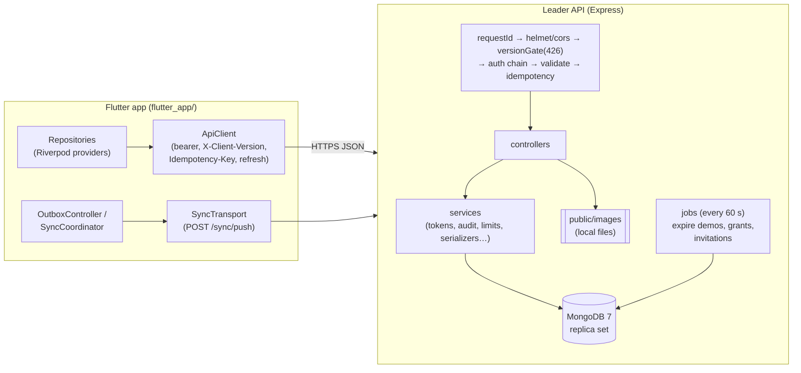

Stack decisions (the handoff left the stack open; this is what was built):

| Concern | Choice |
|---|---|
| Runtime | Node.js ≥ 18, Express 4, CommonJS |
| Database | MongoDB 7 as a **single-node replica set** (transactions work) |
| Tokens | short JWT access token + opaque rotating refresh token (hashed in DB) |
| Validation | Joi, errors → `422 validation` with a field map |
| Images | multer (memory) → sharp → WebP in `public/images/<folder>` |
| Email | nodemailer when SMTP is configured; always a **dev mailbox** outside production |
| Jobs | an in-process interval runner (`jobs/`) |
| Tests | Jest + supertest + mongodb-memory-server |

## 2. Run it locally

```bash
cd backend
npm install
npm run db          # terminal 1 — local MongoDB 7 replica set on 127.0.0.1:27017 (downloads mongod once)
npm run seed:reset  # wipe + seed demo data
npm run dev         # terminal 2 — API on http://localhost:4000
```

- From the **Android emulator** the host is `http://10.0.2.2:4000` — set
  `PUBLIC_BASE_URL=http://10.0.2.2:4000` in `config.env` so image URLs resolve
  on the device too. On a physical phone use your machine's LAN IP.
- Seeded accounts (password `Leader@12345` for all):

| Who | Email | Lands on |
|---|---|---|
| Super Admin | `nullmod.dev@gmail.com` | `/platform` |
| Main Admin of `saas_hilal` | `pbea4007@mtu.edu.iq` | tenant app, full catalogue |
| Simple Admin of `saas_hilal` | `hamodekaherhm@gmail.com` | tenant app, scoped to `d_dam_central` + `d_homs` |
| Verified, unlinked identity | `unlinked@mtm.test` | `/link-team` (Team/Demo decision) |
| Unverified identity | `unverified@mtm.test` | `/verify-email` |
| Pending Simple Admin invitation | `noura@hilal-medical.org` | sign up → auto-linked → `/account-setup` |
| Pending Main Admin seat of `saas_nabd` | `huda@nabd-team.org` | sign up → Team Code `MTM-5JQX-2TWD` → `/account-setup` |

- **OTP codes in development**: every email is stored in the dev mailbox.
  `GET /api/v1/dev/mailbox?to=<email>` returns the latest messages with the
  code already extracted (`items[0].code`). `DEV_FIXED_OTP=246810` (default in
  `config.env`) pins every code to `246810`, the same value the Flutter mock used.
- **Google in development**: with `ALLOW_MOCK_GOOGLE=true` the API accepts
  `mock-google:<email>` / `mock-google-unverified:<email>` as ID tokens (the
  Flutter mock chooser's convention). Real tokens need `GOOGLE_CLIENT_ID`
  = the Web client id you pass to the app as `MTM_GOOGLE_SERVER_CLIENT_ID`.

## 3. The three planes and the data model

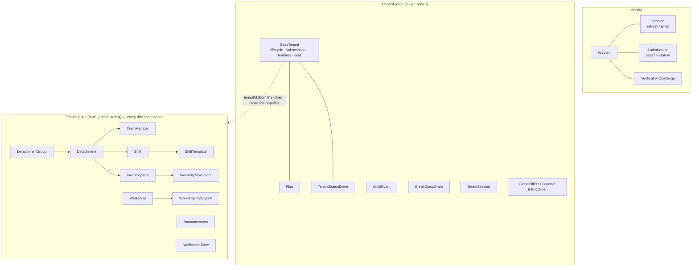

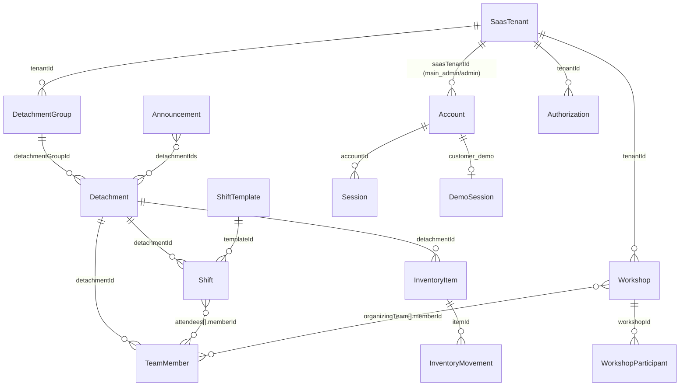

Rules that never bend:

- **`SaasTenant` ≠ `DetachmentGroup` ≠ `Detachment`.** A tenant is the paying
  customer; a group is a branch inside it; a detachment is the field unit.
- **The tenant is derived from the verified token.** No tenant endpoint accepts
  a `tenantId`; tenant JSON never contains one (except `AuthUser.saasTenantId`).
- **Volunteers are never accounts.** Only administrators sign in.

## 4. Wire conventions

| Rule | Detail |
|---|---|
| Base URL | `{origin}/api/v1` |
| Body | JSON, `camelCase`, UTF-8 (Arabic text as-is) |
| Success body | **the resource itself** — `GET /detachments` → `[Detachment]`, `GET /detachments/:id` → `Detachment`. No `{status,data}` wrapper. |
| Paged control-plane lists | `{ "items": [...], "nextCursor": "opaque" \| null, "total"? }` — echo `nextCursor` back as `?cursor=`, never parse it |
| Status codes | `200` read/update/command, `201` create, `202` sign-up challenge, `204` no body |
| Ids | opaque strings (`d_01J…`; seeded ones reuse the mock ids: `d_dam_central`, `m1`, `saas_hilal`) |
| **Calendar days** | `"YYYY-MM-DD"` in the tenant's local calendar (`Asia/Damascus` by default): `Shift.date`, `ShiftTemplate.dates`, `InventoryItem.expiresOn`. Parse with `DateTime.parse("2026-09-28")` → a **local** midnight that `==`-matches `DateTime(y, m, d)`. Never send them with `Z`. |
| **Instants** | RFC 3339 **UTC** with `Z` (`2026-09-28T07:15:00.000Z`). Parse with `DateTime.parse(s)` (→ UTC) and call `.toLocal()` for display. The server accepts offset-less instants from the app and reads them in the tenant timezone. |
| Versions | versioned records carry `"version": <int>` (starts at 1). Send it back on updates to get stale-write protection (optional). |
| Idempotency | header `Idempotency-Key: <uuidv7>` — required on onboarding mutations, platform commands, invitations, announcement publish, checkout, sync push; honoured (optional) on every other write |
| Client version | header `X-Client-Version: 1.0.0` on every request; below the minimum → `426` |
| Money (commerce only) | `{ "amount": 600, "currency": "USD" }` — integer minor units |
| Images | absolute URLs in `imageUrl` / `photoUrl` / `avatarUrl` / `coverImageUrl` / `logoUrl` |

## 5. Errors → `Problem`

Every non-2xx response:

```json
{
  "error": {
    "code": "insufficient_stock",
    "message": "Not enough stock for this outflow.",
    "fields": { "quantity": "..." },
    "reference": "req_01J8ZK3M…"
  }
}
```

- `code` — the **only** branch key (snake_case). The app's
  `Problem.fromJson` already reads `error.code`, `error.message`,
  `error.fields` and `error.reference` — no parser change needed.
- `reference` — the request id (also the `X-Request-Id` header). Show it on
  full-screen unexpected-error surfaces (`ProblemView.reference`).
- Typed extensions sit next to `code` (the app's parser drops unknown members,
  so read them in the feature's own call site from the raw map):

| Code | HTTP | Extensions |
|---|---|---|
| `validation` | 422 | `fields: {path: message}` |
| `stale_write` | 409 | `currentVersion`, `currentRecord` (same shape as the entity's GET) |
| `rate_limited` | 429 | `retryAfterSeconds`, `retryAvailableAt` (+ `Retry-After` header) |
| `verification_code_invalid` | 422 | `attemptsRemaining` |
| `tenant_unavailable` | 403 | `tenantStatus` |
| `plan_limit_reached` | 409 | `limitKey`, `limit`, `usage` |
| `feature_disabled` | 403 | `feature` |
| `attendance_window_expired` | 409 | `closesAt` |
| `upgrade_required` | 426 | `minimumVersion` |
| `conflict` (shift overlap) | 409 | `reason: "overlap"`, `overlapShiftId` |

Global codes the Core `resolveProblem()` should know: `validation`,
`not_found`, `not_permitted`, `conflict`, `stale_write`,
`authentication_expired`, `feature_disabled`, `plan_limit_reached`,
`upgrade_required`, `rate_limited`, `server`, plus the session-state codes
`onboarding_required`, `mfa_required`, `account_unavailable`,
`tenant_context_unavailable`, `tenant_unavailable`, and the idempotency codes
`idempotency_conflict` (a protocol fault — never a stale write) and
`idempotency_in_progress` (retry later). Feature codes are listed per module in
`docs/api/*.md`.

## 6. Authentication, sessions and the startup envelope

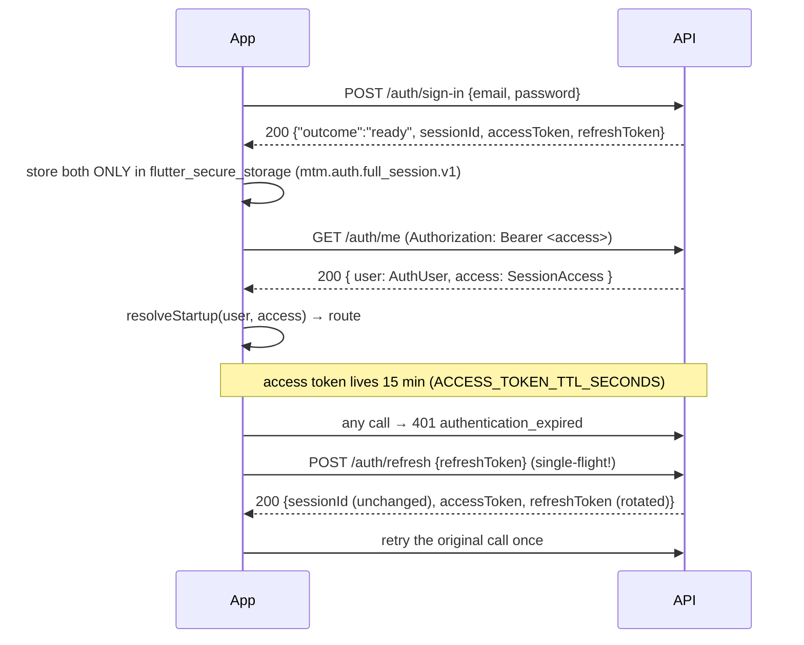

**`GET /auth/me`** answers two sibling objects — map them to the existing
`AuthUser` and `SessionAccess` models unchanged — plus `sessionId`, the stable
server session id (also returned by every sign-in `ready`/`onboarding`
outcome, refresh and demo start). Store it with the tokens; it is how an
offline copy is matched to the session the phone still holds:

```json
{
  "user": {
    "id": "u_demo_main", "name": "سلمى الحارثي", "email": "pbea4007@mtu.edu.iq",
    "role": "main_admin", "saasTenantId": "saas_hilal",
    "capabilities": { "global": ["detachment.create", "…30 keys"], "scoped": {} },
    "orgName": "فرق الهلال الطبية", "avatarInitials": "سا", "avatarUrl": "http://…/images/avatars/…webp"
  },
  "access": { "accountStatus": "active", "tenantStatus": "active", "demoMode": "none", "mfaRequired": false }
}
```

- `role ↔ saasTenantId` invariant holds server-side (super_admin/customer_demo
  → `null`, present).
- `access.sessionExpiresAt` is sent only for Customer Demo sessions.
- `/auth/me` works for suspended/revoked/MFA-pending accounts on purpose, so
  the app can route to `/account-suspended`, `/account-revoked`,
  `/mfa-challenge`. Data endpoints refuse those sessions with
  `account_unavailable` / `mfa_required`.

**Refresh rules** (build them into the ApiClient):

1. Single-flight: one refresh in flight per session; queue other 401s behind it.
2. Rotation: every success returns a NEW refresh token; replace the stored
   pair in one secure-storage write.
3. Replay: presenting an old refresh token revokes the whole family →
   `401 authentication_expired` → clear credentials → `/session-expired`.
4. Offline: keep the pair, sign nobody out.
5. Never queue a refresh in the outbox.

Other account endpoints: `POST /auth/sign-out` (204), `GET /auth/sessions`,
`DELETE /auth/sessions/:id`, `DELETE /auth/sessions` (all others),
`PATCH /auth/me`, `POST|DELETE /auth/me/avatar`, `POST /auth/me/password`,
`POST /auth/mfa/setup|verify|disable`, `POST /auth/new-device/confirm`,
password reset `POST /auth/password-reset/request|verify|complete`
(verify/complete use `Authorization: Bearer <resetToken>`). Full detail:
[`api/auth.md`](./api/auth.md).

## 7. Sign-up & onboarding flow

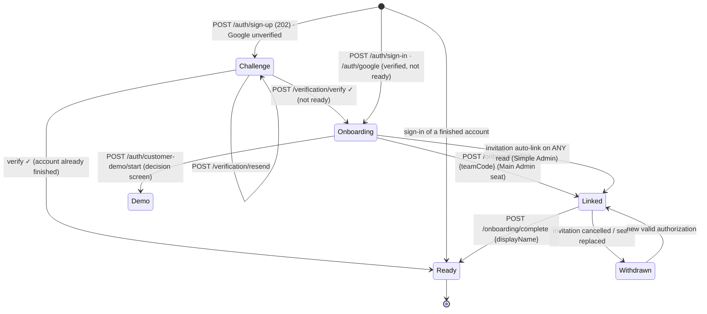

The three `outcome` shapes (sign-in, Google, verify, complete):

```json
{ "outcome": "ready", "sessionId": "s_…", "accessToken": "…", "refreshToken": "…" }
{ "outcome": "verification_required", "challenge": { "challengeId": "vc_…", "maskedEmail": "n***@hilal-medical.org", "codeLength": 6, "expiresAt": "…Z", "resendAvailableAt": "…Z", "attemptsRemaining": 5 } }
{ "outcome": "onboarding", "onboardingToken": "…", "onboardingRefreshToken": "…",
  "snapshot": { "accountId": "u_…", "email": "…", "methods": ["password"], "accountStatus": "pending_setup",
                "linkStatus": "linked", "setupStatus": "required",
                "tenant": { "displayName": "فرق الهلال الطبية", "role": "admin", "tenantStatus": "active" },
                "displayNameSuggestion": "نورة العتيبي", "authorizationExpiresAt": "…Z" } }
```

- Store `challengeId` or the onboarding token pair in `mtm.auth.onboarding.v1`
  exactly as `SecureAuthStateStore` already does.
- The onboarding token only works on `GET /auth/onboarding`,
  `POST /auth/onboarding/link`, `POST /auth/onboarding/complete`,
  `POST /auth/sign-out` and `POST /auth/refresh`; everything else →
  `403 onboarding_required`.
- Send an `Idempotency-Key` (UUIDv7 — `uuidV7()` already exists in
  `core/sync/uuid_v7.dart`) on sign-up, Google, verify, resend, link and
  complete; reuse it only when retrying the same inputs after a transport
  failure. `complete` replays the same `ready` outcome for the same key even
  though the onboarding token was consumed.
- Enumeration safety: sign-up always answers 202 with a challenge; sign-in
  answers `invalid_credentials` for wrong password, unknown address and
  Google-only accounts alike; reset-request always answers `{resetToken}`.

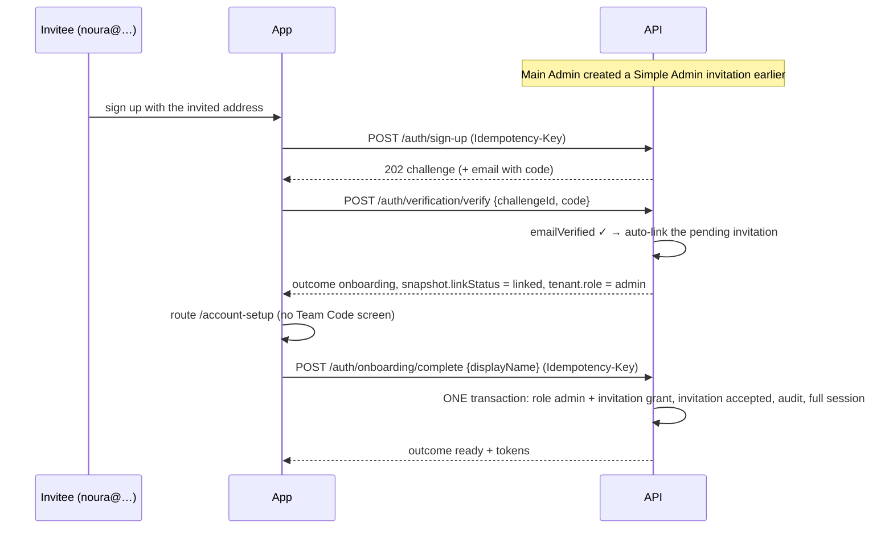

## 8. Authorization: roles, capabilities, features, limits

Every tenant request is checked in this order; each step has its own code, so
the app can say exactly what went wrong:

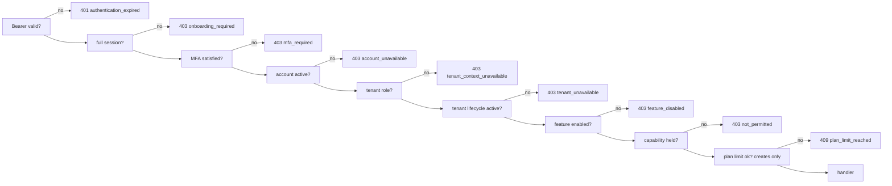

- **Roles** select the surface only: `super_admin` → `/platform/**`;
  `main_admin`/`admin` → tenant endpoints; `customer_demo` → nothing but its
  own demo session endpoints.
- **Capabilities** (30 keys) arrive in `AuthUser.capabilities` —
  `{global:[…], scoped:{detachmentId:[…]}}`. `canIn = global ∪ scoped[det]`;
  any scoped entry implies `detachment.view`. The server applies the same
  resolver (`config/capabilities.js`), so the app's `Capabilities.canIn` is an
  exact UX mirror. A Main Admin holds all 30 globally.
- **Features** (`inventory`, `statistics_reports`, `workshops`,
  `announcements`) — read with `GET /tenant/features`; refresh on app resume.
- **Limits** — plan limits per tenant (`detachment_groups`, `detachments`,
  `admins`, `members`, `workshops`, `storage_bytes`); `GET /tenant/organization`
  shows them (usage only with `org.edit`).
- **Lists are already filtered**: a scoped Simple Admin receives only the
  detachments, members, shifts and notifications it may see.
- Capability changes reach the app at its next `GET /auth/me`.

## 9. Schemas — tenant plane

These are exactly what the Dart `fromJson` methods read (extra fields are
harmless additions). ✱ = derived by the server on read.

### DetachmentGroup
```json
{ "id": "t_damascus", "name": "الهلال الأحمر — فرع دمشق", "createdAt": "2024-03-12T00:00:00.000Z",
  "notes": "يضم مفرزات المدينة وريفها.", "status": "active", "version": 1,
  "detachmentCount": 2, "memberCount": 16, "coveragePercent": 41 }
```
✱ `detachmentCount` (archived included), `memberCount` (Σ active members of its
detachments), `coveragePercent` (mean over ACTIVE detachments, 0 if none).

### Detachment
```json
{ "id": "d_dam_central", "detachmentGroupId": "t_damascus", "name": "مفرزة دمشق المركزية",
  "region": "دمشق", "mainCenter": "مركز الشعلان", "notes": "…", "status": "active", "version": 1,
  "imageUrl": "http://…/images/detachments/…webp",
  "memberCount": 10, "weeklyShiftCount": 6, "coveragePercent": 45 }
```
✱ `memberCount` = active members; `weeklyShiftCount` = shifts dated in the
current Saturday-start week; `coveragePercent` = Σ min(assigned, needed) / Σ needed.

### TeamMember
```json
{ "id": "m1", "name": "أحمد كنعان", "initials": "أك", "department": "الإسعاف", "personalNumber": "101",
  "role": "shiftSupervisor", "detachmentId": "d_dam_central", "attendance": "notCheckedIn",
  "active": true, "version": 1, "phoneMasked": "+963 9xx xxx 791", "photoUrl": "http://…" }
```
- `role` ∈ `shiftSupervisor | administrator | followUp | member` (legacy
  `lead/medic/trainee/volunteer` accepted on input).
- `attendance` ∈ `notCheckedIn | checkedIn | checkedOut | absent` (legacy
  `present/late/notInvited` accepted on input). On a roster it is vestigial —
  real attendance lives on each shift attendee.
- `phoneMasked` only for callers holding `member.contact.view` in that detachment.

### Shift
```json
{ "id": "sh_01J…", "detachmentId": "d_dam_central", "templateId": "tpl_01J…",
  "date": "2026-09-26", "centerName": "مركز الشعلان", "startMinutes": 480, "endMinutes": 840, "needed": 8,
  "attendees": [ { "…TeamMember fields…": "", "attendance": "checkedOut",
                   "checkInAt": "2026-09-26T05:00:00.000Z", "checkOutAt": "2026-09-26T11:00:00.000Z" } ],
  "corrections": [ { "id": "corr_…", "shiftId": "sh_…", "memberId": "m1",
                     "before": {"status": "absent"}, "after": {"status": "checkedIn", "checkInAt": "…Z"},
                     "reason": "نسي المشرف تسجيل الدخول", "author": {"id": "u_…", "displayName": "…"},
                     "correctedAt": "…Z" } ],
  "version": 3, "startsAt": "…Z", "endsAt": "…Z", "crossesMidnight": false, "assigned": 1, "hasCoverageGap": true,
  "attendanceClosesAt": "…Z" }
```
- `date` = the tenant-local day the shift **starts**; `endMinutes <= startMinutes`
  → crosses midnight. `startsAt`/`endsAt` are the server's UTC instants.
- Attendance edits close at `endsAt + attendanceGraceMinutes` (default 60) by
  **server** time → `409 attendance_window_expired`. After that only
  `shift.attendance.override` holders can append a correction (append-only).

### ShiftTemplate
```json
{ "id": "tpl_…", "detachmentId": "d_dam_central", "centerName": "مركز الشعلان",
  "dates": ["2026-09-19", "2026-09-26"], "startMinutes": 480, "endMinutes": 840, "needed": 8, "active": true, "version": 1 }
```

### InventoryItem / InventoryMovement
```json
{ "id": "i2", "detachmentId": "d_dam_central", "name": "باراسيتامول ٥٠٠ ملغ", "unit": "وحدة",
  "currentStock": 72, "minimum": 240, "expiresOn": "2027-01-26", "level": "low",
  "unitsPerStrip": 12, "stripsPerCarton": 10, "preferredUnit": "individual", "version": 1, "imageUrl": "…" }
```
```json
{ "id": "mv_…", "itemId": "i2", "itemName": "باراسيتامول ٥٠٠ ملغ", "direction": "outflow", "quantity": 2,
  "packagingUnit": "strip", "convertedBaseUnitQuantity": 24, "reason": "صرف للمناوبة", "source": "mobile_app",
  "performedBy": "u_demo_main", "performedByName": "سلمى الحارثي", "stockBefore": 96, "stockAfter": 72, "at": "…Z" }
```
`level`: stock 0 → `empty`; stock < minimum → `low`; else `ok`. Stock and
minimum are in base units. Movements are append-only (never versioned).

### Workshop / WorkshopParticipant
```json
{ "id": "w1", "name": "الإسعاف الأولي المتقدم", "at": "…Z", "location": "قاعة التدريب — دمشق",
  "capacity": 20, "registered": 6, "guests": 3, "status": "scheduled", "registrationFee": 25000,
  "archived": false, "organizingTeam": [ { "…TeamMember…": "", "attendance": "notCheckedIn" } ],
  "version": 1, "coverImageUrl": "…" }
```
```json
{ "id": "p1", "workshopId": "w1", "name": "سارة المصري", "initials": "سا", "kind": "member",
  "role": "trainer", "attendance": "notCheckedIn", "paymentStatus": "paid", "version": 1 }
```
✱ `registered` = every register line, `guests` = the guest subset.
`kind: member` lines carry `role` (`leader|trainer|support|management|member`);
guests never do. `registrationFee` is a plain number in the tenant's local
currency (the app shows ل.س). Everyone on the register takes a seat;
organisers never do.

### Announcement
```json
{ "id": "a_seed_1", "text": "تنبيه بخصوص شفت ٤:٠٠–١٠:٠٠ اليوم…", "detachmentIds": ["d_dam_central"],
  "placements": ["notifications", "home", "detachment"], "publishedAt": "…Z", "expiresAt": "…Z",
  "status": "active", "authorName": "أحمد عبد الكريم", "version": 1 }
```

### AppNotification (`GET /notifications?detachmentId=`)
```json
{ "notifications": [
  { "id": "shiftUnderstaffed:sh_…", "kind": "shiftUnderstaffed", "occurredAt": "…Z", "count": 5,
    "recordLabel": "مركز الشعلان", "target": {"type": "shift", "detachmentId": "d_dam_central", "shiftId": "sh_…"}, "isRead": false },
  { "id": "stockLow:i2", "kind": "stockLow", "occurredAt": "…Z", "count": 72, "recordLabel": "باراسيتامول ٥٠٠ ملغ",
    "target": {"type": "storage", "detachmentId": "d_dam_central", "itemId": "i2"}, "isRead": true },
  { "id": "announcement:a_seed_1", "kind": "announcement", "occurredAt": "…Z", "count": 0,
    "target": {"type": "announcement", "announcementId": "a_seed_1"}, "isRead": true } ] }
```
Ids are stable (`<kind>:<recordId>`) so read state survives reloads. The
client's own `syncConflict`/`syncFailed` ids can be stored with
`PUT /notifications/read` too.

### HomeSummary (`GET /home/summary?detachmentId=`)
```json
{ "detachmentId": "d_dam_central", "detachmentName": "مفرزة دمشق المركزية", "region": "دمشق",
  "mainCenter": "مركز الشعلان", "shifts": ["…Shift, yesterday → tomorrow…"], "rosterCount": 10,
  "storageStatus": "depleted", "lowStockCount": 3, "expiringSoonCount": 3, "inventoryAvailable": true,
  "announcements": ["…active, 'home' placement, < 1 h old…"], "generatedAt": "…Z" }
```
`storageStatus` ∈ `empty | healthy | expiring | low | depleted` (worst wins).

### Organization & plan (`GET /tenant/organization`)
```json
{ "organization": {"tenantId": "saas_hilal", "displayName": "فرق الهلال الطبية", "lifecycleStatus": "active", "createdAt": "…Z"},
  "mainAdmin": {"displayName": "سلمى الحارثي"},
  "subscription": {"status": "active", "planId": "mtm_advanced", "renewsAt": "…Z"},
  "limits": {"usageIncluded": true, "items": [{"key": "detachments", "planDefault": 40, "effective": 40, "overridden": false, "usage": 4}]},
  "readAt": "…Z" }
```

## 10. Schemas — identity & control plane

| Object | Where | Shape |
|---|---|---|
| `AuthUser` | `GET /auth/me` → `user` | §6 |
| `SessionAccess` | `GET /auth/me` → `access` | `{accountStatus, tenantStatus, demoMode, mfaRequired, sessionExpiresAt?}` |
| `Session` | `GET /auth/sessions` | `{id, device, ipMasked, locationLabel, startedAt, current, lastUsedAt}` |
| `MfaSetupData` | `POST /auth/mfa/setup` | `{otpauthUrl, manualSecret, backupCodes[]}` |
| `SaasTenant` | `/platform/tenants/**` | `{id, displayName, teamCode, timezone, lifecycle{status, version, suspension?, deletion?}, createdAt, updatedAt, mainAdmin{name, email, provisioning}, subscription{status, planId, version, trialEndsAt, renewsAt, graceEndsAt, limitOverrides}, usage{storageUsedBytes, storageAllowanceBytes?, lastActivityAt}, counts{detachmentGroups, detachments, members, workshops}}` |
| Tombstone | `GET /platform/tenants/:id` after deletion | `{tenantId, displayNameSnapshot, status:"deleted", deletedAt, lifecycleVersion, historyReference}` |
| `Plan` | `/platform/plans` | `{id, name, description, recommended, selectable, defaultLimits{…6 keys}}` |
| Main Admin seat | `/platform/tenants/:id/main-admin` | `{tenant{…}, revision, current{accountId, displayName, loginEmail, status, createdAt, activatedAt?, setup?, suspension?}, replacement?, readAt}` |
| `AuditEvent` | `/platform/audit` | `{id, occurredAt, actor{kind, id?, displayName?}, action, category, target{type, id, displayName?}, tenant?{id, displayName, isDeleted}, changes[{field, before?, after?}]}` |
| `BreakGlassGrant` | `/platform/break-glass/**` | `{id, revision, tenant{tenantId, displayName}, scopes, reason, initiator, issuedAt, expiresAt, status, endedAt?, endReason?}` |
| `DemoSession` | `/auth/customer-demo/**`, `/platform/demo/**` | `{demoSessionId, accountId, demoWorkspaceId, startedAt, expiresAt, status, policyRevision, displayName?, endedAt?, terminationReason?}` |
| Money / Discount / Quote | `/pricing/**`, `/billing/**` | see [`api/commerce.md`](./api/commerce.md) |

## 11. Endpoint map: Flutter seam → HTTP

256 endpoints in total (`npm run routes` prints them from the live router).
Every one is exercised by the Postman collection (`npm run routes:coverage`).
Base path `/api/v1` omitted below. Detail per module in `docs/api/`.

### Identity — `AuthRepository`, `OnboardingRepository` → [`api/auth.md`](./api/auth.md)

| Dart method / screen | HTTP |
|---|---|
| `OnboardingRepository.signUpWithPassword` (/signup) | `POST /auth/sign-up` 202 |
| `signInWithPassword` (/login) | `POST /auth/sign-in` |
| `signInWithGoogle` | `POST /auth/google` |
| `verifyEmail` / `resendVerification` (/verify-email) | `POST /auth/verification/verify` · `/resend` |
| `restore` / `refresh` | `GET /auth/onboarding` |
| `linkTeam` (/link-team) | `POST /auth/onboarding/link` |
| `completeSetup` (/account-setup) | `POST /auth/onboarding/complete` |
| `abandon` / `AuthRepository.signOut` | `POST /auth/sign-out` |
| token refresh (ApiClient) | `POST /auth/refresh` |
| `AuthRepository.currentUser` + `SessionAccess` | `GET /auth/me` |
| profile (/more/profile) | `PATCH /auth/me` · `POST/DELETE /auth/me/avatar` · `POST /auth/me/password` |
| `listSessions` / `revokeSession` (/more/sessions) | `GET /auth/sessions` · `DELETE /auth/sessions/:id` · `DELETE /auth/sessions` |
| `beginMfaSetup` / `verifyMfa` (/mfa-setup, /mfa-challenge) | `POST /auth/mfa/setup` · `/verify` · `/disable` |
| `confirmNewDevice` (/new-device) | `POST /auth/new-device/confirm` |
| `requestPasswordReset` / `verifyResetOtp` / `setNewPassword` (/forgot → /otp → /new-password) | `POST /auth/password-reset/request` · `/verify` · `/complete` |
| `AppVersionRepository.checkSupport` | `GET /app-version/check?version=` |

### Tenant structure — [`api/detachments.md`](./api/detachments.md), [`api/members.md`](./api/members.md), [`api/inventory.md`](./api/inventory.md)

| Dart method | HTTP |
|---|---|
| `DetachmentGroupRepository.list/byId/create/update/delete` | `GET/POST /detachment-groups` · `GET/PUT/PATCH/DELETE /detachment-groups/:id` (delete cascades) |
| `DetachmentRepository.list/byId/create/update/delete` | `GET/POST /detachments` · `GET/PUT/PATCH/DELETE /detachments/:id` |
| archive / restore | `POST /detachments/:id/archive` · `/restore` |
| `DetachmentRepository.stats` | `GET /detachments/:id/stats?days=7` |
| detachment image | `POST/DELETE /detachments/:id/image` |
| `TeamRepository.listForDetachment` | `GET /detachments/:id/members` |
| `create` / `createFromShift` / `findNameMatch` | `POST /members` · `POST /members/from-shift` · `GET /members/match?detachmentId&name` |
| `byId` / `update` / `delete` | `GET/PUT/PATCH/DELETE /members/:id` |
| `assignRole` / `setAttendance` | `PATCH /members/:id/role` · `PATCH /members/:id/attendance` |
| deactivate / reactivate / photo | `POST /members/:id/deactivate` · `/reactivate` · `POST/DELETE /members/:id/photo` |
| `InventoryRepository.listForDetachment` | `GET /detachments/:id/inventory-items` |
| `byId` / `create` / `update` / `delete` | `GET/PUT/PATCH/DELETE /inventory-items/:id` · `POST /inventory-items` |
| `movementsForItem` / `addMovement` | `GET/POST /inventory-items/:id/movements` (+ `GET /detachments/:id/inventory-movements`) |
| item image | `POST/DELETE /inventory-items/:id/image` |

### Shifts & attendance — [`api/shifts.md`](./api/shifts.md)

| `ShiftRepository` method | HTTP |
|---|---|
| `listForDetachmentToday` | `GET /detachments/:id/shifts/today` |
| `listForWeek` / `listForRange` | `GET /detachments/:id/shifts/week?weekStart=` · `GET /detachments/:id/shifts?from&to` |
| `create` (with `repeatOn`) | `POST /detachments/:id/shifts` |
| `copyDay` / `copyWeek` | `POST /detachments/:id/shifts/copy-day` · `/copy-week` |
| `byId` / `update` / `delete` | `GET/PUT/PATCH/DELETE /shifts/:id` |
| `updateRepeat` | `PUT /shifts/:id/repeat` |
| `assignVolunteer` / `unassignVolunteer` | `POST /shifts/:id/assignments` · `DELETE /shifts/:id/assignments/:memberId` |
| `candidatesFor` / `quickFill` | `GET /shifts/:id/candidates` · `POST /shifts/:id/quick-fill` |
| `recordCheckIn` / `recordCheckOut` / `markAbsent` / `resetAttendance` | `POST /shifts/:id/members/:memberId/check-in` · `/check-out` · `/absent` · `/reset` |
| `markAttendance` (legacy) | `PATCH /shifts/:id/members/:memberId/attendance` |
| `addAttendanceCorrection` | `POST /shifts/:id/members/:memberId/attendance-corrections` (+ `GET /shifts/:id/attendance-corrections`) |
| `templates` / `shiftsForTemplate` | `GET /detachments/:id/shift-templates` · `GET /shift-templates/:id` · `GET /shift-templates/:id/shifts` |
| `updateTemplateDates` / `stopTemplate` | `PUT /shift-templates/:id/dates` · `POST /shift-templates/:id/stop` |

### Workshops — [`api/workshops.md`](./api/workshops.md)

| `WorkshopRepository` method | HTTP |
|---|---|
| `list` / `byId` / `create` / `update` | `GET/POST /workshops` · `GET/PUT/PATCH /workshops/:id` |
| `setArchived` | `PATCH /workshops/:id/archive` |
| `participants` | `GET /workshops/:id/participants` |
| `addTeamMember` / `addGuestParticipant` / `addMemberParticipants` (legacy) | `POST /workshops/:id/team-members` · `/guests` · `/participants` |
| `updateTeamMember` / `removeParticipant` | `PUT/DELETE /workshop-participants/:id` |
| `setParticipantAttendance` / `setParticipantPayment` | `PATCH /workshop-participants/:id/attendance` · `/payment` |
| `addOrganizers` / `removeOrganizer` / `setOrganizerAttendance` | `POST /workshops/:id/organizers` · `DELETE /workshops/:id/organizers/:memberId` · `PATCH …/:memberId/attendance` |
| statistics tab / export | `GET /workshops/:id/stats` · `GET /workshops/:id/export.csv` |
| cover image | `POST/DELETE /workshops/:id/cover` |

### Home, notifications, announcements, search, settings

| Dart seam | HTTP | Doc |
|---|---|---|
| `HomeRepository.summary` | `GET /home/summary?detachmentId=` | [home-notifications-search](./api/home-notifications-search.md) |
| org-level Home (new) | `GET /home/overview` | same |
| `NotificationRepository.feed` | `GET /notifications?detachmentId=` | same |
| read / cleared stores | `PUT /notifications/read` · `PUT /notifications/cleared` · `GET /notifications/state` · `GET /notifications/unread-count` | same |
| search (optional server search) | `GET /search?q=&types=` | same |
| `AnnouncementRepository.list/byId/publish/withdraw` | `GET /announcements` · `GET /announcements/:id` · `POST /announcements` · `POST /announcements/:id/withdraw` | [announcements](./api/announcements.md) |
| `SettingsRepository.notificationPrefs` / update | `GET/PUT /settings/notifications` | [tenant-administration](./api/tenant-administration.md) |
| `SettingsRepository.orgInfo` (+ edit, logo) | `GET/PATCH /settings/organization` · `POST/DELETE /settings/organization/logo` | same |
| `OrganizationRepository.readCurrent` (/more/organization, /more/plan) | `GET /tenant/organization` | same |
| tenant feature flags | `GET /tenant/features` | same |
| `SimpleAdminRepository` (/more/simple-admins) | `GET /tenant/simple-admins` · `POST /tenant/simple-admin-invitations` · `…/:id/cancel` · `…/:id/resend` · `PATCH /tenant/simple-admins/:id/capabilities` · `POST …/:id/suspend` · `…/reactivate` | same |
| tenant audit (new) | `GET /tenant/audit` | same |
| tenant analytics (new) | `GET /tenant/analytics/dashboard` · `/detachments/:id` · `/workshops` · `/inventory` | [tenant-analytics](./api/tenant-analytics.md) |
| `SyncTransport` | `POST /sync/push` · `GET /sync/pull` · `GET /sync/status` | [sync](./api/sync.md) |

### Control plane (Super Admin, `/platform/**`)

| Flutter repository / screen | HTTP | Doc |
|---|---|---|
| `SaasTenantRepository` (/platform/tenants) | `GET/POST /platform/tenants` · `GET /platform/tenants/:id` · `…/status-history` · `GET /platform/tenants/suggest-team-code` | [platform-tenants](./api/platform-tenants.md) |
| `TenantLifecycleRepository` | `POST /platform/tenants/:id/lifecycle/suspend` · `/reactivate` · `/deletion/begin` · `/deletion/cancel` · `/deletion/finalize` | same |
| `TenantSubscriptionRepository` | `GET …/subscription` · `GET …/limits` · `POST …/subscription/activate` · `/trial/extend` · `/trial/end` · `/grace` · `/plan` · `PATCH …/limits/:limitKey` · `GET /platform/plans` | same |
| `TenantFeatureRepository` | `GET …/features` · `PATCH …/features/:featureKey` | same |
| `PlatformMainAdminRepository` | `GET …/main-admin` · `POST …/main-admin/setup/resend` · `/suspend` · `/reactivate` · `/replacements` · `/replacements/:id/cancel` | same |
| plans, settings, platform admins, account lookup (new) | `/platform/plans/**` · `GET/PATCH /platform/settings` · `/platform/admins/**` · `/platform/accounts/**` | [platform-configuration](./api/platform-configuration.md) |
| `PlatformOverviewRepository` / `PlatformHealthRepository` / `PlatformSecurityRepository` | `GET /platform/overview` · `/platform/health` · `/platform/security-alerts` | [platform-insights](./api/platform-insights.md) |
| `PlatformAuditRepository` | `GET /platform/audit` · `GET /platform/audit/:id` | same |
| `PlatformReportsRepository` | `GET /platform/reports/subscriptions` · `/usage-limits` · `/feature-availability` · `/platform-activity` | same |
| platform analytics (new) | `GET /platform/analytics/summary` · `/growth` · `/tenants` · `/tenants/:id` | same |
| jobs (new, Operations) | `GET /platform/jobs` · `POST /platform/jobs/run` · `POST /platform/jobs/:name/run` | same |
| `PlatformBreakGlassRepository` (/platform/access) | `GET /platform/break-glass/current` · `GET/POST /platform/break-glass/grants` · `…/:id/end` · `…/:id/revoke` · `GET /platform/break-glass/view/:resource` | [break-glass](./api/break-glass.md) |
| `PlatformDemoActions` (/platform/operations/demo) | `GET/PATCH /platform/demo/policy` · `GET /platform/demo/sessions` · `POST …/:id/terminate` · `…/terminate-all` · `…/cleanup` | [customer-demo](./api/customer-demo.md) |
| `PlatformCommerceActions` (/platform/operations/commerce) | `/platform/commerce/offers/**` · `/platform/commerce/coupons/**` · `/platform/billing/orders/**` | [commerce](./api/commerce.md) |

## 12. Offline-first: outbox push, pull, conflicts

Full protocol: [`api/sync.md`](./api/sync.md). The server side of the app's
`OutboxController` → `SyncCoordinator` → `SyncTransport` design:

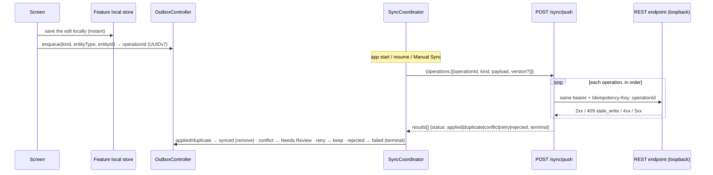

- **Every queued write is re-authorized at replay time** — the push dispatches
  each operation through the real endpoint with the caller's current token, so
  a revoked capability, disabled module or reached limit refuses it
  (`rejected`, `terminal: true`, with the endpoint's `code`).
- **Exactly-once**: `operationId` is the `Idempotency-Key`; a retried or
  duplicated push answers `duplicate` with the original result.
- **Conflicts**: `409 stale_write` → `status: conflict` with `currentVersion` +
  `currentRecord` (the entity's ordinary GET shape) — exactly what
  `ConflictReviewRecorder` / `presentShiftConflict` expect. `useLocal` must
  mint a NEW operation carrying `version: currentVersion`; `useCurrent` sends
  nothing.
- **The terminal "rejected" state the client is missing** (DATA-NEEDS §4.11):
  the backend now tells you explicitly — add one `SyncState.rejected` (or map
  `terminal: true` + non-2xx to `failed` without retry).
- **Pull**: `GET /sync/pull?cursor=` streams per-tenant changes (`upsert`
  with the current record, `delete` tombstones), filtered to what the caller
  may see. Bootstrap: do the normal REST reads, then `GET /sync/pull?since=now`
  and keep the returned cursor; afterwards pull until `hasMore: false` on every
  sync run.

**Two client changes are required before the outbox can talk to this API**
(the backend cannot fix them):

1. `PendingOperation` is deliberately **payload-free**, but a replay needs the
   request body. Keep the payload in the feature's own (encrypted) local store
   keyed by `operationId`, and have the real `SyncTransport` assemble
   `{operationId, kind, payload, version}` from it.
2. Today `detachment_storage_tab.dart` calls `InventoryRepository.addMovement`
   (a direct write) **and then** enqueues the same movement. With a real
   repository that would send it twice. Choose one path per write: either the
   repository writes locally + enqueues (offline-first, recommended), or it
   writes online directly and does not enqueue.

Supported `kind`s (13): `inventory.movement.add`, `shift.attendance.checkIn`,
`.checkOut`, `.absent`, `.reset`, `.mark`, `.correct`, `shift.assign`,
`shift.unassign`, `shift.update`, `member.update`,
`workshop.participant.attendance`, `workshop.participant.payment`.

## 13. Images

Images are stored on the API host under `backend/public/images/<folder>/` and
served statically at `/images/...` (no R2/S3 yet). Every upload is re-encoded
server-side (EXIF stripped, resized, WebP), counted against the tenant's
`storage_bytes` plan limit, and the previous file is deleted on replace.

| Upload endpoint (multipart, field `image`) | Preset → folder | Size box | Returns |
|---|---|---|---|
| `POST /auth/me/avatar` | `avatars/` | 512×512 cover | `{user, access}` (`user.avatarUrl`) |
| `POST /detachments/:id/image` | `detachments/` | 1280×720 cover | `Detachment.imageUrl` |
| `POST /members/:id/photo` | `members/` | 512×512 cover | `TeamMember.photoUrl` |
| `POST /inventory-items/:id/image` | `inventory/` | 800×800 inside | `InventoryItem.imageUrl` |
| `POST /workshops/:id/cover` | `workshops/` | 1600×900 cover | `Workshop.coverImageUrl` |
| `POST /settings/organization/logo` | `tenants/` | 512×512 contain | `OrgInfo.logoUrl` |

Each has a matching `DELETE`. Accepted types: JPEG, PNG, WebP, GIF, HEIC;
max `MAX_UPLOAD_MB` (5 MB) → `413 payload_too_large`. URLs are absolute,
built from `PUBLIC_BASE_URL` — render them with `Image.network`. When images
later move to object storage only the URL host changes; the app does not.

```dart
final request = http.MultipartRequest('POST', api.uri('/members/$memberId/photo'))
  ..headers.addAll(await api.authHeaders())
  ..files.add(await http.MultipartFile.fromPath('image', file.path,
      contentType: MediaType('image', 'jpeg')));
final response = await http.Response.fromStream(await api.client.send(request));
```

## 14. Dashboards & analytics

Two dashboards, both read-only and computed on request (no stale caches):

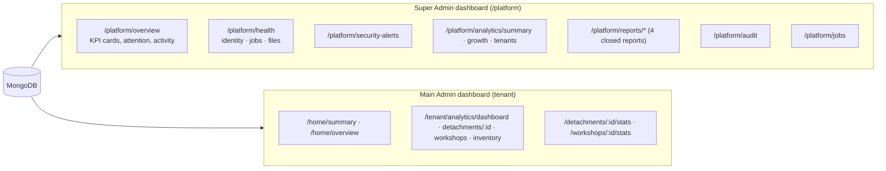

**Platform analytics** — counts and platform facts only; never a tenant's
operational or medical data. Example (`GET /platform/analytics/summary?period=30d`, trimmed):

```json
{ "range": {"from": "2026-08-29T13:18:24.737Z", "before": "2026-09-28T13:18:24.737Z"},
  "kpis": { "tenants": {"total": 10, "newInRange": 4, "active": 7},
            "subscriptions": {"trial": 2, "active": 5, "grace": 2, "inactive": 1},
            "accounts": {"total": 20, "tenantAdmins": 9, "superAdmins": 2, "newInRange": 20},
            "signIns": 11, "demos": {"startedInRange": 3, "active": 0},
            "revenue": {"amount": 4200, "currency": "USD"}, "storageUsedBytes": 19109249024 },
  "distributions": { "lifecycle": [{"key": "active", "count": 9}, "…"],
                     "subscriptionStatus": ["…"], "plans": [{"planId": "mtm_core", "name": "ليدر الأساسية", "count": 2}, "…"],
                     "features": [{"key": "inventory", "enabled": 9, "disabled": 1}, "…"] } }
```

`GET /platform/analytics/growth?granularity=day|week|month` → zero-filled
buckets `{bucket, tenantsCreated, accountsCreated, signIns, demoStarts, revenue}`
(weeks start on Saturday). `GET /platform/analytics/tenants?sort=lastActivity|members|storage`
→ a ranked table; `/tenants/:id` → one tenant's counts, limits, sign-ins and
status history.

**Tenant analytics** — `feature: statistics_reports` + `stats.view`; every
figure covers only detachments where the caller holds `stats.view`.
`GET /tenant/analytics/dashboard?from=2026-08-30&to=2026-09-28` (trimmed):

```json
{ "range": {"from": "2026-08-30", "to": "2026-09-28"},
  "kpis": { "detachments": 4, "members": 25, "shifts": 24, "neededSlots": 137, "filledSlots": 37,
            "coveragePercent": 27, "attendancePercent": 89, "absences": 4, "workshops": 3,
            "workshopAttendancePercent": 86, "lowStockItems": 7, "expiringItems": 4, "activeAnnouncements": 5 },
  "series": { "coverage": [{"date": "2026-09-28", "percent": 11}],
              "attendance": [{"date": "2026-09-28", "percent": 100}],
              "stockMovements": [{"date": "2026-09-28", "inflow": 1, "outflow": 0}] },
  "byDetachment": [{"detachmentId": "d_coast", "name": "مفرزة الساحل", "shifts": 3, "coveragePercent": 31,
                    "attendancePercent": 100, "members": 4, "storageStatus": "low"}],
  "topMembers": [{"memberId": "m1", "name": "أحمد كنعان", "detachmentId": "d_dam_central",
                  "attended": 5, "absent": 0, "attendancePercent": 100}] }
```

Definitions: coverage = Σ min(assigned, needed) / Σ needed; attendance =
(checkedIn + checkedOut) / (checkedIn + checkedOut + absent) — `notCheckedIn`
is pending, not absent. A disabled module's figures are **omitted**, not 0.
All metric definitions: [`api/tenant-analytics.md`](./api/tenant-analytics.md),
[`api/platform-insights.md`](./api/platform-insights.md).

**Control & management** actions available to the Super Admin dashboard:
tenant registration, lifecycle (suspend / reactivate / scheduled deletion /
finalize with tombstone), subscription & plan & per-tenant limit overrides,
module flags, Main Admin seat (resend / suspend / reactivate / replace /
cancel), plan catalogue CRUD, platform policy settings, platform admin
accounts, account lookup + force sign-out, break-glass, Customer Demo policy
and sessions, offers / coupons / billing-order confirmation, and background
jobs (status + run now).

## 15. Customer Demo, break-glass, commerce

### Customer Demo — [`api/customer-demo.md`](./api/customer-demo.md)

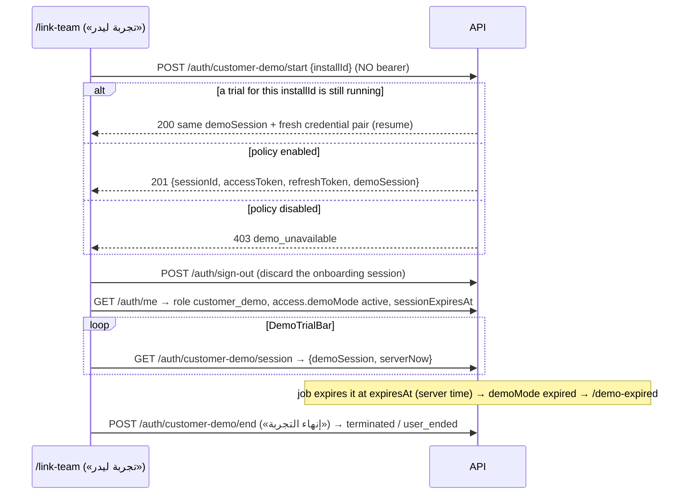

- The demo identity has `saasTenantId: null` and **no** tenant capability on
  the server; every tenant and platform endpoint refuses it. Keep the app's
  in-memory `DemoWorkspace` as the demo's data source — the server owns only
  the session, its expiry and the global policy.
- Send a stable per-install id as `installId` so a double tap, a retry or an
  app restart resumes the same trial instead of creating a second one.
- The Super Admin owns the global policy (`enabled`, `defaultDurationMinutes`,
  revision) — changes are never retroactive.

### Break-glass — [`api/break-glass.md`](./api/break-glass.md)

A Super Admin can open ONE temporary, read-only window into ONE active
tenant's operational data, bound to their session, with a mandatory reason:
`POST /platform/break-glass/grants` → read via
`GET /platform/break-glass/view/{detachment-groups|detachments|members|shifts|inventory-items|workshops}`
(no phone numbers, feature flags honoured) → ends on `…/end`, on expiry
(`breakGlassMinutes`, default 60), when the session ends, or when the tenant
leaves `active`. Activation needs a recent sign-in (`recentAuthMinutes`) →
otherwise `403 recent_authentication_required` (the app's "sign in again").

### Commerce — [`api/commerce.md`](./api/commerce.md)

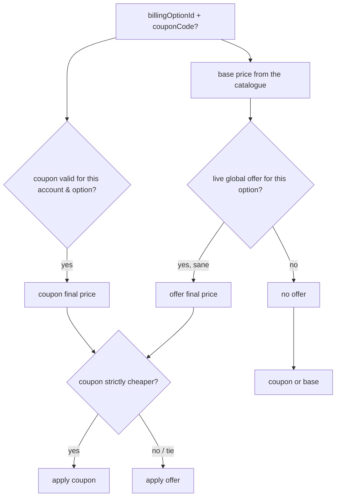

- `GET /pricing/catalog` (public): $6 / $14 / $24 / $40 as `600/1400/2400/4000`
  cents; all four durations grant identical access.
- `POST /pricing/coupons/validate` **never consumes** a coupon;
  `POST /pricing/quote` returns the exact server price (no stacking; tie → offer).
- `POST /billing/checkout` (Main Admin) creates a `pending_payment` order with
  the server-computed price and returns payment instructions (manual provider:
  contact Leader). The Super Admin confirms the payment in
  `POST /platform/billing/orders/:id/confirm` — that single transaction redeems
  the coupon and activates/renews the subscription. Until a payment gateway
  exists, the `/more/pricing` screen can keep its "contact us" flow and show
  server quotes.

## 16. Integration recipe (Dart)

The app was built for exactly this moment: every repository is an abstract
seam behind a Riverpod provider returning `Result<T>` (`Success` / `Failure` /
`Offline`). Integration = one HTTP client + one real implementation per seam +
one provider override each. **No screen changes.**

### 16.1 Add the HTTP client

`package:http` (Dart team) is the only new dependency needed
(`http_parser` comes with it for multipart content types). Base URL through a
dart-define, like the existing `MTM_GOOGLE_SERVER_CLIENT_ID`:

```bash
flutter run --dart-define=LEADER_API_BASE_URL=http://10.0.2.2:4000
```

### 16.2 `ApiClient` — the one place that speaks HTTP

```dart
// lib/core/network/api_client.dart
import 'dart:async';
import 'dart:convert';
import 'dart:io';
import 'package:http/http.dart' as http;
import '../app_info.dart';
import '../result/result.dart';
import '../sync/uuid_v7.dart';

const _baseUrl = String.fromEnvironment('LEADER_API_BASE_URL', defaultValue: 'http://10.0.2.2:4000');

/// Credentials live ONLY in flutter_secure_storage (SecureAuthStateStore).
abstract class TokenVault {
  Future<({String access, String refresh})?> read();
  Future<void> write(String access, String refresh);
  Future<void> clear();
}

class ApiClient {
  ApiClient(this._vault, {http.Client? client, this.onUpgradeRequired, this.onSessionEnded})
      : client = client ?? http.Client();

  final http.Client client;
  final TokenVault _vault;
  final void Function()? onUpgradeRequired; // → ref.read(appVersionProvider.notifier).check()
  final void Function()? onSessionEnded;    // → clear + /session-expired
  Future<bool>? _refreshing;                // single-flight

  Uri uri(String path, [Map<String, String>? query]) =>
      Uri.parse('$_baseUrl/api/v1$path').replace(queryParameters: query);

  Future<Map<String, String>> authHeaders() async {
    final tokens = await _vault.read();
    return {
      'Accept': 'application/json',
      AppInfo.clientVersionHeader: AppInfo.version, // X-Client-Version
      if (tokens != null) 'Authorization': 'Bearer ${tokens.access}',
    };
  }

  /// Send a JSON request and map the answer onto the app's Result.
  /// [parse] turns the decoded body into T. [idempotencyKey] is REQUIRED for
  /// commands the contract marks idempotent — reuse it only to retry the
  /// same inputs.
  Future<Result<T>> send<T>(
    String method,
    String path, {
    Object? body,
    Map<String, String>? query,
    String? idempotencyKey,
    required T Function(Object? json) parse,
    bool retried = false,
  }) async {
    final headers = await authHeaders();
    if (body != null) headers['Content-Type'] = 'application/json';
    if (idempotencyKey != null) headers['Idempotency-Key'] = idempotencyKey;
    final request = http.Request(method, uri(path, query))..headers.addAll(headers);
    if (body != null) request.body = jsonEncode(body);

    final http.Response response;
    try {
      response = await http.Response.fromStream(
          await client.send(request).timeout(const Duration(seconds: 20)));
    } on SocketException {
      return const Offline();
    } on TimeoutException {
      return const Offline();
    } on http.ClientException {
      return const Offline();
    }

    final decoded = response.body.isEmpty ? null : jsonDecode(utf8.decode(response.bodyBytes));
    if (response.statusCode >= 200 && response.statusCode < 300) {
      return Success(parse(decoded));
    }

    final error = (decoded is Map && decoded['error'] is Map) ? decoded['error'] as Map : const {};
    final code = error['code'] as String?;

    if (response.statusCode == 426) {
      onUpgradeRequired?.call();
    } else if (response.statusCode == 401 && code == 'authentication_expired' && !retried) {
      if (await _refresh()) {
        return send(method, path, body: body, query: query, idempotencyKey: idempotencyKey, parse: parse, retried: true);
      }
      onSessionEnded?.call();
    }
    // message is diagnostics only — screens branch on `code` via problemOrNull.
    return Failure(error['message'] as String? ?? 'HTTP ${response.statusCode}', code: code ?? (response.statusCode >= 500 ? 'server' : null));
  }

  /// Rotating, single-use refresh. One in flight; concurrent 401s wait for it.
  Future<bool> _refresh() => _refreshing ??= () async {
        try {
          final tokens = await _vault.read();
          if (tokens == null) return false;
          final r = await client.post(uri('/auth/refresh'),
              headers: {'Content-Type': 'application/json', AppInfo.clientVersionHeader: AppInfo.version},
              body: jsonEncode({'refreshToken': tokens.refresh}));
          if (r.statusCode != 200) {
            if (r.statusCode == 401) await _vault.clear(); // replay/revoked: family is gone
            return false;
          }
          final json = jsonDecode(r.body) as Map<String, dynamic>;
          await _vault.write(json['accessToken'] as String, json['refreshToken'] as String);
          return true;
        } catch (_) {
          return false; // offline: keep the pair, sign nobody out
        } finally {
          _refreshing = null;
        }
      }();

  static String newIdempotencyKey() => uuidV7();
}
```

### 16.3 A repository, end to end

```dart
// lib/features/detachment/data/http_detachment_repository.dart
class HttpDetachmentRepository implements DetachmentRepository {
  HttpDetachmentRepository(this._api);
  final ApiClient _api;

  @override
  Future<Result<List<Detachment>>> list({String? detachmentGroupId, DetachmentStatus? filter, String? query}) =>
      _api.send('GET', '/detachments',
          query: {
            if (detachmentGroupId != null) 'detachmentGroupId': detachmentGroupId,
            if (filter != null) 'filter': filter.name,
            if (query != null && query.isNotEmpty) 'query': query,
          },
          parse: (json) => (json as List).map((e) => Detachment.fromJson(e as Map<String, dynamic>)).toList());

  @override
  Future<Result<Detachment>> update(Detachment d) =>
      _api.send('PUT', '/detachments/${d.id}', body: d.toJson(),
          parse: (json) => Detachment.fromJson(json as Map<String, dynamic>));
}

// lib/features/detachment/data/detachment_providers.dart — the ONLY wiring change:
final detachmentRepositoryProvider = Provider<DetachmentRepository>(
  (ref) => HttpDetachmentRepository(ref.watch(apiClientProvider)),
);
```

### 16.4 `AuthRepository.currentUser()` and `SessionAccess`

`GET /auth/me` returns `{user, access}`. Parse `user` with the existing
`AuthUser.fromJson` and `access` with `SessionAccess.fromJson`, and feed the
envelope into `sessionAccessProvider` (today it only reads
`MockAuthRepository.currentSessionAccess`). Suggested seam: make
`currentUser()` return a small record `(AuthUser user, SessionAccess access)` or
add `AuthRepository.currentAccess()` backed by the same cached `/auth/me` call.

### 16.5 Onboarding

`OnboardingRepository` maps 1:1 (§7). Sign-in/Google/verify/complete return
the `outcome` union — decode it into the existing sealed `AuthEntryOutcome`:

```dart
AuthEntryOutcome parseOutcome(Map<String, dynamic> j, TokenSink sink) {
  switch (j['outcome']) {
    case 'ready':
      sink.fullSession(j['accessToken'], j['refreshToken']);
      return const EntryReady();
    case 'verification_required':
      return EntryVerificationRequired(VerificationChallenge.fromJson(j['challenge']));
    case 'onboarding':
      sink.onboardingSession(j['onboardingToken'], j['onboardingRefreshToken']);
      return EntryContinueOnboarding(OnboardingSnapshot.fromJson(j['snapshot']));
    default:
      throw const FormatException('unknown outcome'); // fail closed
  }
}
```

`OnboardingFailure.retryAvailableAt` ← `error.retryAvailableAt` (or the
`Retry-After` header); `attemptsRemaining` ← `error.attemptsRemaining`.

### 16.6 Dates, done once

```dart
// calendar days ("YYYY-MM-DD") → local midnight — == works against DateTime(y, m, d)
DateTime parseDay(String s) => DateTime.parse(s);
String formatDay(DateTime d) =>
    '${d.year.toString().padLeft(4, '0')}-${d.month.toString().padLeft(2, '0')}-${d.day.toString().padLeft(2, '0')}';
// instants → UTC from the wire; show .toLocal()
DateTime parseInstant(String s) => DateTime.parse(s);
String formatInstant(DateTime d) => d.toUtc().toIso8601String();
```

`Shift.fromJson` reads `date` with `DateTime.parse` → already correct for
`"YYYY-MM-DD"`. When SENDING shift dates use `formatDay`, never
`toIso8601String()` of a UTC value.

### 16.7 Provider overrides — the full list

| Provider (today → mock) | Real implementation calls |
|---|---|
| `authRepositoryProvider` | `/auth/me`, `/auth/sessions`, `/auth/mfa/*`, `/auth/password-reset/*`, `/auth/sign-out`, `/auth/new-device/confirm` |
| `onboardingRepositoryProvider` | `/auth/sign-up`, `/auth/sign-in`, `/auth/google`, `/auth/verification/*`, `/auth/onboarding/*` |
| `appVersionRepositoryProvider` | `GET /app-version/check?version=` (+ any `426`) |
| `detachmentGroupRepositoryProvider` / `detachmentRepositoryProvider` | `/detachment-groups/**`, `/detachments/**` |
| `teamRepositoryProvider` | `/detachments/:id/members`, `/members/**` |
| `shiftRepositoryProvider` | `/detachments/:id/shifts/**`, `/shifts/**`, `/shift-templates/**` |
| `inventoryRepositoryProvider` | `/detachments/:id/inventory-items`, `/inventory-items/**` |
| `workshopRepositoryProvider` | `/workshops/**`, `/workshop-participants/**` |
| `homeRepositoryProvider` | `/home/summary`, `/home/overview` |
| `notificationRepositoryProvider` (+ read/history stores) | `/notifications`, `/notifications/read`, `/notifications/cleared` |
| `announcementRepositoryProvider` | `/announcements/**` |
| `settingsRepositoryProvider` | `/settings/notifications`, `/settings/organization` (theme/motion/frame rate stay device-local) |
| `organizationRepositoryProvider` | `/tenant/organization` |
| tenant feature access (`currentTenantFeatureAccessProvider`) | `/tenant/features` |
| `simpleAdminRepositoryProvider` | `/tenant/simple-admins`, `/tenant/simple-admin-invitations/**` |
| platform repositories (tenants, subscription, features, lifecycle, main admin, audit, break-glass, reports, health, security, overview) | `/platform/**` |
| `demoControlPlaneProvider` / `customerDemoPolicyProvider` | `/auth/customer-demo/**`, `/platform/demo/**` |
| commerce control plane / pricing providers | `/pricing/**`, `/billing/**`, `/platform/commerce/**`, `/platform/billing/**` |
| `syncTransportProvider` | `POST /sync/push`, `GET /sync/pull` |
| `outboxStoreProvider` | local SQLCipher store (unchanged plan) |

## 17. Differences from API_CONTRACT.md

`API_CONTRACT.md` drifted behind the Dart code in several places. Where they
disagree, **this backend follows what the Dart `fromJson`/`toJson` actually
reads and writes**, and fills contract gaps. Things to know:

| Area | API_CONTRACT.md says | This backend does (and why) |
|---|---|---|
| `TeamMember.role` | `lead/medic/trainee/volunteer` | writes `shiftSupervisor/administrator/followUp/member` (what Dart writes); accepts the legacy values on input |
| attendance values | `present/late/absent/notInvited` | writes `notCheckedIn/checkedIn/checkedOut/absent`; accepts legacy on input (`present`/`late` → `checkedIn`) |
| `TeamMember` fields | no `department`, `personalNumber`, `checkInAt`, `checkOutAt` | sends them (Dart reads them) + `active`, `version`, `photoUrl` |
| `Shift` shape | `startHour/endHour/assigned/hasCoverageGap` | `date` (YYYY-MM-DD) + `startMinutes/endMinutes` + `templateId` + attendees; derived extras added |
| `AttendanceCorrection` | example lacks `shiftId` | includes `shiftId` (Dart requires it) |
| `HomeSummary` | canonical model section (activeShift, decisions…) | the endpoint section's shape (detachment + 3-day shifts + roster + storage) — what the app parses |
| Inventory | no packaging fields | `unitsPerStrip`, `stripsPerCarton`, `preferredUnit`, movement `packagingUnit`, `convertedBaseUnitQuantity`, `stockBefore/After`; outflow over stock → `insufficient_stock` (not `validation`) |
| Missing endpoints | 19 shift methods, member/item/detachment CRUD had no route | all implemented (see §11) |
| `version` / `stale_write` | specified but no model carried it | every mutable tenant record has `version`; send it back to opt in to stale-write protection |
| `GET /auth/me` | "AuthUser" | `{ sessionId, user: AuthUser, access: SessionAccess }` — the envelope had no production path before |
| Tenant feature flags | only readable via `/platform/**` | `GET /tenant/features` for the tenant app |
| Customer Demo | contradictory (public start vs per-identity resume) | start is public; resume is keyed by an optional client `installId`; the demo session has **no** tenant capabilities server-side and every tenant endpoint refuses it — the app's in-memory `DemoWorkspace` stays the demo data source |
| Demo control plane codes | `not_authorized` | `not_permitted` (the Core code) |
| Detachment stats | bare 7-value lists | same lists **plus** `days[]`, `from`, `to`, `definitions` (closes DATA-NEEDS §16.2) |
| Org-level Home | missing (DATA-NEEDS §16.1) | `GET /home/overview` |
| Notification feed | `announcement` kind missing | `announcement` rows included; target `{type:"announcement", announcementId}` |
| Sync | undefined | `POST /sync/push` + `GET /sync/pull` (§12) with a terminal/non-terminal flag per operation |
| Commerce endpoints | only in BACKEND-HANDOFF | implemented; payment is a manual provider (Super Admin confirms) until a gateway exists |
| Duration units | "whole seconds" | demo policy uses integer **minutes** (`defaultDurationMinutes`), as the contract's demo section says |
| Motion-level endpoints | listed in BACKEND-HANDOFF §6.3 | **not built** — superseded; theme/motion/frame rate stay device-local |

Policy values the handoff left open are **configurable** at
`PATCH /platform/settings` (defaults in brackets): trial [14 d], grace [14 d],
deletion window [30 d], break-glass [60 min], invitation validity [7 d],
idempotency retention [7 d], attendance grace [60 min], recent-auth window
[30 min], OTP length/TTL/attempts/cooldown [6 / 10 min / 5 / 60 s], sign-in
lockout [5 per 15 min], minimum client version [1.0.0], support contacts.

## 18. Testing against the backend

| Tool | Command | What it proves |
|---|---|---|
| Jest | `npm test` | every module against an in-memory MongoDB 7 replica set — success paths, validation, authorization refusals, business codes, concurrency races |
| Newman | `npm run seed:reset && npm run dev` then `npm run postman:run` | the whole Postman collection top-to-bottom against a real seeded server |
| Route inventory | `npm run routes` / `npm run routes:coverage` | every endpoint the server serves (read from Express itself) and which ones Postman exercises |

Postman: import `postman/Leader.postman_collection.json` and
`postman/Leader.local.postman_environment.json`, run folder **Bootstrap**
first (it signs in the seeded accounts and stores `platformToken`,
`mainAdminToken`, `simpleAdminToken`), then any folder. Each request has
tests and saves the ids later requests need. Upload requests use
`postman/fixtures/sample.jpg` — in the Postman app, set the working directory
to `backend/postman` (Settings → General → Working Directory) or re-pick the
file.

Useful dev switches in `config.env`: `DEV_FIXED_OTP` (fixed OTP),
`DEV_MAILBOX` (`GET /api/v1/dev/mailbox`), `ALLOW_MOCK_GOOGLE`
(`mock-google:<email>` tokens), `ACCESS_TOKEN_TTL_SECONDS` (set it to 30 to
exercise the refresh path quickly), `PATCH /platform/settings
{"minimumClientVersion":"9.0.0"}` to see the forced-upgrade screen.
