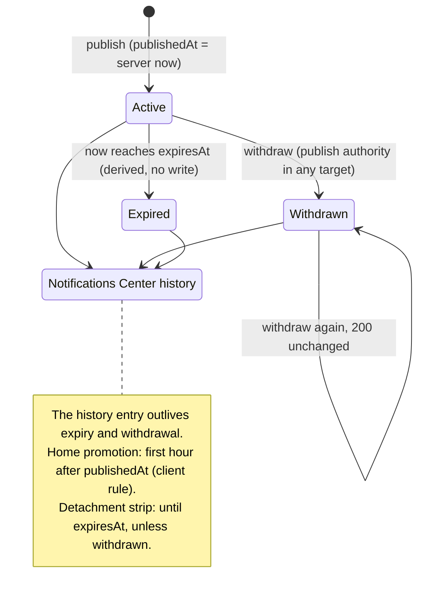

# Announcements — `/announcements`

Internal operational notices from one administrator to the administrators of
one or more detachments — the Flutter **/announcements compose** screen, the
management list, the Home promotion, the detachment strip and the
Notifications Center history (`announcement_models.dart`,
`mock_announcement_repository.dart`, API_CONTRACT.md § Announcements).

Code: `routes/announcementRoutes.js`, `controllers/tenant/announcementController.js`,
`validators/announcementValidators.js`, `models/announcementModel.js`.
Tests: `tests/announcements.test.js`.
Postman: folder **Tenant · Announcements** (`postman/modules/32-announcements.js`).

Every route: `tenantGuard` → feature **`announcements`** (`403 feature_disabled`).

| # | Endpoint | Authority | Success |
|---|---|---|---|
| 45 | `GET /announcements?status&detachmentId` | sees what addresses a viewable detachment | `200 { announcements: [...] }` |
| 46 | `GET /announcements/:announcementId` | same (not visible → 404) | `200 Announcement` |
| 47 | `POST /announcements` | `announcement.publish` in **every** addressed detachment; **`Idempotency-Key` required** | `201 Announcement` |
| 48 | `POST /announcements/:announcementId/withdraw` | `announcement.publish` in **any** addressed detachment | `200 Announcement` |

There is **no delete**: the Notifications Center entry is a record that the
notice was sent.

## Wire shape

```json
{
  "id": "a_01J9ZT4…",
  "text": "اجتماع المسؤولين يوم الخميس الساعة ٧ مساءً في المركز الرئيسي.",
  "detachmentIds": ["d_dam_central", "d_homs"],
  "placements": ["notifications", "home"],
  "publishedAt": "2026-09-28T09:00:00.000Z",
  "expiresAt": "2026-09-29T09:00:00.000Z",
  "status": "active",
  "authorName": "سلمى الحارثي",
  "version": 1
}
```

`placements` always contains `notifications`. `status` is `active` or
`withdrawn` ("expired" is derived by the client from `expiresAt`).

## 45–46. Read

`GET /announcements` → `{ "announcements": [...] }`, newest `publishedAt` first,
**already narrowed**: only announcements addressing at least one detachment the
caller can view (`detachment.view`, implied by any scoped grant; a Main Admin
sees all). Filters: `status=active|withdrawn`, `detachmentId=<id>` (addresses
that detachment — still subject to visibility).

`GET /announcements/:id` → the announcement, or `404 not_found` when it does not
exist **or** the caller cannot see it (existence is not leaked).

## 47. Publish (compose screen)

```http
POST /api/v1/announcements
Idempotency-Key: 0192f3c4-7a1e-7b3c-9d10-5f2a8c1e4b77

{ "text": "انقطاع الماء عن مركز الشعلان اليوم. أحضروا معكم ماء الشرب.",
  "detachmentIds": ["d_dam_central"],
  "placements": ["home", "detachment"],
  "publishedAt": "2026-09-28T12:00:00.000",
  "expiresAt": "2026-09-29T12:00:00.000" }
```

Rules, in order:

1. Caller holds `announcement.publish` somewhere, else `403 not_permitted`; then the `Idempotency-Key` header is **required** (`422 validation`, `fields["Idempotency-Key"]`). Same key + same body → the original response is replayed (`Idempotent-Replayed: true`).
2. `text` — trimmed; length **5–500** else `422 fields.text`. Stored trimmed.
3. `detachmentIds` — non-empty; de-duplicated preserving order; every id an **active** detachment of this tenant, else `422 fields.detachmentIds`.
4. `publishedAt` — **server now**. A client value is advisory: kept only when within **±5 minutes** of server now.
5. `expiresAt` — an instant (no offset → tenant tz), strictly after `publishedAt`, else `422 fields.expiresAt`. There is no permanent announcement.
6. Authority in **every** addressed detachment — one missing → `403 not_permitted` for the **whole** request (never silently narrowed).
7. `placements` ⊆ `notifications|home|detachment`; unknown values dropped; `notifications` always added.
8. `authorId` / `authorName` come from the signed-in account (a body `authorName` is ignored).

## 48. Withdraw

`POST /announcements/:id/withdraw` — visible to the caller (else `404`) and
`announcement.publish` in **any** addressed detachment (else `403`). Sets
`status: "withdrawn"` + `withdrawnAt`; ends the active placements. Already
withdrawn → `200`, unchanged (idempotent).



## Errors

| Code | HTTP | When |
|---|---|---|
| `feature_disabled` | 403 | `announcements` disabled for the tenant |
| `not_permitted` | 403 | no publish authority anywhere; missing in one addressed detachment (publish); missing in all (withdraw) |
| `not_found` | 404 | unknown, other tenant, or not visible to the caller |
| `validation` | 422 | missing `Idempotency-Key`; text bounds; empty/unknown/archived targets; bad or non-future `expiresAt` |
| `idempotency_conflict` | 409 | same key, different body |
| `stale_write` | 409 | withdraw lost a race with a concurrent writer |
