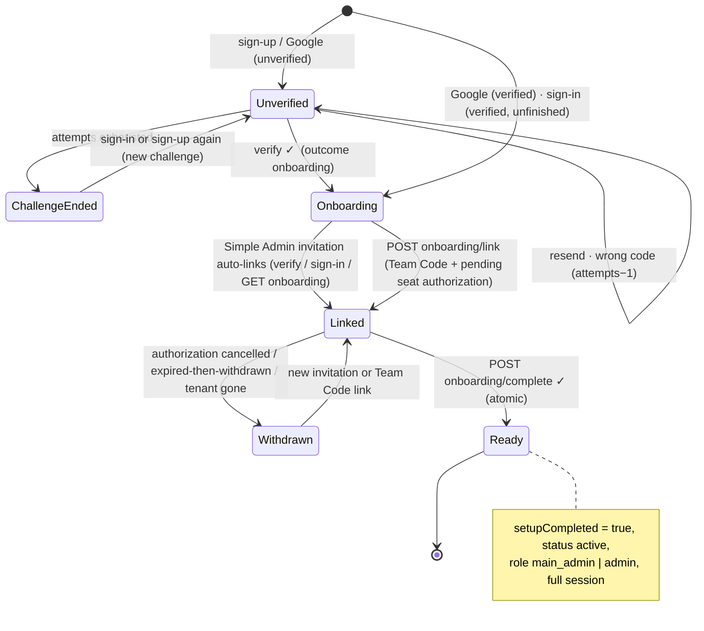
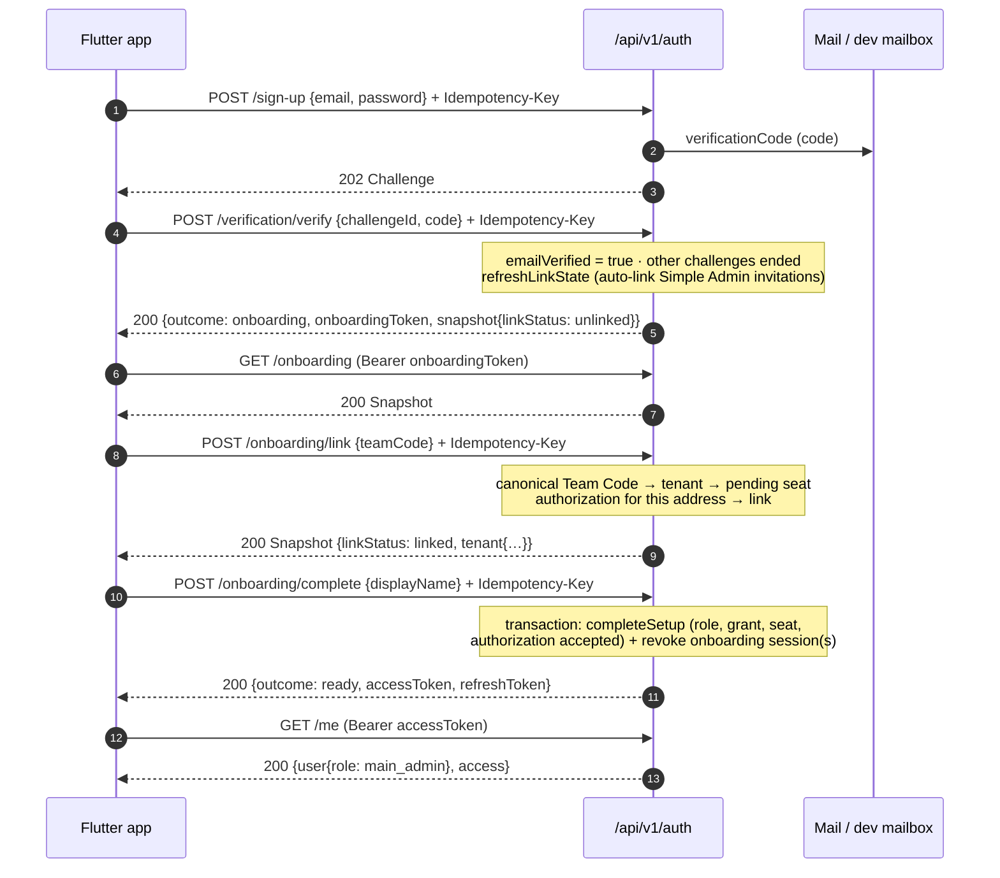
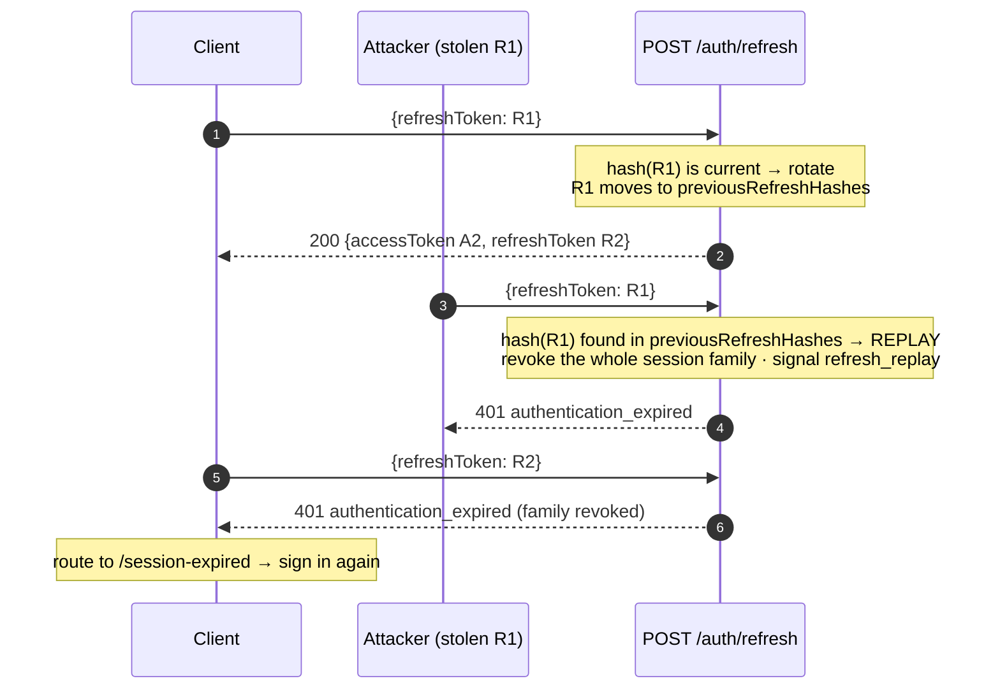

# Auth — identity, sessions & onboarding

Mounted at **`/api/v1/auth`** (`routes/authRoutes.js`). `/auth/customer-demo/**`
is a separate module (see `customer-demo.md`).

Code map: `controllers/auth/*` · `validators/authValidators.js` ·
`services/otpService.js` (codes) · `services/googleService.js` (Google
assertions) · `services/onboardingService.js` (outcome union, snapshot,
`{user, access}`) · shared `tokenService`, `authorizationService`,
`securityService`, `sessionView`.

All errors use the shared envelope `{ "error": { "code", "message", "fields"?, …extensions, "reference" } }`.
The client branches on `code` only.

---

## Contents

1. [Shared shapes](#shared-shapes)
2. [State machine & flows](#state-machine--flows)
3. [Identity proof](#identity-proof) — sign-up, sign-in, Google, verify, resend
4. [Onboarding](#onboarding) — snapshot, link, complete
5. [Sessions](#sessions) — sign-out, refresh, list/revoke, lifetime
6. [Device trust](#device-trust) — X-Device-Id, new-device code, restriction, My devices
7. [The signed-in account](#the-signed-in-account) — me, avatar, password
8. [MFA](#mfa)
9. [Password reset](#password-reset)
10. [Security notes](#security-notes)

---

## Shared shapes

### Challenge (email-ownership code)

```json
{
  "challengeId": "vc_01J9Z8K3M4…",
  "maskedEmail": "s***@hilal.org",
  "codeLength": 6,
  "expiresAt": "2026-09-28T10:10:00.000Z",
  "resendAvailableAt": "2026-09-28T10:01:00.000Z",
  "attemptsRemaining": 5
}
```

A sign-in or new-device challenge adds `"purpose": "sign_in"` or
`"purpose": "new_device"` (see [Device trust](#device-trust)); an
email-ownership challenge has no `purpose`.

Policy (`AppSettings.otp`, editable by a Super Admin): `length` 6, `ttlMinutes` 10,
`maxAttempts` 5, `resendCooldownSeconds` 60. Outside production
`DEV_FIXED_OTP` pins every code (the test suite and Postman use `246810`) and
every mail lands in `GET /api/v1/dev/mailbox?to=<email>`.

### Outcome union (sign-in, Google, verify, complete)

```json
{ "outcome": "ready", "sessionId": "s_…", "accessToken": "eyJ…", "refreshToken": "q3V…" }
```
```json
{ "outcome": "verification_required", "challenge": { …Challenge } }
```
```json
{
  "outcome": "onboarding",
  "sessionId": "s_…",
  "onboardingToken": "eyJ…",
  "onboardingRefreshToken": "Zr1…",
  "snapshot": { …Snapshot }
}
```

- `ready` — a **full** session. Issued to finished administrators
  (`setupCompleted`) and `super_admin`, **including suspended/revoked ones**:
  the client routes on `GET /auth/me → access.accountStatus`, data endpoints
  refuse with `account_unavailable`.
- `onboarding` — a **restricted** session (scope `onboarding`, 30 min access
  TTL). It can only call `/auth/onboarding/**`, `/auth/sign-out` and
  `/auth/refresh`; everything else answers `403 onboarding_required`.
- `verification_required` — no session at all.
- `sessionId` — the stable server session id (`Session._id`, the same value
  as the access token's `sid` and as `id` in `GET /auth/sessions`). It never
  changes across refresh rotation; `onboarding/complete` opens a new session,
  so it returns a new id. It is not a credential. Clients store it next to the
  tokens to match an offline copy to the session they still hold, instead of
  reading the (opaque) access token.

### Onboarding Snapshot

```json
{
  "accountId": "u_01J9Z…",
  "email": "huda@nabd-team.org",
  "methods": ["password"],
  "accountStatus": "pending_setup",
  "linkStatus": "linked",
  "setupStatus": "required",
  "tenant": { "displayName": "فريق النبض", "role": "main_admin", "tenantStatus": "active" },
  "displayNameSuggestion": "هدى السالم",
  "authorizationExpiresAt": "2026-10-05T09:00:00.000Z"
}
```

| Field | Values / rule |
|---|---|
| `methods` | `password` \| `google` |
| `accountStatus` | `active` \| `suspended` \| `revoked` \| `pending_setup` |
| `linkStatus` | `unlinked` \| `linked` \| `withdrawn` |
| `setupStatus` | `required` \| `completed` |
| `tenant` | present **exactly** when `linkStatus = linked`; `role` = `main_admin` \| `admin` |
| `displayNameSuggestion` | authorization's suggested name › account name; omitted when empty |
| `authorizationExpiresAt` | only when linked and the authorization has an expiry |

Never contains a tenant id, a Team Code, counts or capabilities.

### `{ sessionId, user, access }` (`GET /auth/me` and every `/me` write)

```json
{
  "sessionId": "s_…",
  "user": {
    "id": "u_demo_main",
    "name": "سلمى الحارثي",
    "email": "pbea4007@mtu.edu.iq",
    "role": "main_admin",
    "saasTenantId": "saas_hilal",
    "capabilities": { "global": ["detachment.create", "…"], "scoped": {} },
    "orgName": "alwalla",
    "avatarInitials": "سا",
    "avatarUrl": "http://localhost:4000/images/avatars/account-u_demo_main-01j9….webp"
  },
  "access": {
    "accountStatus": "active",
    "tenantStatus": "active",
    "demoMode": "none",
    "mfaRequired": false
  }
}
```

Built by `services/sessionView` (`serializeAuthUser`, `serializeSessionAccess`).
`super_admin` / `customer_demo` → `saasTenantId: null` and an empty grant.
`customer_demo` adds `access.sessionExpiresAt` and `demoMode: active|expired`.

Device trust adds, only when they apply:

- `access.deviceRestriction: { "reason": "new_device", "until": "<ISO>" }` —
  this session's device is in its restricted window; or
  `{ "reason": "device_limit" }` (no `until`) — an untrusted device past the
  trusted-device limit, restricted until a trusted device approves it.
- `access.pendingDeviceApprovals: [{ "id": "dv_…", "label": "Android", "signedInAt": "<ISO>" }]`
  — on a trusted, unrestricted device: new devices waiting for its Yes/No.

### Session (device list)

```json
{
  "id": "s_01J9Z…",
  "device": "Leader app",
  "ipMasked": "192.0.xx.xx",
  "locationLabel": "",
  "startedAt": "2026-09-28T08:00:00.000Z",
  "current": true,
  "lastUsedAt": "2026-09-28T09:41:00.000Z"
}
```

`device` comes from the `X-Device-Name` header when sent, else from the
User-Agent (`Leader app`, `Android`, `iOS`, `Browser`, `Postman`, …).

---

## State machine & flows

### Onboarding state machine



### Sign-up → verify → link → complete



### Refresh rotation & replay



---

## Identity proof

### POST `/auth/sign-up`

| | |
|---|---|
| Auth | none · `authLimiter` (per IP) · **`Idempotency-Key` required** |
| Screen | `/signup` → `/verify-email` |
| Success | **202** Challenge. No session is issued. |

```http
POST /api/v1/auth/sign-up
Idempotency-Key: 0192f1c2-7a6b-7c1d-9e2f-3a4b5c6d7e8f
Content-Type: application/json

{ "email": "salma@hilal.org", "password": "Str0ng-passw0rd" }
```
```json
{ "challengeId": "vc_01J9…", "maskedEmail": "s***@hilal.org", "codeLength": 6,
  "expiresAt": "2026-09-28T10:10:00.000Z", "resendAvailableAt": "2026-09-28T10:01:00.000Z", "attemptsRemaining": 5 }
```

Business rules — **enumeration-safe**: the same 202 Challenge shape in every case.

| Address state | Effect |
|---|---|
| new | account created (`pending_setup`, role null, `unlinked`, unverified, methods `["password"]`) + challenge + code mail |
| provisioned seat account, never claimed (no methods) | password attached — the person **claims** that account (same id) + challenge |
| existing, unverified | password replaced, its other active challenges ended, new challenge |
| existing, verified | **decoy** challenge (`accountId: null`, never verifies) + mail `signupAttemptOnVerified` |

Password: 8–128 characters taken exactly as typed (never trimmed).

| Code | HTTP | When |
|---|---|---|
| `password_rejected` | 422 | password missing, < 8 or > 128 characters (`fields.password`) |
| `validation` | 422 | malformed email (`fields.email`), missing `Idempotency-Key` |
| `idempotency_conflict` / `idempotency_in_progress` | 409 | key reuse with another body / concurrent retry |
| `rate_limited` | 429 | per-IP limiter |

### POST `/auth/sign-in`

| | |
|---|---|
| Auth | none · `authLimiter` |
| Screen | `/login` |
| Success | **200** outcome (`ready` \| `onboarding` \| `verification_required`) |

```json
{ "email": "pbea4007@mtu.edu.iq", "password": "Leader@12345" }
```
```json
{ "outcome": "ready", "sessionId": "s_…", "accessToken": "eyJ…", "refreshToken": "q3V…" }
```

Order of evaluation:

1. Throttle: failures (`sign_in_failed`) for this address within
   `signInLockout.windowMinutes` (15) reached `signInLockout.maxFailures` (5)
   → **429 `rate_limited`** with `retryAfterSeconds` — even for the right password.
2. Unknown address, account without a password method, `customer_demo`
   account, or wrong password → **one** answer: 401 `invalid_credentials`
   (a dummy bcrypt comparison keeps timing alike) + a `sign_in_failed` signal.
3. The request's device is blocked for this account → 403 `device_blocked`.
   A trusted device answered "No" → 403 `password_reset_required` until the
   password is reset.
4. Address not verified → its other challenges end, a new code is mailed →
   `verification_required`.
5. A device the account does not trust → `verification_required` with
   `purpose: "new_device"` (see [Device trust](#device-trust)).
6. Otherwise: Simple Admin invitations auto-link, `lastLoginAt` is set, then
   `ready` (finished or `super_admin`) or `onboarding` (+ snapshot).

| Code | HTTP | When |
|---|---|---|
| `device_id_required` | 400 | no valid `X-Device-Id` (every sign-in, Google and verify sends it) |
| `device_blocked` | 403 | see rule 3 |
| `password_reset_required` | 403 | see rule 3 |
| `invalid_credentials` | 401 | see rule 2 |
| `rate_limited` | 429 | lockout budget spent (`retryAfterSeconds`, `retryAvailableAt`, `Retry-After`) |
| `validation` | 422 | missing email/password |

### POST `/auth/google`

| | |
|---|---|
| Auth | none · **`Idempotency-Key` required** |
| Screen | `/login` and `/signup` ("Continue with Google") |
| Success | **200** outcome |

```json
{ "idToken": "<Google ID token>" }
```

Assertion (`services/googleService`):
- `ALLOW_MOCK_GOOGLE=true` (never in production): `mock-google:<email>` = verified
  identity, `mock-google-unverified:<email>` = unverified identity.
- `GOOGLE_CLIENT_ID` set: `google-auth-library` verifies signature, issuer,
  expiry and audience. The token is never logged or stored.

Identity mapping:

| Found | Effect |
|---|---|
| account with this `googleSub` | that account (marked verified if Google says so) |
| same email, **not yet verified** (provisioned seat or unverified password sign-up) | **claimed**: `googleSub` set, method `google` added, the unproven password is dropped, `emailVerified` from the token |
| same email, verified, no such Google identity | **409 `auth_method_link_required`** |
| nothing | account created, methods `["google"]`, name from Google |

Then: Google says unverified and the account is unverified →
`verification_required`; else the same continuation as sign-in.

| Code | HTTP | When |
|---|---|---|
| `google_assertion_rejected` | 401 | invalid/expired/wrong-audience token, malformed mock |
| `unsupported_auth_method` | 403 | no `GOOGLE_CLIENT_ID` and not a mock token |
| `auth_method_link_required` | 409 | verified account already signs in another way |
| `validation` | 422 | missing `idToken` / `Idempotency-Key` |

### POST `/auth/verification/verify`

| | |
|---|---|
| Auth | none · **`Idempotency-Key` required** |
| Screen | `/verify-email` |
| Success | **200** outcome (`onboarding` for a new identity, `ready` for a finished one) |

```json
{ "challengeId": "vc_01J9…", "code": "246810" }
```

| Code | HTTP | When |
|---|---|---|
| `verification_challenge_ended` | 409 | unknown, already used, ended (a newer challenge replaced it) or attempts exhausted |
| `verification_code_expired` | 409 | now ≥ `expiresAt` — **no attempt spent**; call resend |
| `verification_code_invalid` | 422 | wrong code (a decoy is always wrong); `attemptsRemaining` extension. The attempt that reaches 0 ends the challenge and answers `verification_challenge_ended` |
| `validation` | 422 | missing fields / key |

Correct code → `emailVerified = true`, challenge `verified` (single use),
every other active challenge of the account ended, then the sign-in
continuation (auto-link → `ready` / `onboarding`). Failures record a
`verification_failed` signal.

### POST `/auth/verification/resend`

| | |
|---|---|
| Auth | none · **`Idempotency-Key` required** |
| Screen | `/verify-email` ("Resend code") |
| Success | **200** Challenge — the **same** `challengeId`, new code, expiry/cooldown/attempts reset |

```json
{ "challengeId": "vc_01J9…" }
```

| Code | HTTP | When |
|---|---|---|
| `verification_challenge_ended` | 409 | unknown or ended |
| `verification_resend_throttled` | 429 | before `resendAvailableAt`; `retryAfterSeconds`, `resendAvailableAt` |

Decoys "resend" too (same answer, no mail).

---

## Onboarding

All three require an **onboarding** session (`Authorization: Bearer <onboardingToken>`).
A full token answers **409 `setup_already_completed`**; no/expired token → 401 `authentication_expired`.

### GET `/auth/onboarding`

| | |
|---|---|
| Screen | `/link-team`, `/account-setup` (app start with an onboarding session) |
| Success | **200** Snapshot |

Re-evaluates the link first: a withdrawn/cancelled authorization or a vanished
tenant turns `linked` into `withdrawn`; a pending, unexpired Simple Admin
invitation for the verified address in an **active** tenant auto-links.

### POST `/auth/onboarding/link`

| | |
|---|---|
| Auth | onboarding session · **`Idempotency-Key` required** |
| Screen | `/link-team` (Main Admin enters the Team Code received from the Leader team) |
| Success | **200** Snapshot (`linkStatus: linked`, `tenant` present) |

```json
{ "teamCode": "mtm 4k7p qx92" }
```

The code is canonicalized (`utils/normalize.normalizeTeamCode`: uppercase,
Arabic-Indic digits folded, separators dropped, `MTM` prefix optional) to
`MTM-XXXX-XXXX` over `23456789ABCDEFGHJKMNPQRSTVWXYZ`.

Refusals, **in this order**:

| Code | HTTP | When |
|---|---|---|
| `account_unavailable` | 403 | account suspended or revoked (`accountStatus`) |
| `rate_limited` | 429 | 10 failed links (`team_link_failed`) for this account within 60 min |
| `team_code_malformed` | 422 | not a well-formed Team Code (`fields.teamCode`) — spends nothing |
| `account_already_linked` | 409 | already linked to another tenant (the code is not evaluated, the tenant is never named). Same tenant's code → idempotent 200 |
| `team_link_refused` | 403 | unknown code **or** no pending seat authorization (`initial_seat` / `replacement_designate`) for this address in that tenant — one identical answer + a `team_link_failed` signal |
| `invitation_expired` | 409 | the matching authorization is past `expiresAt` |
| `tenant_unavailable` | 409 | tenant lifecycle ≠ `active` (`tenantStatus`) |

Simple Admins never type a Team Code — their invitation links automatically.

### POST `/auth/onboarding/complete`

| | |
|---|---|
| Auth | onboarding session · **`Idempotency-Key` required (replays after the session was consumed)** |
| Screen | `/account-setup` |
| Success | **200** `{ "outcome": "ready", "sessionId", "accessToken", "refreshToken" }` (a new `sessionId`) |

```json
{ "displayName": "هدى السالم" }
```

In one transaction (`authorizationService.completeSetup`):
display name (1–80 after whitespace collapse) saved, `saasTenantId` set,
`setupCompleted = true`, status `active`; seat kinds → `main_admin` with the
full grant (initial seat: `seat.currentAccountId`; replacement designate:
atomic transfer — the former Main Admin is revoked); `simple_admin` →
`admin` with the invitation's grant, invitation `accepted`
(audit `admin_invitation_accepted`). The onboarding session — and any other
onboarding session of the account — is revoked, then a full session is issued.

**Replay:** the key is scoped to the account (`acc:<sub>` from the bearer's
signature, checked before the session), so the same `Idempotency-Key` + same
body returns the **original** `ready` body (`Idempotent-Replayed: true`) even
though the onboarding session is gone. A different key on the consumed session
→ 401. Use replayed tokens only when the first response was lost; a refresh
token that was already rotated counts as replay.

| Code | HTTP | When |
|---|---|---|
| `validation` | 422 | display name empty/too long (`fields.displayName`), missing key |
| `setup_unavailable` | 409 | not linked, authorization withdrawn, or tenant gone |
| `invitation_expired` | 409 | authorization expired |
| `tenant_unavailable` | 409 | tenant not active (`tenantStatus`) |
| `account_unavailable` | 403 | account suspended/revoked |
| `setup_already_completed` | 409 | a full token was presented / already completed |

---

## Sessions

### POST `/auth/sign-out`

Any live session (full **or** onboarding). Revokes the current session and its refresh family → **204**.
Screen: `/more` → sign out; `/link-team` "use another account".

### POST `/auth/refresh`

| | |
|---|---|
| Auth | none (the refresh token is the credential) |
| Screen | silent (HTTP interceptor); on failure → `/session-expired` |
| Success | **200** `{ "sessionId", "accessToken", "refreshToken" }` (`sessionId` unchanged) |

```json
{ "refreshToken": "q3V…" }
```

Single-use rotation. Presenting an already-rotated token is **replay**: the
whole family is revoked and a `refresh_replay` signal recorded. An onboarding
refresh yields an onboarding token; a full refresh never downgrades. A
suspended account's full session and any revoked account's session end on
refresh. **Every** failure (missing, unknown, expired, revoked, replayed) is
one answer: **401 `authentication_expired`**.

**Lifetime.** `refreshExpiresAt` is the idle deadline: each refresh (and each
`GET /auth/me`, at most about once an hour) slides it to now +
`REFRESH_TOKEN_TTL_DAYS` (7), never past `absoluteExpiresAt` = sign-in +
`SESSION_MAX_DAYS` (30). A session older than the absolute limit, or idle
past its deadline, answers 401 `authentication_expired`.

### GET `/auth/sessions`

`accountGuard` (full session + MFA satisfied). Screen: `/more/security`.
**200** `[Session]` — live full sessions of the account (not revoked, refresh
not expired), newest first, the calling one `current: true`.

### DELETE `/auth/sessions/:sessionId`

`accountGuard` → **204**.

| Code | HTTP | When |
|---|---|---|
| `validation` | 422 | the id is the current session (use sign-out) |
| `not_found` | 404 | unknown, already ended, or another account's session |

### DELETE `/auth/sessions`

`accountGuard` → **200** `{ "revoked": 2 }` — every OTHER session of the account ends.

---

## Device trust

Every sign-in (`/sign-in`, `/google`, `/verification/verify`) sends
`X-Device-Id`: a UUID v4 the app minted on its first launch and keeps in
secure storage (no hardware id). The server stores only its hash, per
account; a reinstall is a new device. Without it → 400 `device_id_required`.

| Device | Sign-in |
|---|---|
| trusted | no code; Google skips its sign-in code only here, and only with the Google identity the account already holds |
| none yet on this account (first device) | email code (`new_device`; a sign-up's own code counts), then **trusted, not restricted** |
| new, a trusted slot is free | email code, then trusted and **restricted** for `NEW_DEVICE_RESTRICT_HOURS` (6) unless a trusted device answers Yes |
| new, `TRUSTED_DEVICES_MAX` (3) already trusted | email code every time; **untrusted and restricted** until a trusted device approves it after a slot is freed |
| blocked | 403 `device_blocked` |

A new device on an account that already had one is announced: the account's
email gets `newDeviceSignedIn`, and its trusted devices see it in
`access.pendingDeviceApprovals`. A session opened before device trust shipped
registers its phone (trusted while a slot is free, no code) on its first
request carrying `X-Device-Id`.

**Restricted session** (`middlewares/restrictedSession.js`), refused with
**403 `session_restricted`** `{ reason, restrictedUntil? }`:

- always: `POST /me/password`, `POST /mfa/setup|disable`, `DELETE /sessions[/:id]`,
  device approve/deny/remove, every `/tenant/simple-admin*` write,
  `/settings/organization` writes, `/billing/*` writes,
  `GET /workshops/:id/export.csv`, every `/platform/*` write;
- edits, deletes and record actions on any tenant record this device did not
  create (`_createdByDevice`), except attendance check-in/out/absent,
  inventory movements, shift-assignment adds and adding people to a workshop.

Creating records, reading, and editing what the device created stay open.
`POST /sync/push` replays each operation through the API, so a refused
operation comes back with `httpStatus: 403`, `code: "session_restricted"`.

### GET `/auth/devices`

`accountGuard`. Screen: `/more/security/devices`.
**200** `{ "limit": 3, "devices": [Device] }` — trusted then untrusted; blocked
devices are not listed.

```json
{
  "id": "dv_…",
  "label": "Android",
  "status": "trusted",
  "current": false,
  "restricted": true,
  "restrictedUntil": "2026-10-08T22:00:00.000Z",
  "signedInAt": "2026-10-08T16:00:00.000Z",
  "lastSeenAt": "2026-10-08T16:05:00.000Z"
}
```

### POST `/auth/devices/:deviceId/approve`

`accountGuard`, from a trusted, unrestricted device ("Yes, this is my
device") → **204**. The device's restriction lifts at once (an untrusted one
becomes trusted).

| Code | HTTP | When |
|---|---|---|
| `not_permitted` | 403 | the caller's device is not trusted (or unknown) |
| `session_restricted` | 403 | the caller is restricted itself |
| `trusted_device_limit` | 409 | approving an untrusted device while the limit is full (`limit`) |
| `not_found` | 404 | unknown, blocked, or another account's device |

### POST `/auth/devices/:deviceId/deny`

`accountGuard`, from a trusted, unrestricted device ("No, this is not me") →
**200** `{ "passwordReset": true|false }`. The device is blocked, **every**
session of the account ends (the answering one too), and an account with a
password must reset it (`password_reset_required` on password sign-in until
then; Google-only accounts skip the reset). A Simple Admin's No emails the
team's Main Admin; a Main Admin's (or Super Admin's) No emails the Super
Admins and raises a `security_device_denied_*` alert on
`/platform/security-alerts`. Refusals as for approve.

### DELETE `/auth/devices/:deviceId`

`accountGuard` → **204**. The device's sessions end; it is a new device next
time. 422 `validation` for the device in use (sign out instead); 404 for a
blocked or unknown device. Refused while restricted.

---

## The signed-in account

### GET `/auth/me`

| | |
|---|---|
| Auth | full session — **no** MFA and **no** account-status gate, so the client can route to `/mfa-challenge` or `/account-suspended` |
| Screen | app start / startup classifier, `/more` |
| Success | **200** `{ sessionId, user, access }` |

`403 onboarding_required` for an onboarding token; 401 `authentication_expired` without a live session.

### PATCH `/auth/me`

`accountGuard` · optional `Idempotency-Key`. Screen: `/more/profile`.

```json
{ "name": "سلمى الحارثي" }
```

**200** `{ user, access }`. Name collapsed, 1–80 → else 422 `validation` (`fields.name`).

### POST `/auth/me/avatar`

`accountGuard` · optional `Idempotency-Key` · `multipart/form-data`, field **`image`**
(JPEG/PNG/WebP/GIF/HEIC, ≤ `MAX_UPLOAD_MB`). Re-encoded to a 512×512 WebP under
`/images/avatars/`, counted in the tenant's `storage_bytes`; the previous file
is deleted. **200** `{ user, access }` with `user.avatarUrl`.

| Code | HTTP | When |
|---|---|---|
| `validation` | 422 | no file / wrong type / unreadable image (`fields.image`) |
| `payload_too_large` | 413 | over the upload limit |
| `plan_limit_reached` | 409 | tenant storage allowance exhausted |

### DELETE `/auth/me/avatar`

`accountGuard` → **200** `{ user, access }` without `avatarUrl`; file removed.

### POST `/auth/me/password`

`accountGuard` · optional `Idempotency-Key`. Screen: `/more/security`.

```json
{ "currentPassword": "Leader@12345", "newPassword": "N3w-passw0rd!" }
```

**204**. Every OTHER session of the account is revoked.

| Code | HTTP | When |
|---|---|---|
| `invalid_credentials` | 422 | wrong current password or no password method (`fields.currentPassword`) |
| `password_rejected` | 422 | new password not 8–128 characters (`fields.newPassword`) |

---

## MFA

TOTP (RFC 6238, SHA-1, 6 digits, 30 s, ±1 step), issuer **Leader**.
Screens: `/mfa-setup`, `/mfa-challenge`, `/more/security`.

### POST `/auth/mfa/setup`

Full session + active account (no MFA gate). **200**:

```json
{
  "otpauthUrl": "otpauth://totp/Leader:salma%40hilal.org?secret=JBSWY3DPEHPK3PXP&period=30&digits=6&algorithm=SHA1&issuer=Leader",
  "manualSecret": "JBSWY3DPEHPK3PXP",
  "backupCodes": ["k7m2p9qx4t", "…8 codes…"]
}
```

Stores a **pending** secret and 8 single-use backup codes (only hashes kept).
MFA is **not** enabled until `/mfa/verify`. Calling setup again replaces the
pending secret and the codes.

| Code | HTTP | When |
|---|---|---|
| `conflict` | 409 | MFA already enabled |
| `account_unavailable` | 403 | account not active |

### POST `/auth/mfa/verify`

Full session + active account (no MFA gate). `{ "code": "123456" }` → **204**.

- A pending secret exists and the code matches it → MFA **enabled**, this
  session marked verified; every OTHER open session of the account must now
  pass the second factor (`mfaRequired: true`).
- MFA enabled and this session not yet verified → a TOTP **or** an unused
  backup code (consumed) → session verified (`authenticatedAt` refreshed).

After enabling, every new sign-in gets a session with `access.mfaRequired: true`;
data endpoints answer **403 `mfa_required`** until this call succeeds.

| Code | HTTP | When |
|---|---|---|
| `mfa_code_invalid` | 422 | wrong code (`mfa_failed` signal) |
| `rate_limited` | 429 | 10 failed codes for the account within 15 min |
| `conflict` | 409 | nothing to verify (no pending secret, MFA off, or session already verified) |
| `validation` | 422 | missing code |

### POST `/auth/mfa/disable`

`accountGuard` (session already MFA-verified) + `{ "code" }` (TOTP or backup
code) → **204**; secret, pending secret and backup codes wiped.
`mfa_required` 403 on an unverified session · `mfa_code_invalid` 422 ·
`conflict` 409 when MFA is off · `rate_limited` 429.

---

## Password reset

Screens: `/forgot` → `/otp` → `/new-password`. The reset bearer is a
short-lived JWT (`RESET_TOKEN_TTL_MINUTES`, 15) bound to one `PasswordReset`
record; access tokens are not accepted and vice versa.

### POST `/auth/password-reset/request`

`authLimiter`. `{ "email": "salma@hilal.org" }` → **always 200** `{ "resetToken": "eyJ…" }`.

| Address | Effect |
|---|---|
| account with a password | code mailed (`passwordResetCode`, OTP policy), older open resets of the account die |
| Google-only account | mail `googleOnlyReset` + decoy record |
| unknown | decoy record, no mail |

`validation` 422 only for a malformed address.

### POST `/auth/password-reset/verify`

`Authorization: Bearer <resetToken>` · `{ "email": "salma@hilal.org", "code": "246810" }` → **204**.

| Code | HTTP | When |
|---|---|---|
| `authentication_expired` | 401 | missing/invalid/expired reset token, used reset, superseded reset, attempts exhausted |
| `reset_code_expired` | 409 | code past its expiry — request a new one |
| `reset_code_invalid` | 422 | wrong code, email mismatch or decoy; `attemptsRemaining` extension. At 0 the reset is dead (401 afterwards) |
| `validation` | 422 | missing email/code |

### POST `/auth/password-reset/complete`

`Authorization: Bearer <resetToken>` · `{ "password": "N3w-passw0rd!" }` → **204**.

The reset must be verified and unused, else 401 `authentication_expired`;
weak password → 422 `password_rejected`. Success: password set, the address
counts as verified, the reset is consumed (single use), **every** session of
the account is revoked — the user signs in again.

---

## Security notes

- Enumeration safety: sign-up (decoy challenge), sign-in (one
  `invalid_credentials`, dummy bcrypt), password reset (decoy record, always
  200), Team Code link (one `team_link_refused` for unknown code and missing
  authorization).
- Throttles (`SecuritySignal`, sliding windows): `sign_in_failed` per address
  (settings `signInLockout`), `team_link_failed` per account (10/60 min),
  `mfa_failed` per account (10/15 min). `verification_failed`, `reset_failed`
  `refresh_replay` and `new_device_denied` are recorded for
  `/platform/security-alerts`.
  Per-IP `authLimiter` (60/15 min) fronts sign-up, sign-in and reset request.
- Stored secrets: password bcrypt (cost 12), OTP / backup codes / refresh
  tokens / device ids as sha256; the TOTP secret is stored as-is (`select: false`).
- Idempotency records of `verify`, `google` and `complete` hold the issued
  tokens so a lost response can be replayed; they expire after
  `idempotencyRetentionDays`.

## Seeded accounts & fixtures

| Who | Email | Notes |
|---|---|---|
| Super Admin | `nullmod.dev@gmail.com` | `ready` |
| Main Admin (saas_hilal) | `pbea4007@mtu.edu.iq` | `ready` |
| Simple Admin (saas_hilal) | `hamodekaherhm@gmail.com` | `ready` |
| Invited Simple Admin | `noura@hilal-medical.org` | sign-up → verify auto-links (fresh seed only) |

Password for every seeded account: `SEED_PASSWORD` (default `Leader@12345`).
Postman: folder 0 signs the three in; folder 1 exercises every endpoint here.
