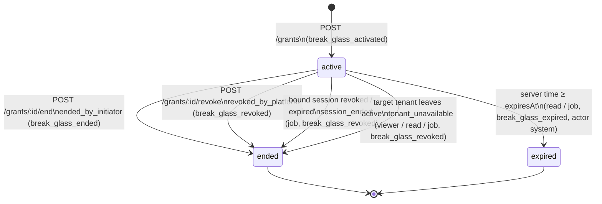

# Break-glass emergency access

Mounted at `/api/v1/platform/break-glass`. **Super Admin only** (`platformGuard`:
session → MFA → account lifecycle → `super_admin`, else `403 not_permitted`).

Contract: `API_CONTRACT.md` → "Break-glass emergency access — Point 12".
Flutter surfaces: **`/platform/access`** (management page, request flow, the
persistent `PlatformShell` strip, one-shot expiry handling) and the grant-scoped
read-only viewer.

A **grant** is exceptional, temporary, single-tenant, **read-only** access bound
to **one** Super Admin **session** for a stated reason. It is never a role, a
tenant `Cap`, impersonation, a lifecycle bypass, or permanent. The signed-in
`AuthUser` stays `super_admin` with `saasTenantId: null` for the whole grant.

Code: `routes/platform/breakGlassRoutes.js` → `controllers/platform/breakGlassController.js`
→ `services/breakGlassService.js`; job `jobs/definitions/03-settle-break-glass.js`.

## The grant resource

```json
{
  "id": "bg_01J8…",
  "revision": 1,
  "tenant": { "tenantId": "saas_hilal", "displayName": "alwalla" },
  "scopes": ["tenant_operational_read"],
  "reason": "تعذّر على قائد الفريق الوصول إلى سجلات المناوبات",
  "initiator": { "accountId": "u_demo_platform", "displayName": "مدير منصة ليدر" },
  "issuedAt": "2026-09-28T09:00:00.000Z",
  "expiresAt": "2026-09-28T10:00:00.000Z",
  "status": "active"
}
```

- `status`: `active | expired | ended`. Only `ended` carries `endedAt` +
  `endReason` (`ended_by_initiator | session_ended | tenant_unavailable | revoked_by_platform`).
- `revision` is the command concurrency token; every state change bumps it.
- `expiresAt = issuedAt + AppSettings.breakGlassMinutes` (default 60). The client proposes no duration.
- Never returned or stored: session id, tokens, device/IP, Team Code, Main Admin
  contact, subscription/plan/features, operational data.

## State machine



Terminal states are final: renewed access is a **new** grant with a new reason.
Every transition is one conditional update (`status: 'active'`) plus its audit
event in the same transaction, so concurrent settlers never double-transition.

## Endpoints

### `GET /current`

The calling session's possibly-live grant, else its most recent terminal grant,
else `null`. **Settles on read**: an active grant past `expiresAt` becomes
`expired` (revision +1, audit `break_glass_expired`, actor `system`); an active
grant whose tenant is no longer `active` becomes `ended` / `tenant_unavailable`.

```json
{ "grant": { "id": "bg_…", "status": "active", "…": "…" }, "readAt": "2026-09-28T09:05:00.000Z" }
```

### `POST /grants` — activate (`Idempotency-Key` required)

```json
{
  "tenantId": "saas_hilal",
  "expectedTenantVersion": 4,
  "scopes": ["tenant_operational_read"],
  "reason": "تعذّر على قائد الفريق الوصول إلى سجلات المناوبات"
}
```

→ `201` the new `active` grant. `expectedTenantVersion` is the tenant
**lifecycle** version the operator reviewed (`GET /platform/tenants/:id` →
`lifecycle.version`). Flutter mints `break-glass:activate:<uuidv7>` per draft
(a retry of the unchanged draft reuses it).

Refusals, **in this order**:

| # | Condition | Status | `code` |
|---|---|---|---|
| 0 | missing key / `tenantId` / `expectedTenantVersion` | 422 | `validation` |
| 1 | reason empty after whitespace collapse, > 280 chars, not a string | 422 | `invalid_break_glass_reason` |
| 2 | `scopes` not a non-empty array of known scopes | 422 | `invalid_break_glass_scope` |
| 3 | `session.authenticatedAt` older than `AppSettings.recentAuthMinutes` (30) | 403 | `recent_authentication_required` (+`recentAuthMinutes`) |
| 4 | tenant has a tombstone (or lifecycle `deleted`) | 409 | `tenant_already_deleted` |
| 5 | unknown tenant | 404 | `tenant_not_found` |
| 6 | lifecycle ≠ `active` | 409 | `tenant_not_eligible` (+`tenantStatus`) |
| 7 | `expectedTenantVersion` ≠ `lifecycle.version` | 409 | `stale_tenant` (+`currentVersion`) |
| 8 | this session already holds a live grant | 409 | `break_glass_already_active` (+`grant`) |

The reason is stored collapsed (trim + single spaces) and is **never** copied into audit changes.

### `POST /grants/:grantId/end` (`Idempotency-Key` required)

`{ "expectedRevision": 1 }` → `200` the grant, `status: ended`, `endReason: ended_by_initiator`.
Flutter key: `break-glass:end:<grantId>:<revision>`.

| Condition | Status | `code` |
|---|---|---|
| unknown id, or a grant of **another session** | 404 | `break_glass_not_found` |
| grant not active (ended, expired — settled first) | 409 | `break_glass_not_active` (+`grant`) |
| `expectedRevision` mismatch | 409 | `stale_break_glass` (+`currentRevision`, `currentRecord`) |

### `GET /grants?status&cursor&limit` — management view

Every grant (all sessions, all admins), newest `issuedAt` first →
`{ items: [Grant], nextCursor }`. `status` ∈ `active|expired|ended`; `limit` 1–100
(default 50). Overdue actives are settled before listing.

### `POST /grants/:grantId/revoke` (`Idempotency-Key` required)

Any Super Admin may revoke any live grant: `{ "expectedRevision": 1 }` → the
grant `ended` / `revoked_by_platform`; audit `break_glass_revoked` with the
revoking admin as actor. Same `404 / 409` codes as `end` (without the session check).

### Grant-scoped read-only viewer — `GET /view/<resource>`

| Resource | Query | Items | Feature flag |
|---|---|---|---|
| `detachment-groups` | — | `DetachmentGroup` + live roll-ups | — |
| `detachments` | — | `Detachment` + live roll-ups | — |
| `members` | `detachmentId?` | `TeamMember` — **never** `phoneMasked` | — |
| `shifts` | `detachmentId?`, `from?`, `to?` (`YYYY-MM-DD`, tenant calendar, ≤ 31 days inclusive; default = the current Saturday-start week) | `Shift` (attendees without phones) | — |
| `inventory-items` | `detachmentId?` | `InventoryItem` | `inventory` |
| `workshops` | — | `Workshop` (organisers without phones) | `workshops` |

```json
{ "grantId": "bg_…", "tenant": { "tenantId": "saas_hilal", "displayName": "alwalla" }, "items": [ … ] }
```

Shapes are exactly the tenant plane's (`services/serializers.js`). Every read is
authorized in the contract's precedence:

1. session / MFA / account / `super_admin` (the guard);
2. a live grant **bound to this session** (expiry settled first) → else `403 not_permitted`;
3. scope `tenant_operational_read` → else `403 not_permitted`;
4. target lifecycle **re-evaluated per request** → not `active`: the grant ends
   `tenant_unavailable` and the read answers `403 tenant_unavailable` (+`tenantStatus`);
5. the tenant's feature flag → `403 feature_disabled` (+`feature`).

Unknown `detachmentId` → `404 not_found`; bad range → `422 validation`
(`from`/`to`). Only `GET` exists — any other method or resource is `404`.

## Settlement job — `settle-break-glass`

Runs every `JOBS_INTERVAL_SECONDS`; returns the number of grants moved.

| Found | Becomes | Audit |
|---|---|---|
| active, `expiresAt ≤ now` | `expired` | `break_glass_expired` (system) |
| active, bound `Session` revoked / refresh-expired / missing | `ended` · `session_ended` | `break_glass_revoked` (system) |
| active, tenant missing or lifecycle ≠ `active` | `ended` · `tenant_unavailable` | `break_glass_revoked` (system) |

## Audit

Category `emergency_access`; target `{ type: "break_glass_grant", id }`; `tenant`
is the minimal reference; the event's internal `grantId` is set. Actions:
`break_glass_activated`, `break_glass_ended`, `break_glass_expired`, `break_glass_revoked`.
The free-text reason never enters audit.
