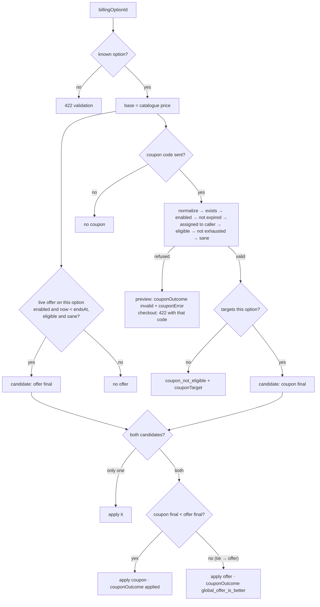
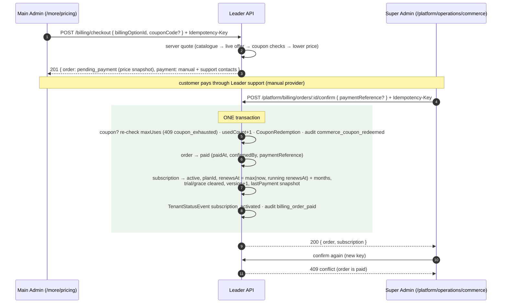

# Commerce — pricing, offers, coupons, checkout (Point 19)

| Mount | Who | Flutter |
|---|---|---|
| `/api/v1/pricing` | public reads; quote/validate: any full session (incl. an active Customer Demo) | `/more/pricing` |
| `/api/v1/billing` | tenant **Main Admin** only (`tenantGuard` + role) | `/more/pricing` → subscribe |
| `/api/v1/platform/commerce` | Super Admin | `/platform/operations/commerce` |
| `/api/v1/platform/billing` | Super Admin | `/platform/operations/commerce` (orders) |

Rules: `BACKEND-HANDOFF.md` §18. Code: `services/pricingService.js` (all price
math + quotes), `services/billingService.js` (checkout, confirmation),
`controllers/pricingController.js`, `controllers/billingController.js`,
`controllers/platform/commerceController.js`, `controllers/platform/billingAdminController.js`.

## Product and money

One product, one full-access plan, four durations — all grant identical capabilities.

| `id` | months | base | effective monthly |
|---|---|---|---|
| `monthly` | 1 | 600 | 600 |
| `three_months` | 3 | 1400 | 467 |
| `six_months` | 6 | 2400 | 400 |
| `twelve_months` | 12 | 4000 | 333 |

Money is **always** `{ "amount": <integer minor units>, "currency": "USD" }`.
Promotion eligibility is policy data (`PROMOTION_ELIGIBLE_OPTIONS`): currently
`monthly` and `three_months`.

**Discount** — `{ "kind": "percentage", "percent": 10 }` or
`{ "kind": "fixed_final_price", "finalPrice": { "amount": 200, "currency": "USD" } }`.

- percentage: `discount = floor((base × pct + 50) / 100)`, `final = base − discount`
  (1400 @ 10% → 1260 · 600 @ 33% → 402)
- fixed final price: `final = finalPrice.amount` («first month for $2» = 200)
- **sane** for an option iff eligible, percent 1–90, and `0 < final < base`.

**PriceQuote**:

```json
{
  "billingOptionId": "three_months", "months": 3,
  "basePrice": { "amount": 1400, "currency": "USD" },
  "finalPrice": { "amount": 1260, "currency": "USD" },
  "promotion": { "source": "global_offer", "id": "offer_01J…", "label": "عرض الخريف" },
  "durationSavings": { "amount": 540, "currency": "USD" },
  "promotionSavings": { "amount": 140, "currency": "USD" },
  "effectiveMonthly": { "amount": 420, "currency": "USD" }
}
```

`durationSavings = max(0, monthlyBase × months − final)`, `promotionSavings = base − final`,
`effectiveMonthly = round-half-up(final / months)`. `promotion` is absent when
none applies; for a coupon it is `{ source: "coupon", id, code, label: code }`,
for an offer `label` is its title (or `"global_offer"`).

## Price resolution — no stacking



## Public / session endpoints — `/api/v1/pricing`

| Method | Path | Auth | Answer |
|---|---|---|---|
| `GET` | `/catalog` | none | `{ currency, options: [{ id, months, basePrice, effectiveMonthly, promotionEligible, grantsFullAccess: true }], support: { email, telegram, whatsapp } }` |
| `GET` | `/offers/active` | none | `[{ id, target, discount, title, endsAt }]` — live, sane offers on eligible options, the first (oldest) per target |
| `GET` | `/quotes` | optional | `[PriceQuote]` for all four options, live offers applied |
| `POST` | `/quote` | any full session | `{ billingOptionId, couponCode? }` → `PriceQuote` + `couponOutcome` (`applied` \| `global_offer_is_better` \| `invalid`) + `couponError` (+`couponTarget`) when invalid. No code → no `couponOutcome`. |
| `POST` | `/coupons/validate` | any full session | `{ code, billingOptionId? }` → see below |

### `POST /pricing/coupons/validate` — a READ

**Never** consumes, reserves, decrements or marks anything; validate as often as you like.

```json
{ "valid": true, "coupon": { "code": "LEADER10", "target": "three_months" },
  "quote": { "…": "PriceQuote for coupon.target, best of offer vs coupon" },
  "couponOutcome": "applied", "appliesToSelected": false }
```

`appliesToSelected` = `billingOptionId === coupon.target` (true when no option is sent).
The coupon's internal `note` is never returned here.

Refusals (all `422`), in this order:

| Condition | `code` |
|---|---|
| malformed after normalization, or unknown | `coupon_not_found` |
| disabled | `coupon_disabled` |
| `expiresAt` reached | `coupon_expired` |
| assigned to another account | `coupon_not_assigned` |
| target not promotion-eligible | `coupon_not_eligible` |
| `usedCount ≥ maxUses` | `coupon_exhausted` |
| resulting price not sane | `coupon_invalid_price` |

Code normalization: trim, remove all internal whitespace, uppercase, then `^[A-Z0-9-]{3,24}$`.
The client collapses the first four into one message (no enumeration); the server keeps them distinct.

## Checkout and confirmation



### `POST /billing/checkout` (`Idempotency-Key` required)

`{ "billingOptionId": "monthly", "couponCode": "TRY2" }` — nothing else is read
(client prices are stripped). → `201`:

```json
{
  "order": { "id": "bo_01J…", "billingOptionId": "monthly", "months": 1,
             "basePrice": { "amount": 600, "currency": "USD" }, "finalPrice": { "amount": 200, "currency": "USD" },
             "promotion": { "source": "coupon", "id": "coupon_…", "code": "TRY2", "label": "TRY2" },
             "planId": "mtm_standard", "status": "pending_payment", "createdAt": "…" },
  "payment": { "provider": "manual", "status": "pending_payment",
               "instructions": "تم إنشاء طلب الاشتراك وهو بانتظار الدفع…",
               "support": { "email": "support@leader.app", "telegram": "", "whatsapp": "" } }
}
```

`planId` = the tenant's current plan, else `mtm_standard`. **No redemption happens here.**

| Condition | Status | `code` |
|---|---|---|
| Simple Admin | 403 | `not_permitted` |
| Super Admin / Customer Demo (no tenant) | 403 | `tenant_context_unavailable` |
| tenant not active | 403 | `tenant_unavailable` |
| bad option / missing key | 422 | `validation` |
| invalid coupon | 422 | the validate codes above (`coupon_not_eligible` + `couponTarget` for another duration) |

### `GET /billing/orders` · `GET /billing/orders/:orderId`

Main Admin only; tenant-scoped (another tenant's order is `404 not_found`).
Order JSON: `{ id, billingOptionId, months, basePrice, finalPrice, promotion, planId, status, createdAt, paidAt?, cancelledAt? }`,
`status` ∈ `pending_payment | paid | cancelled`, `promotion` is `null` when none.

## Platform — `/api/v1/platform/billing`

| Method | Path | Notes |
|---|---|---|
| `GET` | `/orders?status&tenantId&cursor&limit` | `{ items: [Order + tenantId + tenantName (+ paymentReference, confirmedBy)], nextCursor }`, newest first |
| `GET` | `/orders/:orderId` | one order |
| `POST` | `/orders/:orderId/confirm` | key required; `{ paymentReference? }` → `{ order, subscription }`; not pending → `409 conflict`; exhausted coupon → `409 coupon_exhausted`; unknown → `404 not_found` |
| `POST` | `/orders/:orderId/cancel` | key required; pending only (`409 conflict`) → the cancelled order; audit `billing_order_cancelled` |

A coupon deleted after checkout does not block confirmation: the customer paid
the snapshotted price, so the redemption row is still written.

## Platform — `/api/v1/platform/commerce`

**Offer JSON** `{ id, enabled, live, target, discount, title, endsAt, createdAt, updatedAt }`.
**Coupon JSON** (platform only) `{ id, code, enabled, live, target, discount,
assignment: { kind, accountId?, accountEmail? }, note, expiresAt, maxUses, usedCount, createdAt, updatedAt }`.

| Method | Path | Body / notes |
|---|---|---|
| `GET` | `/offers` | all offers, newest first |
| `POST` | `/offers` | key required; `{ target, discount, title?, endsAt?, enabled? (false) }` → 201 |
| `GET` / `PATCH` / `DELETE` | `/offers/:offerId` | PATCH is partial (≥ 1 field); DELETE → 204 |
| `POST` | `/offers/:offerId/enable` · `/disable` | → Offer |
| `GET` | `/coupons` | all coupons, newest first |
| `POST` | `/coupons` | key required; `{ code, target, discount, assignment?: {kind:"public"} \| {kind:"account", accountId? \| email?}, note?, expiresAt?, maxUses?, enabled? (false) }` → 201 |
| `GET` / `PATCH` / `DELETE` | `/coupons/:couponId` | PATCH is partial; DELETE → 204 |
| `POST` | `/coupons/:couponId/enable` · `/disable` | → Coupon |

A targeted coupon's email is resolved **server-side** to an account id; only
the id is stored (`accountEmail` is looked up on read).

| Condition | Status | `code` |
|---|---|---|
| unknown offer | 404 | `offer_not_found` |
| creating/enabling/patching into a LIVE offer while another LIVE offer targets the same option | 409 | `offer_conflict` |
| ineligible target, percent outside 1–90, fixed price not strictly between 0 and base | 422 | `promotion_invalid` |
| unknown `target` / malformed discount / `maxUses < 1` | 422 | `validation` |
| coupon code fails normalization | 422 | `coupon_code_invalid` |
| code already used | 409 | `coupon_code_taken` |
| unknown coupon | 404 | `coupon_not_found` |
| assignment account/email unknown or missing | 422 | `validation` (`fields.assignment`) |

Instants (`endsAt`, `expiresAt`) are RFC 3339; without an offset they are read as UTC.

## Audit (category `commerce`)

`commerce_offer_created|updated|enabled|disabled|removed` (target `global_offer`),
`commerce_coupon_created|updated|enabled|disabled|removed` (target `coupon`,
display name = code), `commerce_coupon_redeemed` (only at confirmation),
`billing_order_paid`, `billing_order_cancelled` (target `billing_order`, typed
changes `billing_order_status`, `subscription_status`, `plan_assignment`).
Validation never writes audit.
