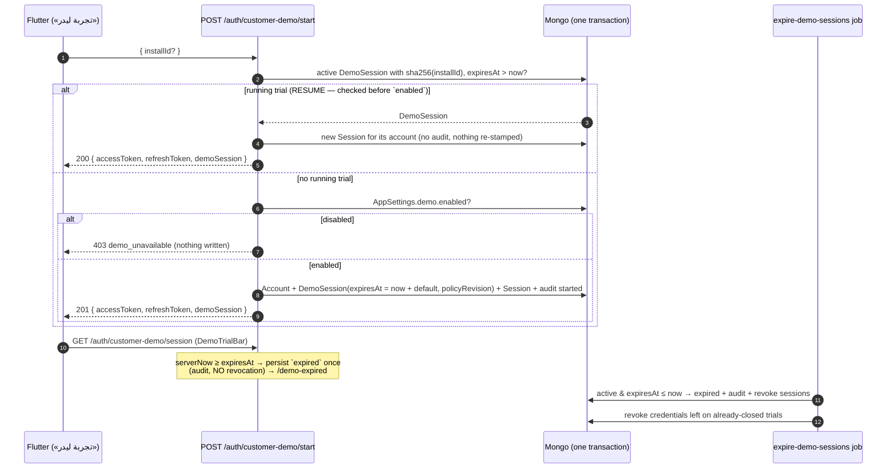

# Customer Demo

Two surfaces:

| Mount | Who | Flutter |
|---|---|---|
| `/api/v1/auth/customer-demo` | the public trial and its holder | the post-verification «تجربة ليدر» option, `DemoTrialBar`, `/demo-expired` |
| `/api/v1/platform/demo` | Super Admin (`platformGuard`) | `/platform/operations/demo` («إدارة الحسابات التجريبية») |

Product rules: `BACKEND-HANDOFF.md` §12 (+ §12.1 cleanup, §12.2 start/resume,
§12.3 audit, §12.4 authorization). Code: `routes/customerDemoRoutes.js`,
`routes/platform/demoRoutes.js`, `controllers/customerDemoController.js`,
`controllers/platform/demoController.js`, `services/demoService.js`,
job `jobs/definitions/02-expire-demo-sessions.js`.

A demo is an `Account { role: customer_demo, name: "زائر تجريبي", saasTenantId: null }`
plus one `DemoSession` plus one full `Session`. It **never** creates a
`SaasTenant`, Team Code, membership, account link or capability, and every
tenant (`403 tenant_context_unavailable`) and platform (`403 not_permitted`)
endpoint refuses it. `GET /auth/me` reads `role: customer_demo`,
`saasTenantId: null`, empty capabilities, `access.demoMode: active|expired` and
`access.sessionExpiresAt`.

## Resources

**DemoPolicy** (`AppSettings.demo`, integer **minutes**):

```json
{ "enabled": true, "defaultDurationMinutes": 1440, "maxDurationMinutes": 43200, "revision": 3,
  "updatedBy": { "accountId": "u_demo_platform", "displayName": "مدير منصة ليدر" }, "updatedAt": "2026-09-28T08:00:00.000Z" }
```

**DemoSession** — never a token, credential, device identifier or workspace content:

```json
{
  "demoSessionId": "demo_01J…", "accountId": "u_01J…", "demoWorkspaceId": "dws_01J…",
  "startedAt": "2026-09-28T09:00:00.000Z", "expiresAt": "2026-09-29T09:00:00.000Z",
  "status": "terminated", "policyRevision": 3, "displayName": "زائر تجريبي",
  "endedAt": "2026-09-28T10:00:00.000Z", "terminationReason": "user_ended"
}
```

- `status` ∈ `active | expired | terminated`, always **by server time** (a
  stored `active` past `expiresAt` reads — and is persisted, once — as `expired`).
- `terminationReason` ∈ `user_ended | super_admin_terminated | terminate_all`,
  only with `terminated` + `endedAt`. An expired session carries no reason.
- `expiresAt` and `policyRevision` are stamped **once** at creation.

## Start / resume / expiry



### `POST /auth/customer-demo/start` — public, `demoStartLimiter`

Body (optional): `{ "installId": "8–128 chars" }` — a client install id, stored
only as a sha256 resume key. No bearer, no Team Code, no role.

- **Resume**: same `installId` while its trial is active by server time → `200`,
  same `demoSessionId`, same `expiresAt`/`startedAt`/`policyRevision`, a new
  credential pair, **no** audit. Works even while the policy is disabled.
- **New**: `201 { accessToken, refreshToken, demoSession }`; audit
  `customer_demo_session_started` (actor `system`, target
  `{ type: "customer_demo_session", id }`).
- **Atomic**: account, demo session, session and audit are one transaction —
  a failure leaves no record (it is not a trial that ended early).

| Condition | Status | `code` |
|---|---|---|
| `installId` shorter than 8 / longer than 128 | 422 | `validation` |
| policy disabled and nothing to resume | 403 | `demo_unavailable` |
| start abuse (per IP, 20/hour) | 429 | `rate_limited` (+`Retry-After`) |

### `GET /auth/customer-demo/session` — demo bearer

→ `{ "demoSession": DemoSession, "serverNow": "…" }`. A non-demo session →
`403 not_permitted`. When the window has closed it persists `expired` once and
audits `customer_demo_session_expired` (system) but **does not** revoke the
credential (the job does), so the client can route to `/demo-expired`.

### `POST /auth/customer-demo/end` — demo bearer

The holder ends their own trial («إنهاء التجربة») → `200 { demoSession }` with
`status: terminated`, `terminationReason: user_ended`, `endedAt`; every session
of the demo account is revoked; audit `customer_demo_session_terminated` (actor `system`).

| Condition | Status | `code` |
|---|---|---|
| not a demo session | 403 | `not_permitted` |
| trial already expired/terminated (by server time) | 409 | `demo_session_not_active` |

Demo-authorized reads elsewhere (`POST /pricing/quote`, `POST /pricing/coupons/validate`)
answer `401 authentication_expired` once the trial is not active by server time.

## Platform — `/api/v1/platform/demo`

### `GET /policy` → DemoPolicy

### `PATCH /policy` (`Idempotency-Key` required)

`{ "enabled"?: bool, "defaultDurationMinutes"?: int, "expectedRevision": int }` → DemoPolicy.

- Minutes: integer, `≥ 60`, `≤ maxDurationMinutes` → else `422 validation`
  with `fields.defaultDurationMinutes`.
- `expectedRevision` ≠ current → `409 stale_demo_policy` (+`currentRevision`, `currentPolicy`).
- Unchanged values → `200`, **no** revision bump, no audit.
- A change bumps `revision`, stamps `updatedBy`/`updatedAt`, audits
  `customer_demo_policy_changed` with typed changes `demo_availability` (bool)
  and/or `demo_default_duration` (integer minutes).
- **Not retroactive**: existing sessions keep `expiresAt` and `policyRevision`.
  **Disabling terminates nothing** — eviction is the separate `terminate-all`.

### `GET /sessions?status&cursor&limit`

→ `{ items: [DemoSession], counts: { active, expired, terminated }, nextCursor }`.
Active rows first, **soonest `expiresAt` first**; then expired/terminated,
newest `startedAt` first. Overdue actives are settled to `expired` before reading.
`status` ∈ `active|expired|terminated`; `limit` 1–100 (default 50).

### `POST /sessions/:demoSessionId/terminate` (`Idempotency-Key` required)

→ `200 DemoSession` (`terminated`, `super_admin_terminated`); the account's
sessions are revoked; audit `customer_demo_session_terminated` (actor: the Super Admin).

| Condition | Status | `code` |
|---|---|---|
| unknown id | 404 | `demo_session_not_found` |
| not active by server time | 409 | `demo_session_not_active` |

### `POST /sessions/terminate-all` (`Idempotency-Key` required)

Every session active by server time → `terminated` / `terminate_all`, one
`customer_demo_session_terminated` audit **per session** → `{ "terminated": n }`.

### `POST /sessions/cleanup` (`Idempotency-Key` optional)

Deletes **only expired** operational rows → `{ "removed": n }`. Terminated rows
stay (an operator decided them). **Audit is never touched** (§12.1).

## Job — `expire-demo-sessions`

Active sessions past `expiresAt` → `expired` + `customer_demo_session_expired`
(system) + every session of the demo account revoked; then revokes credentials
still live on already-closed trials. Returns the affected count; idempotent.

## Audit

| Action | When | Actor |
|---|---|---|
| `customer_demo_policy_changed` | `enabled` / `defaultDurationMinutes` changed | platform administrator |
| `customer_demo_session_started` | a trial is **created** (never on resume) | system |
| `customer_demo_session_terminated` | ended early | system (`user_ended`) / platform administrator |
| `customer_demo_session_expired` | server time reached `expiresAt` | system |

Target `{ type: "customer_demo_session", id: demoSessionId, displayName: accountId }`.
No token, credential, device fingerprint or workspace content is ever logged.
