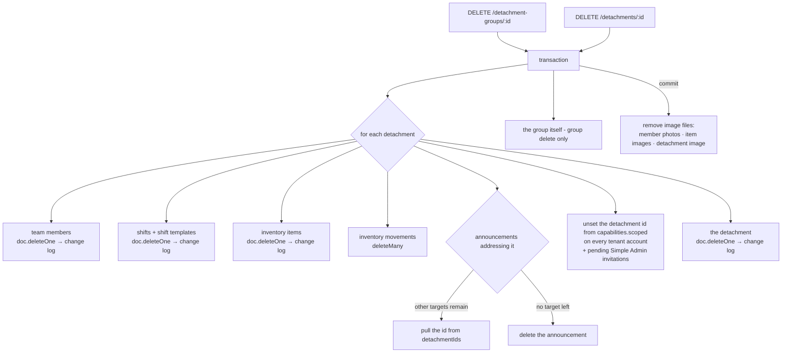

# Detachment groups & detachments — `/detachment-groups`, `/detachments`

The tenant's operational structure: **groups** (a local grouping inside one
tenant — a branch or operating area) and the **detachments** inside them (the
field units every scoped capability is anchored to). Also the detachment's
daily **stats** series, its **image**, and the detachment-scoped reads that
feed the detail tabs (roster, store, ledger).

Flutter: `DetachmentGroupRepository`, `DetachmentRepository`
(`/detachment-groups`, `/detachment-groups/:groupId`, `/detachment/:id` and its
tabs **team / shifts / storage / stats**).

Code: `routes/detachmentGroupRoutes.js`, `routes/detachmentRoutes.js`,
`controllers/tenant/{detachmentGroup,detachment}Controller.js`,
`services/{detachmentCascade,detachmentStatsService}.js` (+ shared
`rollups.js`, `serializers.js`), `validators/structureValidators.js`.
Tests: `tests/tenant-structure.test.js`.
Postman: folder **Tenant · Detachment groups & detachments** (`postman/modules/20-tenant-structure.js`).

> `/detachments/:detachmentId/shifts*` and `/shift-templates` are the shift
> module's (`routes/detachmentShiftRoutes.js`) and are documented there.

All errors use the shared envelope `{ "error": { "code", "message", "fields"?, …, "reference" } }`.

| Endpoint | Guard (after `tenantGuard`) | Success |
|---|---|---|
| `GET /detachment-groups?query=` | — (visible groups only) | `200 [DetachmentGroup]` |
| `GET /detachment-groups/:groupId` | visible | `200 DetachmentGroup` |
| `POST /detachment-groups` | `detachment.create` · limit `detachment_groups` | `201 DetachmentGroup` |
| `PUT /detachment-groups/:groupId` | `detachment.edit` | `200 DetachmentGroup` |
| `PATCH /detachment-groups/:groupId` | `detachment.edit` | `200 DetachmentGroup` |
| `DELETE /detachment-groups/:groupId` | `detachment.archive` | `204` (cascade) |
| `GET /detachments?detachmentGroupId=&filter=&query=` | — (visible detachments only) | `200 [Detachment]` |
| `POST /detachments` | `detachment.create` · limit `detachments` | `201 Detachment` |
| `GET /detachments/:detachmentId` | `detachment.view` in it | `200 Detachment` |
| `PUT /detachments/:detachmentId` | `detachment.edit` in it (+ `detachment.archive` to change `status`) | `200 Detachment` |
| `PATCH /detachments/:detachmentId` | idem | `200 Detachment` |
| `POST /detachments/:detachmentId/archive` | `detachment.archive` in it | `200 Detachment` |
| `POST /detachments/:detachmentId/restore` | `detachment.archive` in it · limit `detachments` | `200 Detachment` |
| `DELETE /detachments/:detachmentId` | `detachment.archive` in it | `204` (cascade) |
| `GET /detachments/:detachmentId/stats?days=7` | module `statistics_reports` · `stats.view` in it | `200 DetachmentStats` |
| `POST /detachments/:detachmentId/image` | `detachment.edit` in it (multipart `image`) | `200 Detachment` |
| `DELETE /detachments/:detachmentId/image` | `detachment.edit` in it | `200 Detachment` |
| `GET /detachments/:detachmentId/members?includeInactive=` | `member.view` in it | `200 [TeamMember]` — see [members.md](members.md) |
| `GET /detachments/:detachmentId/inventory-items` | module `inventory` · `detachment.view` | `200 [InventoryItem]` — see [inventory.md](inventory.md) |
| `GET /detachments/:detachmentId/inventory-movements?limit=` | module `inventory` · `detachment.view` | `200 [InventoryMovement]` — see [inventory.md](inventory.md) |

Every write accepts an optional `Idempotency-Key` (same key + same body →
the stored response is replayed with `Idempotent-Replayed: true`).

**Refusal order** (never collapsed): `401 authentication_expired` → … →
`403 tenant_context_unavailable` (platform/demo session) → `403
feature_disabled` → capability / existence → `422 validation` → `409
plan_limit_reached` / business conflicts → `409 stale_write`.
On `/detachments/:detachmentId…` the detachment is loaded **before** the
scoped capability check, so a detachment of another tenant is always `404
not_found`, never `403`. Group writes check their **global** capability first
(`403`), then load the group (`404`).

---

## 1. Visibility

`caps.visibleDetachmentIds(grant)`:

- `null` (global `detachment.view`, e.g. every Main Admin) → every detachment
  and every group of the tenant;
- otherwise the detachments in the grant's `scoped` map (any non-empty scoped
  entry implies `detachment.view` there). A **group** is visible when it holds
  at least one visible detachment.

A hidden group answers `404 not_found` on `GET /detachment-groups/:id`; a
hidden detachment of the caller's own tenant answers `403 not_permitted` on
`GET /detachments/:id` (the client renders it as a permission state).

## 2. Wire shapes

### DetachmentGroup

```json
{
  "id": "t_damascus",
  "name": "مجموعة دمشق",
  "notes": "المفارز العاملة داخل المدينة وريفها.",
  "createdAt": "2025-01-24T09:00:00.000Z",
  "status": "active",
  "version": 3,
  "detachmentCount": 2,
  "memberCount": 18,
  "coveragePercent": 84
}
```

### Detachment

```json
{
  "id": "d_dam_central",
  "detachmentGroupId": "t_damascus",
  "name": "مفرزة دمشق المركزية",
  "region": "دمشق",
  "mainCenter": "مركز الشعلان",
  "notes": "أعلى تغطية في الأسبوعين الماضيين.",
  "imageUrl": "http://localhost:4000/images/detachments/detachment-d_dam_central-01j….webp",
  "memberCount": 10,
  "weeklyShiftCount": 6,
  "coveragePercent": 92,
  "status": "active",
  "version": 1
}
```

`notes` and `imageUrl` are omitted when empty. `status` is `active | archived`.

### Roll-up formulas (computed on every read — `services/rollups.js`)

| Field | Definition |
|---|---|
| `Detachment.memberCount` | active team members of the detachment |
| `Detachment.weeklyShiftCount` | shifts **dated** in the current week (Saturday start, tenant timezone) |
| `Detachment.coveragePercent` | `round(Σ min(assigned, needed) / Σ needed × 100)` over this week's shifts, capped at 100; `0` when the week has none |
| `DetachmentGroup.detachmentCount` | detachments in the group, archived included |
| `DetachmentGroup.memberCount` | Σ `memberCount` of those detachments, archived included |
| `DetachmentGroup.coveragePercent` | rounded **mean** of `coveragePercent` over the group's **active** detachments; `0` when none |

Roll-ups are always the whole group's (a scoped caller sees the group's
totals, not a per-grant subset). Roll-up fields sent in a request body are
ignored.

---

## 3. Detachment groups

### List / get

```http
GET /api/v1/detachment-groups?query=دمشق
```

`query` (optional, ≤ 80) matches `name` or `notes` after Arabic search
folding (`أ/إ/آ → ا`, `ى → ي`, `ة → ه`, diacritics and tatweel removed,
Arabic-Indic digits → ASCII, case-insensitive). Sorted by creation.

### Create

```http
POST /api/v1/detachment-groups
Content-Type: application/json
Idempotency-Key: 01928c1e-…

{ "name": "مجموعة الساحل", "notes": "اللاذقية وطرطوس" }
```

`201` with every roll-up `0`. The name is trimmed and whitespace-collapsed;
uniqueness is on the lower-cased collapsed name inside the tenant.

### Update

`PUT` = the whole editable record: `{ id?, name, notes?, status?, version? }`.
An **absent `notes` clears it**; `status` absent = unchanged; `id`, when
sent, must equal the path id. `PATCH` = any subset of the same fields.

```http
PUT /api/v1/detachment-groups/t_coast
Content-Type: application/json

{ "id": "t_coast", "name": "مجموعة الساحل السوري", "notes": "ثلاث مفارز", "status": "active", "version": 2, "memberCount": 40 }
```

### Delete (cascade)

`DELETE /detachment-groups/:groupId` removes the group **and every detachment
in it (archived included) with their whole contents** (§5). The client
confirms once; the server asks nothing more.

| Refusal | When |
|---|---|
| `403 not_permitted` | missing the global capability (`detachment.create` / `.edit` / `.archive`) |
| `404 not_found` | unknown id, other tenant, or (GET) a group the caller cannot see |
| `409 conflict` | the name is used by another group of the tenant (`fields.name`) |
| `409 plan_limit_reached` | create beyond the plan's `detachment_groups` (`limitKey`, `limit`, `usage`) |
| `409 stale_write` | `version` sent and the group moved on (`currentVersion`, `currentRecord`) |
| `422 validation` | empty name, name > 80, notes > 500, unknown `status`, body `id` ≠ path id |

---

## 4. Detachments

### List

```http
GET /api/v1/detachments?detachmentGroupId=t_damascus&filter=active&query=مركز
```

All parameters optional. `filter` = `active | archived | all` (default all).
`query` matches name, region, mainCenter or notes (Arabic folding). Only
visible detachments are returned, sorted by creation.

### Create

```http
POST /api/v1/detachments
Content-Type: application/json

{ "detachmentGroupId": "t_damascus", "name": "مفرزة المزة", "region": "دمشق", "mainCenter": "مركز المزة", "notes": "جديدة" }
```

A detachment is always created inside a group: an unknown group is `422
validation` with `fields.detachmentGroupId`. `region` / `mainCenter` may be
empty strings.

### Update

`PUT` = `{ id?, detachmentGroupId?, name, region, mainCenter, notes?, status?, version? }`
— `region`/`mainCenter` default to `""`, an absent `notes` clears it,
`status` and `detachmentGroupId` absent = unchanged. `PATCH` = any subset.

- Changing `status` additionally needs `detachment.archive` in the detachment
  (`403 not_permitted`); `archived → active` also checks the `detachments` limit.
- Moving to another group (`detachmentGroupId`) requires that group to exist
  (`422 validation`, `fields.detachmentGroupId`).

### Archive / restore

`POST /detachments/:id/archive` and `/restore` (body optional: `{ "version": 4 }`)
are idempotent: archiving an archived detachment is `200` with no change.
`restore` is refused with `409 plan_limit_reached` when the plan's
`detachments` (non-archived) limit is already used.

### Image

```http
POST /api/v1/detachments/d_dam_central/image
Content-Type: multipart/form-data; boundary=…

image=<jpeg|png|webp|gif|heic, ≤ MAX_UPLOAD_MB>
```

The upload is re-encoded to WebP (1280×720 cover, EXIF stripped), counted in
the tenant's `storage_bytes`, and the previous file is deleted. `DELETE
/detachments/:id/image` clears it. Missing file / unreadable image → `422
validation` (`fields.image`); too large → `413 payload_too_large`; beyond the
storage allowance → `409 plan_limit_reached` (`limitKey: storage_bytes`).

| Refusal | When |
|---|---|
| `403 not_permitted` | capability missing in that detachment (or `detachment.create` globally for create) |
| `404 not_found` | unknown / other-tenant detachment |
| `409 plan_limit_reached` | create / restore / status→active beyond `detachments` |
| `409 stale_write` | stale `version` |
| `422 validation` | empty name, unknown group, unknown `filter`/`status`, body `id` ≠ path id |

---

## 5. Cascade delete

`DELETE /detachments/:id` (and a group delete, for each of its detachments)
runs in **one transaction** (`services/detachmentCascade.js`); image files are
removed from disk only after it commits.



Shift / workshop lines elsewhere that referenced a deleted member keep the id
and render as a missing member («عضو محذوف»).

---

## 6. Stats — `GET /detachments/:detachmentId/stats?days=7`

Module `statistics_reports` + `stats.view` in the detachment. `days` 7–90
(default 7). One integer per calendar day (tenant timezone), **oldest first,
ending today**. The Flutter `DetachmentStats` reads the three series; `days`,
`from`, `to` and `definitions` are additive.

```json
{
  "attendanceSeries": [88, 90, 75, 100, 0, 67, 92],
  "coverageSeries":   [100, 83, 75, 100, 0, 50, 100],
  "stockSeries":      [2, 0, 5, 1, 0, 0, 3],
  "days": ["2026-09-22", "2026-09-23", "2026-09-24", "2026-09-25", "2026-09-26", "2026-09-27", "2026-09-28"],
  "from": "2026-09-22",
  "to": "2026-09-28",
  "definitions": {
    "attendanceSeries": "% of resolved attendees (checkedIn+checkedOut) over (checkedIn+checkedOut+absent) for shifts dated that day; 0 when none resolved",
    "coverageSeries": "round(Σ min(assigned,needed) / Σ needed × 100) for shifts dated that day; 0 when none",
    "stockSeries": "inventory movements recorded that day (count, inflow+outflow)"
  }
}
```

| Series | Formula (per day) |
|---|---|
| `attendanceSeries` | `round((checkedIn + checkedOut) / (checkedIn + checkedOut + absent) × 100)` over attendees of shifts **dated** that day; `notCheckedIn` is excluded; `0` when nobody is resolved |
| `coverageSeries` | `round(Σ min(assigned, needed) / Σ needed × 100)` over shifts dated that day; `0` when there are none |
| `stockSeries` | number of inventory movements (inflows + outflows) whose `at` falls on that day in the tenant timezone; all zeros when the `inventory` module is disabled |

| Refusal | When |
|---|---|
| `403 feature_disabled` | `statistics_reports` off for the tenant (`feature`) |
| `404 not_found` | unknown / other-tenant detachment |
| `403 not_permitted` | no `stats.view` in the detachment |
| `422 validation` | `days` outside 7–90 |
