# Home, Notifications Center & Global Search — `/home`, `/notifications`, `/search`

Three read surfaces that **join** records other modules own — so a number on
the dashboard, a row in the Notifications Center or a search hit can never
disagree with the screen it opens.

Flutter: `HomeRepository` (`/home`, the Today dashboard),
`NotificationRepository` (`/notifications`, the Notifications Center), Global
Search (`/search`).

Code: `routes/{home,notification,search}Routes.js`,
`controllers/tenant/{home,notification,search}Controller.js`,
`services/{homeService,notificationFeedService}.js`,
`validators/structureValidators.js`.
Tests: `tests/tenant-home.test.js`, `tests/tenant-notifications.test.js`, `tests/tenant-search.test.js`.
Postman: folder **Tenant · Home, notifications & search** (`postman/modules/23-home-notifications-search.js`).

| Endpoint | Guard (after `tenantGuard`) | Success |
|---|---|---|
| `GET /home/summary?detachmentId=` | `detachment.view` in it | `200 HomeSummary` |
| `GET /home/overview` | — (visible active detachments) | `200 Overview` |
| `GET /notifications?detachmentId=` | `detachment.view` in it | `200 { notifications: [AppNotification] }` |
| `GET /notifications/unread-count?detachmentId=` | `detachment.view` in it | `200 { count }` |
| `PUT /notifications/read` | — (the caller's own state) | `200 { readIds }` |
| `PUT /notifications/cleared` | — | `200 { clearedIds }` |
| `GET /notifications/state` | — | `200 { readIds, clearedIds }` |
| `GET /search?q=&types=&limit=` | — (visible active detachments) | `200 { query, results }` |

`detachmentId`-scoped reads: missing → `422 validation`
(`fields.detachmentId`); not in the tenant → `404 not_found`; in the tenant
but not visible → `403 not_permitted`. The client renders each as its own
state instead of silently switching detachment. A platform or demo session →
`403 tenant_context_unavailable`.

---

## 1. `GET /home/summary?detachmentId=d_dam_central`

```json
{
  "detachmentId": "d_dam_central",
  "detachmentName": "مفرزة دمشق المركزية",
  "region": "دمشق",
  "mainCenter": "مركز الشعلان",
  "shifts": [ { "id": "sh_…", "date": "2026-09-27", "centerName": "مركز الشعلان", "startMinutes": 1200, "endMinutes": 120, "…": "Shift" } ],
  "rosterCount": 10,
  "storageStatus": "low",
  "lowStockCount": 3,
  "expiringSoonCount": 2,
  "inventoryAvailable": true,
  "announcements": [ { "id": "a_…", "text": "اجتماع المفرزة الساعة الثامنة مساءً", "detachmentIds": ["d_dam_central"], "placements": ["notifications", "home"], "publishedAt": "2026-09-28T09:40:00.000Z", "expiresAt": "2026-09-29T09:40:00.000Z", "status": "active", "authorName": "سلمى الحارثي", "version": 1 } ],
  "generatedAt": "2026-09-28T10:02:11.391Z"
}
```

| Field | Rule |
|---|---|
| `shifts` | every shift **dated** yesterday, today or tomorrow (tenant tz), the full `Shift` shape of the schedule endpoints, sorted by `startsAt`. Three days because "running now" / "next" are clock questions (a 20:00–02:00 shift dated yesterday is still running at 01:00). |
| `rosterCount` | active team members |
| `storageStatus` | worst wins: any item `level empty` → `depleted`; any `low` → `low`; any `expiresOn ≤ today + 30` (expired included) → `expiring`; otherwise `healthy`; no items, or module `inventory` off → `empty` |
| `lowStockCount` | items whose `level ≠ ok` (includes the empty ones) |
| `expiringSoonCount` | items with `expiresOn ≤ today + 30` (`EXPIRING_SOON_DAYS`, expired included) |
| `inventoryAvailable` | the `inventory` module flag (when `false` the three storage figures are `empty` / `0` / `0`) |
| `announcements` | module `announcements` on: announcements addressed to this detachment that are `active`, carry the `home` placement, were published **less than 1 hour ago** (and not in the future) and have not expired; newest first. `[]` when the module is off. |

Queued writes, failed sync runs and conflicts are **client-side** and never on
this payload.

## 2. `GET /home/overview`

Organisation-level aggregate over the caller's **visible, active** detachments.

```json
{
  "generatedAt": "2026-09-28T10:02:11.391Z",
  "totals": { "detachments": 4, "members": 38, "todayShifts": 6, "understaffedShifts": 2, "lowStockItems": 5, "expiringItems": 3 },
  "detachments": [
    { "id": "d_dam_central", "name": "مفرزة دمشق المركزية", "rosterCount": 10, "todayShifts": 2, "understaffedShifts": 1, "storageStatus": "low", "lowStockCount": 3 }
  ],
  "workshopsThisWeek": 2
}
```

- `todayShifts` — shifts dated today; `understaffedShifts` — of those, `assigned < needed`.
- `lowStockItems` / `expiringItems` — Σ of each detachment's `lowStockCount` / `expiringSoonCount` (0 with `inventory` off).
- `workshopsThisWeek` — present **only** with the `workshops` module: count of
  non-archived workshops whose `at` falls in the current Saturday-start week
  (tenant tz).

---

## 3. Notifications Center — `GET /notifications?detachmentId=`

```json
{
  "notifications": [
    { "id": "shiftUnderstaffed:sh_412", "kind": "shiftUnderstaffed", "occurredAt": "2026-09-28T12:00:00.000Z", "count": 2, "recordLabel": "مركز الميدان", "target": { "type": "shift", "detachmentId": "d_dam_central", "shiftId": "sh_412" }, "isRead": false },
    { "id": "stockLow:i2", "kind": "stockLow", "occurredAt": "2026-09-28T10:02:11.391Z", "count": 72, "recordLabel": "باراسيتامول ٥٠٠ ملغ", "target": { "type": "storage", "detachmentId": "d_dam_central", "itemId": "i2" }, "isRead": true },
    { "id": "announcement:a_77", "kind": "announcement", "occurredAt": "2026-09-28T09:40:00.000Z", "count": 0, "recordLabel": "اجتماع المفرزة الساعة الثامنة مساءً", "target": { "type": "announcement", "announcementId": "a_77" }, "isRead": true }
  ]
}
```

The feed is **derived on every read** (`services/notificationFeedService.js`),
never stored, and already filtered to what the caller may see. A row id is
`<kind>:<recordId>` — stable for as long as the condition holds, so read state
keyed by it survives the rebuild. Rows are sorted newest `occurredAt` first
(the client regroups by day anyway). "now" is **server** time.

### Derivation

```mermaid
flowchart TD
    R[GET /notifications?detachmentId] --> L{detachment in tenant?}
    L -->|no| E404[404 not_found]
    L -->|yes| V{detachment.view?}
    V -->|no| E403[403 not_permitted]
    V -->|yes| SH[shifts dated yesterday..tomorrow]
    V -->|yes| ST{module inventory on<br/>and prefs.stockAlerts?}
    V -->|yes| AN{module announcements on?}
    SH --> U{endsAt > now<br/>and assigned < needed?}
    U -->|yes, shift.assign or shift.manage| RU[shiftUnderstaffed<br/>count = needed − assigned<br/>occurredAt = startsAt]
    SH --> M{endsAt ≤ now < endsAt + grace<br/>and notCheckedIn > 0?}
    M -->|yes, shift.attendance.record / .override| RM[shiftAttendanceMissing<br/>count = notCheckedIn<br/>occurredAt = endsAt]
    SH --> S{0 ≤ startsAt − now ≤ 6 h?}
    S -->|yes, prefs.shiftReminders ≠ false| RS[shiftStartingSoon<br/>count 0, occurredAt = startsAt]
    ST -->|yes| W{per item, worst wins}
    W -->|level empty| RD[stockDepleted, count 0]
    W -->|level low| RL[stockLow, count = currentStock]
    W -->|expiresOn ≤ today+30| RE[stockExpiring<br/>count = days left, may be negative<br/>occurredAt = expiresOn 00:00 tenant tz]
    AN -->|yes| A[every announcement addressed here,<br/>any status, publishedAt ≤ now]
    A -->|id not in clearedIds| RA[announcement, isRead true]
    RU & RM & RS & RD & RL & RE --> RD2[isRead = id ∈ readIds]
```



| Kind | Condition | `count` | `occurredAt` | Target | Needs (in the detachment) |
|---|---|---|---|---|---|
| `shiftUnderstaffed` | `endsAt > now` and `assigned < needed` | `needed − assigned` | `startsAt` | `{type:"shift", detachmentId, shiftId}` | `shift.assign` or `shift.manage` |
| `shiftAttendanceMissing` | `endsAt ≤ now < endsAt + attendanceGraceMinutes` and attendees still `notCheckedIn` > 0 | that number | `endsAt` | shift | `shift.attendance.record` (or `.override`) |
| `shiftStartingSoon` | `0 ≤ startsAt − now ≤ 6 h` | 0 | `startsAt` | shift | `detachment.view`; dropped when `notificationPrefs.shiftReminders = false` |
| `stockDepleted` | item `level empty` | 0 | now | `{type:"storage", detachmentId, itemId}` | `detachment.view`; module `inventory`; `notificationPrefs.stockAlerts ≠ false` |
| `stockLow` | item `level low` | `currentStock` | now | storage | idem |
| `stockExpiring` | otherwise, `expiresOn ≤ today + 30` (expired included) | days left (negative once expired) | `expiresOn` 00:00 tenant tz | storage | idem |
| `announcement` | addressed to the detachment, any status, published | 0 | `publishedAt` | `{type:"announcement", announcementId}` | `detachment.view`; module `announcements`; not in the caller's cleared set |

- Stock is **one row per item** — an empty item that is also expiring is a
  `stockDepleted` row only.
- `recordLabel` is a real name from the record: the shift's `centerName`, the
  item name, or the announcement text.
- `attendanceGraceMinutes` is the platform setting (default 60).
- Announcements carry **no read state**: always `isRead: true`, never counted
  as unread; they can only be **cleared** (history hidden per account).

### Read / cleared state

Per ACCOUNT (`NotificationState`), not per detachment.

```http
PUT /api/v1/notifications/read
Content-Type: application/json

{ "ids": ["shiftUnderstaffed:sh_412", "syncConflict:op_19"] }
```

→ `200 { "readIds": [ … the caller's complete set … ] }`.

- `ids`: 1–500 strings (≤ 200 chars each). Idempotent — an id already read is
  not an error. **Unknown ids are stored, never rejected** (the client keeps
  its own `syncConflict:` / `syncFailed:` rows in the same set).
- The stored set is ordered oldest → newest, de-duplicated (a re-sent id moves
  to the newest end) and capped at the **5000 newest** ids. The update is
  atomic, so concurrent calls never lose ids.

`PUT /notifications/cleared` `{ ids }` → `{ clearedIds }` — same rules, for
announcement history (`announcement:<id>`). `GET /notifications/state` →
`{ readIds, clearedIds }`.

`GET /notifications/unread-count?detachmentId=` → `{ "count": 3 }` — rows of
that detachment's feed whose kind is not `announcement` and that are not read.

| Refusal | When |
|---|---|
| `422 validation` | missing `detachmentId`; `ids` missing, empty, > 500, not strings |
| `404 not_found` / `403 not_permitted` | as for Home |

---

## 4. Global Search — `GET /search?q=شاش&types=member,item&limit=20`

```json
{
  "query": "شاش",
  "results": [
    { "type": "item", "id": "i3", "title": "شاش طبي ١٠سم", "subtitle": "32 رول · مفرزة دمشق المركزية", "detachmentId": "d_dam_central", "target": { "type": "storage", "detachmentId": "d_dam_central", "itemId": "i3" } },
    { "type": "member", "id": "m1", "title": "أحمد كنعان", "subtitle": "الإسعاف · مفرزة دمشق المركزية", "detachmentId": "d_dam_central", "target": { "type": "member", "detachmentId": "d_dam_central", "memberId": "m1" } }
  ]
}
```

| Param | Rule |
|---|---|
| `q` | required, 1–80 chars, must keep at least one character after folding |
| `types` | optional comma list of `member, detachment, shift, item` (default all) |
| `limit` | 1–50, default 20 (applied after ranking) |

Corpus — only the caller's **visible, ACTIVE** detachments:

| Type | Matches | Scope | Target |
|---|---|---|---|
| `member` | name · department · personalNumber (active members) | `member.view` in the member's detachment | `{type:"member", detachmentId, memberId}` |
| `detachment` | name · region · mainCenter | visible | `{type:"detachment", detachmentId}` |
| `shift` | centerName, shifts dated weekStart − 7 d … weekStart + 20 d (Saturday week, tenant tz) | `detachment.view` | `{type:"shift", detachmentId, shiftId}` |
| `item` | name · unit | module `inventory` on | `{type:"storage", detachmentId, itemId}` |

Matching folds **both sides** with `utils/normalize.searchFold` (the Dart
`memberSearchKey` twin): hamza/alef variants → `ا`, `ى → ي`, `ؤ → و`, `ئ → ي`,
`ة → ه`, harakat and tatweel removed, Arabic-Indic digits → ASCII, Latin
lower-cased — so «احمد» finds «أحمد». Ranking: exact title → title prefix →
title contains → secondary field; ties by type order (member, detachment,
shift, item), then title.

| Refusal | When |
|---|---|
| `422 validation` | `q` missing/empty/> 80/nothing searchable, unknown type (`fields.types`), `limit` outside 1–50 |
