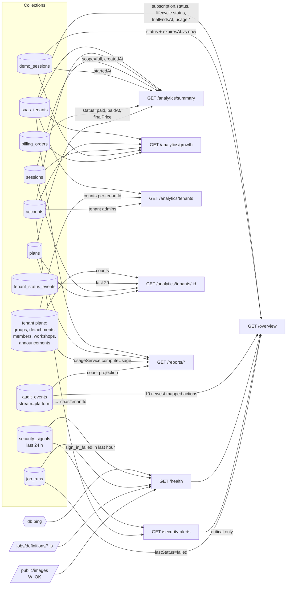

# Platform insights — Overview, Health, Security, Audit, Reports, Analytics, Jobs

Super Admin (`super_admin`) control-plane reads that feed the Platform
dashboard, all under `/api/v1/platform`:

| Screen | Endpoint(s) |
|---|---|
| Overview cards | `GET /platform/overview` |
| Health page | `GET /platform/health` |
| Security page | `GET /platform/security-alerts` |
| Audit log | `GET /platform/audit`, `GET /platform/audit/:eventId` |
| Reports catalogue | `GET /platform/reports/{subscriptions,usage-limits,feature-availability,platform-activity}` |
| Analytics charts | `GET /platform/analytics/{summary,growth,tenants,tenants/:tenantId}` |
| Operations → jobs | `GET /platform/jobs`, `POST /platform/jobs/run`, `POST /platform/jobs/:name/run` |

Contract sources: `API_CONTRACT.md` → `GET /platform/overview`, "Platform
Health and Security reads — Point 10", "Platform Audit Log read — Point 11",
"Platform Reports — Point 13A". Code: `routes/platform/{insights,audit,reports,analytics,jobs}Routes.js`,
`services/{platformInsightsService,reportService,platformAnalyticsService}.js`,
`validators/platformInsightsValidators.js`, `jobs/definitions/01-expire-invitations.js`.

## Common rules

- **Authorization.** Every route runs `platformGuard` (session → MFA → account
  lifecycle → `super_admin`). A tenant session gets `403 not_permitted`, no
  bearer gets `401 authentication_expired`. `/platform/overview`,
  `/platform/health` and `/platform/security-alerts` attach the guard per
  route, so an unknown `/platform/*` path still answers `404 not_found`.
- **Read-only.** Nothing here writes, except the two job-run commands.
  Opening a page never creates an audit event.
- **Privacy.** Responses carry platform facts and counts only: never a tenant's
  member names, attendance, stock or medical data, a Team Code, an email, a
  token, an IP or a raw exception string. Tenant references are
  `{ id, displayName }` (plus `isDeleted` where the contract asks for it).
- **Time.** Every instant is RFC 3339 UTC (`…Z`). Query instants may carry any
  offset; an instant sent **without** an offset is read as UTC (the control
  plane has no tenant timezone). Ranges are half-open `[from, before)`.
- **Bodies are bare** (no `{status, data}` wrapper). Errors use the standard
  envelope `{ "error": { "code", "message", "fields"?, "reference" } }`.

## Where the numbers come from



---

## GET /platform/overview

Decision-first overview: KPI cards, health strip, "needs attention" list,
recent activity and storage usage.

```json
{
  "generatedAt": "2026-09-28T10:00:00.000Z",
  "tenants": { "total": 8, "activeSubscriptions": 4, "activeTrials": 2, "gracePeriod": 1, "suspended": 1, "deletionPending": 1 },
  "demos": { "active": 2, "simple": 2, "full": 0, "expiringSoon": 1 },
  "health": [
    { "id": "identity", "label": "الهوية وتسجيل الدخول", "status": "healthy", "summary": "تسجيل الدخول يعمل بشكل طبيعي", "observedAt": "2026-09-28T10:00:00.000Z" },
    { "id": "background_jobs", "label": "المهام الخلفية", "status": "healthy", "summary": "المهام الخلفية تعمل في مواعيدها", "observedAt": "2026-09-28T09:59:30.000Z" },
    { "id": "files", "label": "الملفات", "status": "healthy", "summary": "رفع الصور وعرضها يعمل بشكل طبيعي", "observedAt": "2026-09-28T10:00:00.000Z" }
  ],
  "attention": [
    { "id": "attention_deletion_saas_rukn", "severity": "warning", "category": "tenant_lifecycle", "title": "فريق بانتظار الحذف النهائي", "description": "«فريق الركن الطبي» مجدول للحذف النهائي.", "occurredAt": "2026-09-27T08:00:00.000Z", "target": "tenants", "tenantId": "saas_rukn", "scheduledFor": "2026-10-27T08:00:00.000Z" },
    { "id": "attention_grace", "severity": "warning", "category": "subscription", "title": "اشتراك واحد في فترة السماح", "description": "يحتاج إلى متابعة قبل انتهاء فترة السماح.", "occurredAt": "2026-09-28T10:00:00.000Z", "target": "tenants" },
    { "id": "attention_trials_ending", "severity": "info", "category": "trial", "title": "فترة تجربة تنتهي قريبًا", "description": "عدد فترات التجربة التي تنتهي خلال 3 أيام: 1.", "occurredAt": "2026-09-28T10:00:00.000Z", "target": "tenants" }
  ],
  "recentActivity": [
    { "id": "audit_01J…", "type": "demo_started", "title": "بدأت تجربة عميل جديدة", "description": "تجربة بسيطة", "occurredAt": "2026-09-28T09:52:00.000Z" },
    { "id": "audit_01J…", "type": "tenant_created", "title": "تسجيل فريق جديد", "description": "«فرق الهلال الطبية»", "occurredAt": "2026-09-27T12:00:00.000Z" }
  ],
  "usage": { "storageUsedBytes": 19327352832, "storageAllowanceBytes": 107374182400 }
}
```

### Metric definitions

| Field | Definition |
|---|---|
| `tenants.total` | SaasTenant docs with `lifecycle.status ≠ deleted`. |
| `tenants.activeSubscriptions` / `activeTrials` / `gracePeriod` | Non-deleted tenants with `subscription.status` = `active` / `trial` / `grace`. Commercial axis only: a suspended tenant still counts in its commercial bucket. `inactive` has no card, so these may total less than `total`. |
| `tenants.suspended` / `deletionPending` | Non-deleted tenants with `lifecycle.status` = `suspended` / `deletion_pending`. Lifecycle axis, orthogonal to the three above. |
| `demos.active` | DemoSession with stored `status = active` **and** `expiresAt > now` (server time). A stored `active` past expiry is not counted. |
| `demos.simple` / `demos.full` | `simple = active`, `full = 0` (Point 18B: no demo kinds exist yet — CLAUDE-PROVISIONAL). |
| `demos.expiringSoon` | Active demos with `expiresAt ≤ now + 24 h`. |
| `health` | The three signals of `GET /platform/health`. |
| `usage.storageUsedBytes` | Σ `usage.storageUsedBytes` of non-deleted tenants. |
| `usage.storageAllowanceBytes` | Σ of the non-null `usage.storageAllowanceBytes` of non-deleted tenants (0 when none is set). |
| `usage` | Omitted entirely when there is no non-deleted tenant. |

### `attention` items (most severe first, then newest)

| Condition | id | severity | category | target | extras |
|---|---|---|---|---|---|
| Each tenant in `deletion_pending` | `attention_deletion_<tenantId>` | warning | `tenant_lifecycle` | `tenants` | `tenantId`, `scheduledFor` (from `lifecycle.deletion.scheduledFor`); `occurredAt` = deletion `requestedAt` |
| ≥ 1 tenant in commercial `grace` | `attention_grace` | warning | `subscription` | `tenants` | title carries the count («اشتراك واحد…», «اشتراكان…», «3 اشتراكات…») |
| ≥ 1 `trial` tenant whose `trialEndsAt` is in `(now, now + 3 days]` | `attention_trials_ending` | info | `trial` | `tenants` | count in the description |
| Each **critical** security alert | `attention_<alertId>` | critical | `security` | `security` | `occurredAt` = alert `detectedAt` |
| Each health signal `degraded` / `unavailable` | `attention_health_<signalId>` | warning / critical | `health` | `health` | `occurredAt` = signal `observedAt` |
| Each defined job whose last run failed | `attention_job_<name>` | warning | `background_job` | `operations` | the raw error text is never included |

### `recentActivity`

The 10 newest **platform-stream** AuditEvents whose action maps to an activity
type (newest first; unmapped actions are skipped, not counted):

| Audit action | `type` | title |
|---|---|---|
| `tenant_registered` | `tenant_created` | تسجيل فريق جديد |
| `subscription_activated`, `subscription_moved_to_grace`, `plan_changed`, `trial_extended`, `trial_ended` | `subscription_changed` | per action |
| `customer_demo_session_started` | `demo_started` | بدأت تجربة عميل جديدة |
| `customer_demo_session_expired` | `demo_expired` | انتهت تجربة عميل |

`description` is the tenant display-name snapshot in «…» when the event has one.

---

## GET /platform/health

```json
{
  "generatedAt": "2026-09-28T10:00:00.000Z",
  "isPartial": false,
  "signals": [
    { "id": "identity", "label": "الهوية وتسجيل الدخول", "status": "healthy", "summary": "تسجيل الدخول يعمل بشكل طبيعي", "observedAt": "2026-09-28T10:00:00.000Z" },
    { "id": "background_jobs", "label": "المهام الخلفية", "status": "degraded", "summary": "تأخّر تشغيل بعض المهام الخلفية عن موعده", "observedAt": "2026-09-28T09:40:00.000Z" },
    { "id": "files", "label": "الملفات", "status": "healthy", "summary": "رفع الصور وعرضها يعمل بشكل طبيعي", "observedAt": "2026-09-28T10:00:00.000Z" }
  ]
}
```

Exactly three signals, always in this order; `isPartial` is always `false`.

| Signal | Rule (evaluated top-down) |
|---|---|
| `identity` | DB `ping` fails → `unavailable`. > 50 `sign_in_failed` SecuritySignals in the last hour → `degraded`. Else `healthy`. `observedAt` = now. |
| `background_jobs` | Considers JobRun docs whose name is a **currently defined** job (`jobs/index.loadDefinitions()`). None → `unknown` (never "healthy"). Any `lastStatus = failed` → `degraded`. Any `lastRunAt` older than `3 × JOBS_INTERVAL_SECONDS` → `degraded`. Else `healthy`. `observedAt` = newest `lastRunAt`. |
| `files` | `fs.access(public/images, W_OK)` succeeds → `healthy`, else `unavailable`. |

No topology, host metrics or raw telemetry is exposed.

---

## GET /platform/security-alerts

Computed current-awareness snapshot over **SecuritySignal in the last 24 h**.
Not audit, no history, no acknowledgement.

```json
{
  "generatedAt": "2026-09-28T10:00:00.000Z",
  "alerts": [
    {
      "id": "security_refresh_replay_3f9a1c2b",
      "severity": "critical",
      "category": "authentication",
      "title": "إعادة استخدام رمز جلسة سابق",
      "description": "رُصدت محاولة لإعادة استخدام رمز تحديث مستهلك، فأُنهيت الجلسة المرتبطة احترازيًا. عدد الإشارات خلال آخر 24 ساعة: 1.",
      "detectedAt": "2026-09-28T09:41:00.000Z",
      "affectedTenant": { "id": "saas_hilal", "displayName": "فرق الهلال الطبية", "isDeleted": false }
    }
  ]
}
```

| Rule (last 24 h) | id | severity |
|---|---|---|
| Any `refresh_replay`, one alert per accountId | `security_refresh_replay_<sha256(accountId)[0..8]>` | critical |
| ≥ 5 `sign_in_failed` for one `emailHash` | `security_repeated_sign_in_<emailHash[0..8]>` | warning |
| ≥ 10 `team_link_failed` for one accountId | `security_team_link_<sha256(accountId)[0..8]>` | warning |
| ≥ 5 `mfa_failed` for one accountId | `security_mfa_<sha256(accountId)[0..8]>` | warning |
| ≥ 20 `sign_in_failed` platform-wide | `security_sign_in_failures_24h` | info |

- `category` is always `authentication`; order: severity desc, then
  `detectedAt` (the newest signal of the group) desc.
- `affectedTenant` appears when the signals carry a `tenantId`, or an
  `accountId` whose account has a `saasTenantId`, **and** that tenant is not
  deleted. Never on the platform-wide info alert.
- Titles/descriptions carry counts only: never the email, the hash, an account
  id, an IP or a token. The short hash appears only inside the opaque `id`.
- An empty list means "no current alert", not "secure".

---

## GET /platform/audit

The immutable platform audit stream (`stream = platform`; tenant-stream events
never appear).

| Query | Meaning |
|---|---|
| `from` | Inclusive instant. |
| `before` | Exclusive instant. `from ≥ before` → `422 validation` (`fields.before`). |
| `actorKind`, `actorId` | Exact `actor.kind` / `actor.id`. |
| `action`, `category` | Exact action / derived category. |
| `tenantId` | Exact `tenant.id`. |
| `targetType` | Exact `target.type`. |
| `search` | Case-insensitive literal substring (regex-escaped) over event `id`, `actor.displayName`, `target.id`, `target.displayName`, `tenant.id`, `tenant.displayName`. Never change bodies. |
| `cursor` | Opaque; an empty value means page one. Malformed → `422 validation` (`fields.cursor`). |
| `limit` | 1–100, default 50 (else `422 validation`). |

Filters apply **before** paging. Order is total and stable: `occurredAt` desc,
then `id` desc. The cursor encodes the last row's `{at, id}`.

```json
{
  "items": [
    {
      "id": "audit_01J…",
      "occurredAt": "2026-09-10T15:30:00.000Z",
      "actor": { "kind": "platform_administrator", "id": "u_demo_platform", "displayName": "مدير منصة ليدر" },
      "action": "feature_flag_changed",
      "category": "entitlement",
      "target": { "type": "tenant_feature", "id": "inventory", "displayName": "Inventory" },
      "tenant": { "id": "saas_hilal", "displayName": "فرق الهلال الطبية", "isDeleted": false },
      "changes": [{ "field": "feature_enabled", "before": { "kind": "bool", "value": true }, "after": { "kind": "bool", "value": false } }]
    }
  ],
  "nextCursor": "eyJ2IjoxLCJhdCI6…"
}
```

`nextCursor` is `null` on the last page. `target`/`tenant` are omitted when
the event has none.

## GET /platform/audit/:eventId

One platform-stream event (same JSON as a list item). Unknown id or a
tenant-stream id → `404 not_found`.

---

## Reports — GET /platform/reports/*

Implements `API_CONTRACT.md → Platform Reports — Point 13A` exactly.

### Envelope (three snapshot reports)

```json
{
  "type": "subscriptions",
  "generatedAt": "2026-09-28T10:00:00.000Z",
  "snapshotId": "rpt_01J…",
  "summary": { },
  "rows": { "items": [ ], "nextCursor": "eyJ2IjoxLCJzIjoi…" }
}
```

- `type` is `subscriptions` | `usage_limits` | `feature_availability`.
- **Snapshot-bound cursors.** Page one computes the full filtered row set and,
  when it spans more than one page, stores it (rows, order and summary) in an
  in-process LRU: at most **8** snapshots, **3 h** TTL. The cursor is
  `{s: snapshotId, o: offset}`. Pages 2…n are served from that snapshot, so
  they never mix with fresher data. A cursor whose snapshot was evicted or
  expired → **`409 report_cursor_expired`** (reload page one). A cursor from
  another report, or sent with different filters → `422 validation`.
  Snapshots live in one API process; behind several instances, pin report
  reads or accept an occasional `report_cursor_expired`.
- `summary` covers the **entire filtered set**, never a page.
- **Deleted tenants are never rows or buckets**; `lifecycle=deleted` is a
  validation error.
- Rows carry `tenant: {id, displayName}` plus the report's typed fields only.

### Shared query parameters (closed — any unknown parameter → `422 validation`)

| Param | Values |
|---|---|
| `lifecycle` | comma list of `active`, `suspended`, `deletion_pending` (default all three) |
| `planId` / `noPlan=true` | one plan, or tenants without a plan (mutually exclusive → `422`) |
| `cursor` | opaque |
| `limit` | 1–100, default 50 |

A tenant whose `planId` names no Plan document is treated as **no plan**
(consistent with `usageService`: no plan → no limits).

### GET /platform/reports/subscriptions

Extra params: `status` (comma list of `trial`, `active`, `grace`, `inactive`),
`dueBefore` (instant; keeps rows with `relevantDate < dueBefore`, overdue
included; rows without a date never match).

```json
"summary": {
  "tenantCount": 6,
  "byStatus":    [{"key":"active","count":2},{"key":"trial","count":2},{"key":"grace","count":1},{"key":"inactive","count":1}],
  "byLifecycle": [{"key":"active","count":4},{"key":"suspended","count":1},{"key":"deletion_pending","count":1}],
  "byPlan":      [{"plan":{"id":"mtm_core","name":"ليدر الأساسية"},"count":2},{"plan":null,"count":1}]
},
"rows": {"items": [{"tenant":{"id":"saas_hilal","displayName":"فرق الهلال الطبية"},"lifecycle":"active","subscriptionStatus":"trial","plan":null,"relevantDate":"2026-10-05T00:00:00.000Z"}], "nextCursor": null}
```

- `relevantDate`: trial → `trialEndsAt`; active → `renewsAt`; grace →
  `graceEndsAt`; inactive → `null`. Stored server values only.
- `byStatus` (all four keys), `byLifecycle` (all three) and `byPlan` each sum to
  `tenantCount`. `byPlan` lists plans with ≥ 1 tenant, count desc then plan id
  asc, then one `plan: null` bucket (only when > 0).
- Row order: `relevantDate` asc, no date last, then `tenant.id` asc.

### GET /platform/reports/usage-limits

Extra params: `limitKey` (`detachment_groups`, `detachments`, `admins`,
`members`, `workshops`, `storage_bytes` — **ranks**, does not filter), `band`
(comma list of `within_limit`, `at_limit`, `over_limit`, `no_limit`, matched
against `limitKey`'s band, else the row's most severe band).

```json
"summary": { "tenantCount": 6, "byKey": [{"key":"members","bands":[{"key":"within_limit","count":4},{"key":"at_limit","count":0},{"key":"over_limit","count":1},{"key":"no_limit","count":1}]}] },
"rows": {"items": [{"tenant":{"id":"saas_rukn","displayName":"فريق الركن الطبي"},"lifecycle":"active","plan":{"id":"mtm_core","name":"ليدر الأساسية"},"cells":[{"key":"members","usage":118,"limit":100,"overridden":true}]}]}
```

- `usage` = `usageService.computeUsage(tenant)[key]` (the same numbers plan
  enforcement uses): groups; non-archived detachments; tenant admin accounts
  (`main_admin` + `admin`, not revoked — a real count); active members;
  non-archived workshops; `usage.storageUsedBytes`.
- `limit` = effective `override ?? plan default`; `overridden` says which. No
  plan → every `limit` is `null`, every band `no_limit`, `overridden` false.
- Bands: usage > limit `over_limit`; = `at_limit`; < `within_limit`. No
  "near limit" threshold exists.
- Every row carries all six keys; `byKey` covers all six and each sums to
  `tenantCount`.
- Row order: band severity desc (over, at, within, none), ratio desc
  (`usage/limit`; a zero limit is 1 at zero usage, ∞ above), `tenant.id` asc.

### GET /platform/reports/feature-availability

Extra params: `featureKey` (`inventory`, `statistics_reports`, `workshops`,
`announcements`), `state` (`enabled` / `disabled`; **requires** `featureKey`).

```json
"summary": { "tenantCount": 6, "byFeature": [{"key":"workshops","states":[{"key":"enabled","count":5},{"key":"disabled","count":0},{"key":"unsupported","count":1}]}] },
"rows": {"items": [{"tenant":{"id":"saas_hilal","displayName":"فرق الهلال الطبية"},"lifecycle":"active","features":[{"key":"inventory","state":"enabled"}]}]}
```

- Reports the Feature Flag only (not capabilities, limits or module usage).
- A missing/unreadable flag row is `unsupported` (its own bucket, only listed
  when > 0), never `disabled`. Each `byFeature` sums to `tenantCount`.
- Row order: display name in Arabic collation (`Intl.Collator('ar')`), then
  `tenant.id` asc.

### GET /platform/reports/platform-activity

Params: `from` (inclusive), `before` (exclusive), `category`
(`tenant_management`, `subscription`, `entitlement`, `lifecycle`,
`emergency_access`, `account_management`, `customer_demo`). No cursor/limit
(sending one → `422 validation`).

```json
{
  "type": "platform_activity",
  "generatedAt": "2026-09-28T10:00:00.000Z",
  "snapshotId": "rpt_01J…",
  "range": { "from": "2026-08-29T10:00:00.000Z", "before": "2026-09-28T10:00:00.000Z" },
  "evidenceAvailableFrom": null,
  "byAction": [{ "key": "tenant_registered", "count": 1 }, { "key": "break_glass_activated", "count": 0 }]
}
```

- Counts platform-stream AuditEvents with `from ≤ occurredAt < before` — the
  exact filter of `GET /platform/audit?from&before&action`, so the two agree.
- `byAction`: every catalogue action (`auditService.ACTION_CATEGORY`) of the
  seven categories above (or of the one `category`), zeros included, in
  catalogue order; then any other action actually seen in the range, sorted.
- Default range: `[now − 30 days, now)`; `before` alone → `from = before − 30
  days`. `range` echoes the resolved bounds.
- `from ≥ before` → `422 validation`; span > 367 × 24 h → **`422
  report_range_too_large`**.
- `evidenceAvailableFrom` is `null` (no audit retention cut-off exists yet).

### Report errors

| Code | Status | When |
|---|---|---|
| `validation` | 422 | unknown/bad parameter, `planId`+`noPlan`, `state` without `featureKey`, malformed or foreign cursor, `from ≥ before` |
| `report_cursor_expired` | 409 | the cursor's snapshot is gone (LRU eviction, 3 h TTL, restart) |
| `report_range_too_large` | 422 | platform-activity span > 367 days |
| `not_permitted` | 403 | not a Super Admin |

---

## Analytics — GET /platform/analytics/*

Dashboard charts. Range params on `summary`, `growth` and `tenants/:tenantId`:
`period` = `7d | 30d | 90d | 365d` (default `30d`) **or** explicit `from` /
`before` (explicit bounds win; `before` defaults to now; `from ≥ before` →
`422 validation`).

### GET /platform/analytics/summary

```json
{
  "range": { "from": "2026-08-29T10:00:00.000Z", "before": "2026-09-28T10:00:00.000Z" },
  "kpis": {
    "tenants": { "total": 8, "newInRange": 2, "active": 5 },
    "subscriptions": { "trial": 2, "active": 4, "grace": 1, "inactive": 1 },
    "accounts": { "total": 14, "tenantAdmins": 11, "superAdmins": 1, "newInRange": 3 },
    "signIns": 57,
    "demos": { "startedInRange": 6, "active": 2 },
    "revenue": { "amount": 1400, "currency": "USD" },
    "storageUsedBytes": 19327352832
  },
  "distributions": {
    "lifecycle": [{ "key": "active", "count": 6 }, { "key": "suspended", "count": 1 }, { "key": "deletion_pending", "count": 1 }],
    "subscriptionStatus": [{ "key": "trial", "count": 2 }, { "key": "active", "count": 4 }, { "key": "grace", "count": 1 }, { "key": "inactive", "count": 1 }],
    "plans": [{ "planId": "mtm_core", "name": "ليدر الأساسية", "count": 3 }, { "planId": null, "name": null, "count": 1 }],
    "features": [{ "key": "inventory", "enabled": 7, "disabled": 1 }]
  },
  "generatedAt": "2026-09-28T10:00:00.000Z"
}
```

| KPI | Definition |
|---|---|
| `tenants.total` | Non-deleted tenants. |
| `tenants.newInRange` | SaasTenant docs with `createdAt` in range, **any** lifecycle (a tenant created then deleted in the range was still created). |
| `tenants.active` | Non-deleted tenants whose `usage.lastActivityAt` (bumped at most every 5 min by tenant-plane requests) is in range. |
| `subscriptions.*` | Non-deleted tenants per `subscription.status` (current state, not in-range). |
| `accounts.total` | Accounts whose role is not `customer_demo` (includes not-yet-linked identities, any status). |
| `accounts.tenantAdmins` | `main_admin` + `admin` accounts, status ≠ `revoked` (the `admins` usage definition). |
| `accounts.superAdmins` | `super_admin` accounts, status ≠ `revoked`. |
| `accounts.newInRange` | Non-demo accounts with `createdAt` in range. |
| `signIns` | Sessions with `scope = full` created in range (each successful full sign-in or refresh-family start; onboarding sessions excluded). |
| `demos.startedInRange` | DemoSession `startedAt` in range. |
| `demos.active` | Stored `active` and `expiresAt > now`. |
| `revenue` | Σ `finalPrice.amount` of BillingOrders `status = paid`, `paidAt` in range, currency USD (integer minor units). |
| `storageUsedBytes` | Σ `usage.storageUsedBytes`, non-deleted tenants. |
| `distributions.lifecycle` | Non-deleted tenants per lifecycle (3 keys; sums to `tenants.total`). |
| `distributions.subscriptionStatus` | Non-deleted tenants per commercial status (4 keys). |
| `distributions.plans` | Every Plan (by `order`) with its non-deleted tenant count, then unknown plan ids (name = id), then the `planId: null` bucket (always present). Sums to `tenants.total`. |
| `distributions.features` | Per feature key: `enabled` = tenants whose flag row is enabled; `disabled` = `total − enabled` (a missing row counts as disabled here — fail-closed; the report shows it as `unsupported`). |

### GET /platform/analytics/growth

Params: `granularity` = `day | week | month` (default `day`), `from`,
`before`, `period`. Default range: 30 days (day), 12 weeks (week), 365 days
(month).

```json
{
  "granularity": "day",
  "range": { "from": "2025-03-01T00:00:00.000Z", "before": "2025-03-06T00:00:00.000Z" },
  "series": [
    { "bucket": "2025-03-01", "tenantsCreated": 0, "accountsCreated": 0, "signIns": 0, "demoStarts": 0, "revenue": 0 },
    { "bucket": "2025-03-02", "tenantsCreated": 1, "accountsCreated": 1, "signIns": 0, "demoStarts": 0, "revenue": 1400 }
  ]
}
```

- `bucket` = start of the bucket as `YYYY-MM-DD` in **UTC**. Weeks start on
  **Saturday** (the product week, `utils/time.weekStartOf`); months on the 1st.
- Every bucket overlapping `[from, before)` is present, zero-filled; only
  events inside `[from, before)` are counted (a partial first/last bucket
  counts only its in-range part).
- Series fields use the summary's definitions: `tenantsCreated`
  (`SaasTenant.createdAt`, any lifecycle), `accountsCreated` (non-demo
  accounts), `signIns` (full sessions), `demoStarts` (`startedAt`), `revenue`
  (paid USD orders by `paidAt`).
- More than **400** buckets → `422 validation` (`fields.granularity`).

### GET /platform/analytics/tenants

Params: `sort` = `lastActivity | members | storage` (default `lastActivity`),
`limit` 1–100 (default 50). Non-deleted tenants.

```json
{ "items": [{ "tenantId": "saas_hilal", "displayName": "فرق الهلال الطبية", "lifecycleStatus": "active", "subscriptionStatus": "active", "planId": "mtm_standard", "counts": { "detachments": 5, "members": 29, "workshops": 6, "admins": 2 }, "storageUsedBytes": 1048576, "lastActivityAt": "2026-09-28T09:55:00.000Z" }] }
```

Counts follow `usageService` definitions (non-archived detachments, active
members, non-archived workshops, non-revoked tenant admins). Sort: the chosen
key desc (`lastActivityAt` null last), then `tenantId` asc. Counts only — no
names or records.

### GET /platform/analytics/tenants/:tenantId

Params: `period` / `from` / `before` (for `signInsInRange`).

```json
{
  "tenant": { "id": "saas_hilal", "displayName": "فرق الهلال الطبية", "lifecycleStatus": "active", "subscriptionStatus": "active", "planId": "mtm_standard", "createdAt": "2026-01-10T08:00:00.000Z" },
  "range": { "from": "2026-08-29T10:00:00.000Z", "before": "2026-09-28T10:00:00.000Z" },
  "counts": { "detachmentGroups": 3, "detachments": 4, "members": 29, "workshops": 6, "admins": 2, "announcements": 7 },
  "activity": { "signInsInRange": 12, "lastActivityAt": "2026-09-28T09:55:00.000Z" },
  "limits": [{ "key": "members", "overridden": false, "planDefault": 300, "effective": 300, "usage": 29 }],
  "statusHistory": [{ "id": "evt_01J…", "type": "plan_changed", "occurredAt": "2026-09-01T12:00:00.000Z", "note": null }],
  "generatedAt": "2026-09-28T10:00:00.000Z"
}
```

- `counts.announcements` = announcements with `status = active`; the rest as
  above.
- `activity.signInsInRange` = full sessions created in range by accounts whose
  `saasTenantId` is this tenant.
- `limits` = `usageService.limitRows(tenant).rows` (six keys; `planDefault` /
  `effective` only when a plan is assigned).
- `statusHistory` = the 20 newest TenantStatusEvents, newest first.
- Unknown or deleted tenant → `404 not_found`.

---

## Jobs — /platform/jobs

### GET /platform/jobs

```json
[
  { "name": "expire-invitations", "description": "Expire pending admin authorizations past their expiresAt and withdraw the accounts linked to them.", "lastRunAt": "2026-09-28T09:59:30.000Z", "lastSuccessAt": "2026-09-28T09:59:30.012Z", "lastStatus": "ok", "lastError": null, "runs": 412, "lastAffected": 0 },
  { "name": "expire-demo-sessions", "description": "…", "lastRunAt": null, "lastSuccessAt": null, "lastStatus": null, "lastError": null, "runs": 0, "lastAffected": null }
]
```

Every defined job (`jobs/definitions/*.js`, file order) merged with its
`job_runs` heartbeat; never-run jobs carry nulls and `runs: 0`. Heartbeats of
jobs no longer defined follow, with `description: null`.

### POST /platform/jobs/run

Runs every job now (sequentially, the interval runner's code path) →
`{ "results": [{ "name", "status": "ok", "affected" } | { "name", "status": "failed", "error" }] }`.
Returns `{ "results": [] }` when a run is already in progress.

### POST /platform/jobs/:name/run

Runs one job → `{ "name": "expire-invitations", "status": "ok", "affected": 1 }`.
Unknown name → `404 not_found`.

Both commands are idempotent by nature (a second run finds nothing to do) and
honour an optional `Idempotency-Key` (replay → the stored result, no second
run).

### Job `expire-invitations` (`jobs/definitions/01-expire-invitations.js`)

Pending Authorizations (Main Admin seats, replacement designates, Simple Admin
invitations) with `expiresAt ≤ now` → `status: expired`. Accounts linked to
them (`linkedAuthorizationId`, `linkStatus: linked`, setup not completed) →
`linkStatus: withdrawn`, `linkedAuthorizationId: null` (the shape
`authorizationService.refreshLinkState` writes). Authorizations without
`expiresAt` never expire here. Returns the number expired.

---

## Errors summary

| Code | Status | Endpoints |
|---|---|---|
| `authentication_expired` | 401 | all (no/expired bearer) |
| `not_permitted` | 403 | all (not `super_admin`) |
| `validation` | 422 | audit, reports, analytics query errors; bad/foreign cursors; `from ≥ before`; > 400 growth buckets |
| `not_found` | 404 | `GET /platform/audit/:eventId`, `GET /platform/analytics/tenants/:tenantId`, `POST /platform/jobs/:name/run` |
| `report_cursor_expired` | 409 | snapshot reports |
| `report_range_too_large` | 422 | platform-activity report |
