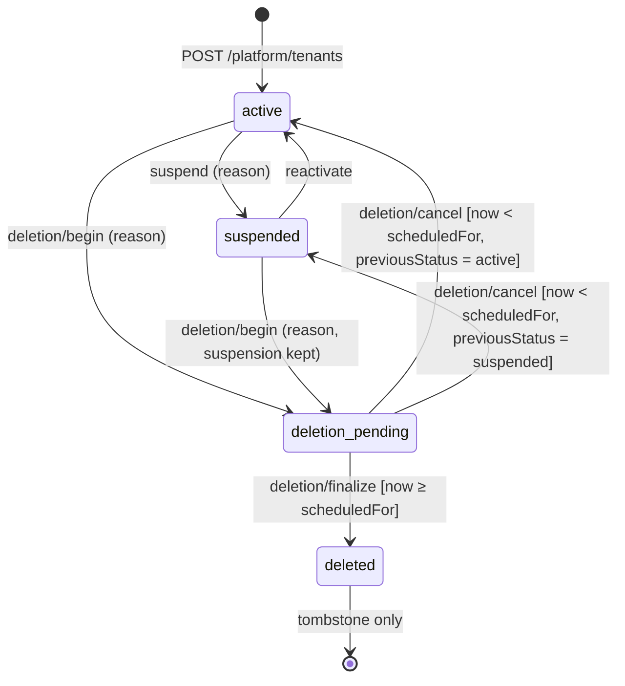
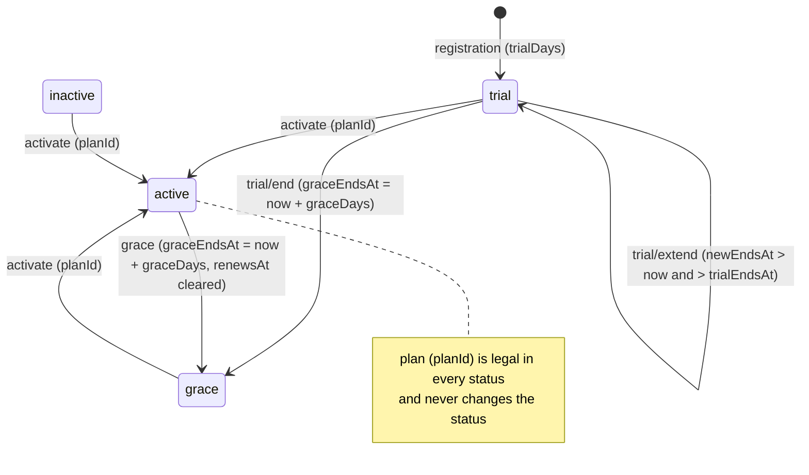
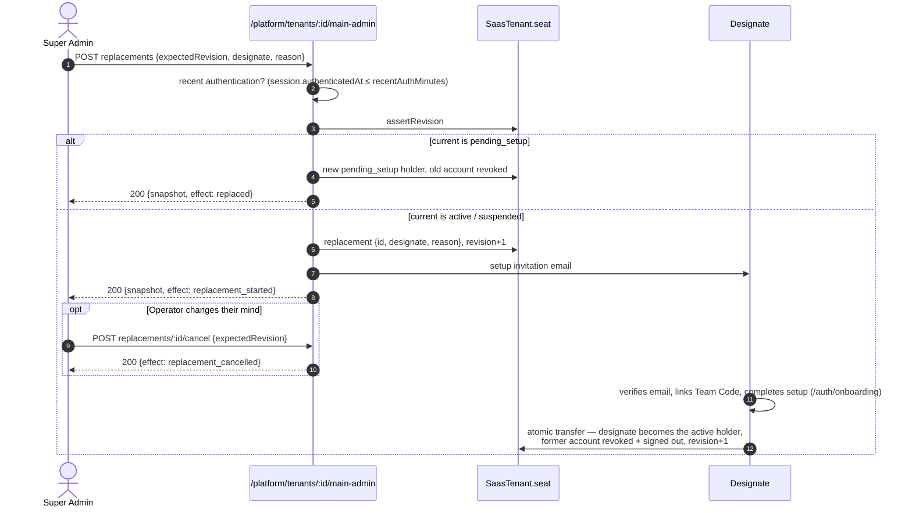

# Platform · Tenants — `/platform/tenants`

The Super Admin control plane for SaaS subscribers (`SaasTenant`): the
**/platform/tenants** list, the **tenant detail** page and its tabs —
**subscription**, **limits**, **features**, **main-admin** and the
**operations** (lifecycle) panel. API_CONTRACT.md §§ Point 6 (SaasTenant),
Point 7 (subscription/limits), Point 8 (features), Point 9 (lifecycle),
Point 14 (Main Admin seat).

Code: `routes/platform/tenantsRoutes.js` ·
`controllers/platform/{tenants,lifecycle,subscription,features,mainAdmin}Controller.js` ·
`validators/platformTenantValidators.js` · `services/tenantView.js` (wire shapes +
platform counts) · `services/tenantLifecycleService.js` (state machine, Team Code
rules, final-deletion cascade) · shared `authorizationService` (seat),
`usageService` (limits), `auditService`, `txn`.
Tests: `tests/platform-tenants.test.js`, `tests/platform-tenants-lifecycle.test.js`,
`tests/platform-tenants-subscription.test.js`, `tests/platform-tenants-main-admin.test.js`.
Postman: folder **Platform · Tenants** (`postman/modules/10-platform-tenants.js`).

**Every route:** `platformGuard` — a full, MFA-satisfied session of an active
`super_admin`. A `main_admin` / `admin` / `customer_demo` session gets
`403 not_permitted`; no bearer → `401 authentication_expired`. The tenant is
always the `:tenantId` path parameter — these endpoints are cross-tenant by
nature and never read a tenant-operational endpoint.

**Commands** (every `POST`/`PATCH` below) require an `Idempotency-Key` header
(missing → `422 validation` on `fields["Idempotency-Key"]`) and run in one
MongoDB transaction. Same key + same body → the original response is replayed
(`Idempotent-Replayed: true`, no new effect, no new audit/history row); same key
+ another body → `409 idempotency_conflict`. Keys are per attempt: mint one when
the operator confirms, reuse it only to retry that unchanged draft.

| # | Endpoint | Screen | Success |
|---|---|---|---|
| 1 | `GET /platform/tenants?search&status&cursor&limit` | /platform/tenants | `200 { items, total, nextCursor }` |
| 2 | `GET /platform/tenants/suggest-team-code` | create form | `200 { teamCode }` |
| 3 | `POST /platform/tenants` | create form | `201 SaasTenant` |
| 4 | `GET /platform/tenants/:tenantId` | tenant detail | `200 SaasTenant` \| `200 Tombstone` |
| 5 | `GET /platform/tenants/:tenantId/status-history` | tenant detail → history | `200 [StatusEvent]` |
| 6 | `POST …/lifecycle/suspend` | operations | `200 LifecycleResult` |
| 7 | `POST …/lifecycle/reactivate` | operations | `200 LifecycleResult` |
| 8 | `POST …/lifecycle/deletion/begin` | operations | `200 LifecycleResult` |
| 9 | `POST …/lifecycle/deletion/cancel` | operations | `200 LifecycleResult` |
| 10 | `POST …/lifecycle/deletion/finalize` | operations | `200 LifecycleResult + tombstone` |
| 11 | `GET …/subscription` | subscription | `200 { subscription, currentPlan }` |
| 12 | `GET …/limits` | limits | `200 LimitsProjection` |
| 13 | `POST …/subscription/activate` | subscription | `200 { subscription, currentPlan }` |
| 14 | `POST …/subscription/trial/extend` | subscription | `200 { subscription, currentPlan }` |
| 15 | `POST …/subscription/trial/end` | subscription | `200 { subscription, currentPlan }` |
| 16 | `POST …/subscription/grace` | subscription | `200 { subscription, currentPlan }` |
| 17 | `POST …/subscription/plan` | subscription | `200 { subscription, currentPlan }` |
| 18 | `PATCH …/limits/:limitKey` | limits | `200 LimitsProjection` |
| 19 | `GET …/features` | features | `200 { tenantId, tenantName, features }` |
| 20 | `PATCH …/features/:featureKey` | features | `200 FeatureRow` |
| 21 | `GET …/main-admin` | main-admin | `200 SeatSnapshot` |
| 22 | `POST …/main-admin/setup/resend` | main-admin | `200 { snapshot, effect }` |
| 23 | `POST …/main-admin/suspend` | main-admin | `200 { snapshot, effect }` |
| 24 | `POST …/main-admin/reactivate` | main-admin | `200 { snapshot, effect }` |
| 25 | `POST …/main-admin/replacements` | main-admin | `200 { snapshot, effect }` |
| 26 | `POST …/main-admin/replacements/:replacementId/cancel` | main-admin | `200 { snapshot, effect }` |

`…` = `/platform/tenants/:tenantId`.

---

## Wire shapes

### SaasTenant

```json
{
  "id": "saas_hilal",
  "displayName": "alwalla",
  "teamCode": "MTM-8J9M-4A4E",
  "timezone": "Asia/Damascus",
  "lifecycle": { "status": "active", "version": 4 },
  "createdAt": "2025-01-04T16:00:00.000Z",
  "updatedAt": "2026-09-20T10:12:00.000Z",
  "mainAdmin": { "name": "سلمى الحارثي", "email": "pbea4007@mtu.edu.iq", "provisioning": "active" },
  "subscription": {
    "status": "active",
    "planId": "mtm_advanced",
    "version": 3,
    "trialEndsAt": null,
    "renewsAt": "2027-01-04T16:00:00.000Z",
    "graceEndsAt": null,
    "limitOverrides": { "detachments": 20 }
  },
  "usage": { "storageUsedBytes": 7516192768, "storageAllowanceBytes": 21474836480, "lastActivityAt": "2026-09-28T08:00:00.000Z" },
  "counts": { "detachmentGroups": 3, "detachments": 4, "members": 29, "workshops": 6 }
}
```

| Field | Rule |
|---|---|
| `lifecycle` | `status ∈ active \| suspended \| deletion_pending` (a deleted tenant is a Tombstone, never this shape). `version` = lifecycle concurrency token. `suspension {suspendedAt, reason}` present while suspended, and kept while `deletion_pending` from `suspended`. `deletion {requestedAt, scheduledFor, previousStatus, reason}` present while `deletion_pending`. |
| `mainAdmin` | The seat's **current** account. `provisioning` = `pending_setup` iff that account has not completed setup, else `active` (a suspended holder is still `active` here — the seat tab carries the account status). Never a credential. |
| `subscription` | `status ∈ trial \| active \| grace \| inactive`; `planId` is `null` for "no plan"; `trialEndsAt` / `renewsAt` / `graceEndsAt` are `null` when not meaningful; `limitOverrides` only lists tenant-specific deviations. |
| `usage` | `storageAllowanceBytes` is **omitted** when no truthful allowance exists. `lastActivityAt` may be `null`. |
| `counts` | Platform aggregates: every DetachmentGroup, non-archived Detachments, active TeamMembers, non-archived Workshops. |

### Tombstone (after final deletion)

```json
{
  "tenantId": "saas_01JAB…",
  "displayNameSnapshot": "فرق الأمل الطبية",
  "status": "deleted",
  "deletedAt": "2026-10-28T09:00:00.000Z",
  "lifecycleVersion": 3,
  "historyReference": "tenant-lifecycle:saas_01JAB…"
}
```

No Team Code, Main Admin, email, subscription, limits, features, reason, usage or counts.

### Plan (read by #11/#12, managed in platform-configuration.md)

```json
{ "id": "mtm_standard", "name": "ليدر القياسية", "description": "للفرق النشطة متعددة المفارز.", "recommended": true, "selectable": true,
  "defaultLimits": { "detachment_groups": 5, "detachments": 15, "admins": 8, "members": 300, "workshops": 40, "storage_bytes": 21474836480 } }
```

---

## 1. List — `GET /platform/tenants`

| Query | Rule |
|---|---|
| `search` | Folded match (Arabic diacritics/tatweel stripped; alef/ya/waw/ta-marbuta variants and Arabic-Indic digits folded; case-insensitive) against display name, Main Admin name, Main Admin email and Team Code. A Team Code also matches in any spacing/case (`mtm 4k7p qx92`) or without the prefix/dashes (`4K7PQX92`). |
| `status` | List projection: `trial \| active \| grace \| inactive \| suspended \| deletion_pending`. A blocking lifecycle state wins over the commercial status (a suspended tenant on an active plan lists as `suspended`). |
| `cursor` | Opaque — echo `nextCursor` unread. |
| `limit` | 1–100, default 50. |

Filtering happens **before** paging; order is newest-registered first, ties by
id (stable). `total` counts the whole filtered set. Tombstones are never list items.

```json
{ "items": [ { "id": "saas_hilal", "displayName": "alwalla", "…": "…" } ], "total": 8, "nextCursor": "eyJ2IjoxLCJvIjo1MH0" }
```

| Error | When |
|---|---|
| `422 validation` | `limit` outside 1–100, unknown `status`, malformed `cursor` |

## 2. Suggest a Team Code — `GET /platform/tenants/suggest-team-code`

`200 { "teamCode": "MTM-7DQX-4NKR" }` — canonical `MTM-XXXX-XXXX` over
`23456789ABCDEFGHJKMNPQRSTVWXYZ`, neither in use nor retired. A suggestion, not
a reservation: the create call is authoritative.

## 3. Register — `POST /platform/tenants` (Idempotency-Key)

```http
POST /api/v1/platform/tenants
Idempotency-Key: 0192f3c4-7a1e-7b3c-9d10-5f2a8c1e4b77

{
  "displayName": "فريق الشمال الطبي",
  "mainAdminName": "أمل السبيعي",
  "mainAdminEmail": "amal@shamal.org",
  "teamCode": "MTM-7DQX-4NKR",
  "timezone": "Asia/Damascus"
}
```

- `displayName`, `mainAdminName`: 1–80 characters after whitespace collapse.
  `mainAdminEmail`: trimmed + lower-cased. `teamCode` optional (generated when
  absent) and canonicalised (`mtm 7dqx 4nkr` → `MTM-7DQX-4NKR`). `timezone`
  optional IANA zone (default `AppSettings.defaultTimezone`). A status or plan
  in the body is ignored.
- Creates, atomically: lifecycle `active` v1; subscription `trial`, `planId:
  null`, `trialEndsAt = now + AppSettings.trialDays`; the default features
  (`inventory`, `announcements` on; `statistics_reports`, `workshops` off); the
  Main Admin seat — a `pending_setup` account + an `initial_seat` authorization
  and the setup invitation email (no Team Code in it). History rows
  `tenant_created` + `trial_started`; audit `tenant_registered`.
- **Never returns a password, temporary password, OTP, token or link.**

`201` → `SaasTenant` (`mainAdmin.provisioning: "pending_setup"`).

| Error | When |
|---|---|
| `422 validation` | `fields.displayName` / `mainAdminName` / `mainAdminEmail` / `timezone`; `fields.teamCode` when present but not a valid code |
| `409 tenant_code_conflict` | the canonical code is used by a live tenant **or retired** by a deleted one |
| `409 main_admin_identity_unavailable` | the email already belongs to any Leader account (nothing is created) |

## 4. Detail — `GET /platform/tenants/:tenantId`

`200 SaasTenant`; after final deletion `200 Tombstone` (render the dedicated
tombstone view, never coerce it); unknown id → `404 not_found`.

## 5. Status history — `GET /platform/tenants/:tenantId/status-history`

Compact lifecycle/subscription chronology, newest first. **Not** the audit log:
no actor, no request data. Still readable for a tombstone.

```json
[
  { "id": "evt_01JAB…", "type": "tenant_suspended", "occurredAt": "2026-09-09T14:00:00.000Z", "note": "مراجعة إدارية" },
  { "id": "evt_01JA9…", "type": "trial_started", "occurredAt": "2026-09-01T09:00:00.000Z", "note": null },
  { "id": "evt_01JA9…", "type": "tenant_created", "occurredAt": "2026-09-01T09:00:00.000Z", "note": null }
]
```

`type ∈ tenant_created, trial_started, trial_ended, trial_extended,
subscription_activated, moved_to_grace, plan_changed, limit_override_changed,
tenant_suspended, tenant_reactivated, deletion_requested, deletion_cancelled,
tenant_deleted`. `note` is the lifecycle reason (suspend / begin deletion), else `null`.
Unknown tenant (no record, no tombstone) → `404 not_found`.

---

## 6–10. Lifecycle (operations panel)



| Command | Body | From → to |
|---|---|---|
| `POST …/lifecycle/suspend` | `{ reason, expectedVersion }` | `active → suspended`; `suspension {suspendedAt, reason}` |
| `POST …/lifecycle/reactivate` | `{ expectedVersion }` | `suspended → active`; suspension cleared |
| `POST …/lifecycle/deletion/begin` | `{ reason, expectedVersion }` | `active\|suspended → deletion_pending`; `deletion {requestedAt, scheduledFor = now + AppSettings.deletionWindowDays, previousStatus, reason}` |
| `POST …/lifecycle/deletion/cancel` | `{ expectedVersion }` | `deletion_pending → previousStatus` (exactly, including suspension) — only while `now < scheduledFor` |
| `POST …/lifecycle/deletion/finalize` | `{ expectedVersion }` | `deletion_pending → deleted` — only when `now ≥ scheduledFor` |

```http
POST /api/v1/platform/tenants/saas_najd/lifecycle/suspend
Idempotency-Key: 0192f3c4-8a00-7c11-a1b2-3c4d5e6f7081

{ "reason": "مراجعة إدارية", "expectedVersion": 1 }
```

```json
{
  "tenantId": "saas_najd",
  "displayNameSnapshot": "فريق نجد للاستجابة",
  "lifecycle": { "status": "suspended", "version": 2, "suspension": { "suspendedAt": "2026-09-28T09:00:00.000Z", "reason": "مراجعة إدارية" } },
  "changed": true
}
```

Rules:

- Check order: tenant → reason → `expectedVersion` → transition → deletion window.
- `reason`: a string of 1–280 characters after whitespace collapse (stored collapsed).
- Every success bumps `lifecycle.version`, appends a history row
  (`tenant_suspended`, `tenant_reactivated`, `deletion_requested`,
  `deletion_cancelled`, `tenant_deleted`; `note` = reason) and an audit event
  (`tenant_suspended`, `tenant_reactivated`, `deletion_requested`,
  `deletion_cancelled`, `deletion_finalized`; target `tenant_lifecycle`;
  change `lifecycle_status` before/after).
- Suspend and begin-deletion **end every active break-glass grant** of the
  tenant (`status: ended`, `endReason: tenant_unavailable`, revision + 1).
- The lifecycle never changes the subscription, features, limits, Team Code,
  Main Admin seat or any session. Tenant users are blocked on their next
  request by `tenantGuard` (`403 tenant_unavailable` + `tenantStatus`).

**Finalize** — the destructive cascade, in one transaction:
every tenant-plane document (DetachmentGroup, Detachment, TeamMember, Shift,
ShiftTemplate, InventoryItem, InventoryMovement, Workshop, WorkshopParticipant,
Announcement, NotificationState, ChangeLog, Authorization, BillingOrder) and the
change-log counter; every session of the tenant's accounts is revoked and those
accounts (administrators + provisioned seat accounts) are **deleted**; the Team
Code is retired (only its SHA-256 is kept — it can never be reused); the
Tombstone is written; the `SaasTenant` is removed; audit `deletion_finalized`
with tenant reference `{ id, displayName, isDeleted: true }`. Uploaded files are
removed from disk right after commit. Audit events and the status history are
retained. The response adds `lifecycle.deletion.deletedAt` and `tombstone`:

```json
{
  "tenantId": "saas_01JAB…",
  "displayNameSnapshot": "فرق الأمل الطبية",
  "lifecycle": { "status": "deleted", "version": 3,
    "deletion": { "requestedAt": "…", "scheduledFor": "…", "previousStatus": "active", "reason": "طلب إغلاق موثّق", "deletedAt": "2026-10-28T09:00:00.000Z" } },
  "changed": true,
  "tombstone": { "tenantId": "saas_01JAB…", "displayNameSnapshot": "فرق الأمل الطبية", "status": "deleted", "deletedAt": "2026-10-28T09:00:00.000Z", "lifecycleVersion": 3, "historyReference": "tenant-lifecycle:saas_01JAB…" }
}
```

A retry of finalize with the **same** key replays this body; with a **new** key → `409 tenant_already_deleted`.

| Error | When |
|---|---|
| `404 tenant_not_found` | no tenant and no tombstone |
| `409 tenant_already_deleted` | the id is a tombstone |
| `422 invalid_lifecycle_reason` | suspend/begin without a 1–280 character string reason |
| `422 validation` | `expectedVersion` missing / not a positive integer |
| `409 stale_tenant` | `expectedVersion ≠ lifecycle.version` (+ `currentVersion`, `lifecycleStatus`) — no write |
| `409 invalid_tenant_transition` | any transition not in the table (suspend twice, reactivate an active tenant, …) |
| `409 deletion_window_expired` | cancel at or after `scheduledFor` |
| `409 deletion_not_effective` | finalize before `scheduledFor` (+ `scheduledFor`) |
| `409 idempotency_conflict` | key reused with another body |

---

## 11–18. Subscription & limits (subscription and limits tabs)



### 11. `GET …/subscription`

```json
{
  "subscription": { "status": "trial", "planId": null, "version": 2, "trialEndsAt": "2026-10-28T09:00:00.000Z", "renewsAt": null, "graceEndsAt": null, "limitOverrides": {} },
  "currentPlan": null
}
```

`currentPlan: null` only for the explicit no-plan state. `planId` set but the
plan no longer resolves → `409 plan_not_found`. Unknown tenant → `404 not_found`.

### 12. `GET …/limits`

```json
{
  "tenantId": "saas_afiah",
  "tenantName": "جمعية عافية",
  "plan": { "id": "mtm_standard", "name": "ليدر القياسية", "defaultLimits": { "detachment_groups": 5, "detachments": 15, "admins": 8, "members": 300, "workshops": 40, "storage_bytes": 21474836480 } },
  "subscription": { "version": 7, "limitOverrides": { "detachments": 20 } },
  "usage": { "detachment_groups": 4, "detachments": 15, "admins": 1, "members": 233, "workshops": 19, "storage_bytes": 4508876800 },
  "effective": { "detachment_groups": 5, "detachments": 20, "admins": 8, "members": 300, "workshops": 40, "storage_bytes": 21474836480 },
  "rows": [ { "key": "detachments", "overridden": true, "planDefault": 15, "effective": 20, "usage": 15 } ]
}
```

`effective = override ?? plan default`, per key; `rows` has all six keys. A
limit below usage is allowed — nothing is deleted; tenant creates of that
resource answer `plan_limit_reached` until usage drops. No plan → `409 plan_not_found`.

### 13–17. Commands

| Command | Body | Legal from | Effect |
|---|---|---|---|
| `POST …/subscription/activate` | `{ planId, expectedVersion }` | `trial`, `grace`, `inactive` | `active`, `planId`, `renewsAt = now + 365 d`, `trialEndsAt = graceEndsAt = null` |
| `POST …/subscription/trial/extend` | `{ newEndsAt, expectedVersion }` | `trial` | `trialEndsAt = newEndsAt` |
| `POST …/subscription/trial/end` | `{ expectedVersion }` | `trial` | `grace`, `graceEndsAt = now + AppSettings.graceDays`, `trialEndsAt = null` |
| `POST …/subscription/grace` | `{ expectedVersion }` | `active` | `grace`, `graceEndsAt = now + graceDays`, `renewsAt = null` |
| `POST …/subscription/plan` | `{ planId, expectedVersion }` | any | `planId` changes; status unchanged; overrides kept |

```http
POST /api/v1/platform/tenants/saas_nabd/subscription/activate
Idempotency-Key: 0192f3c4-9b00-7d22-b3c4-5d6e7f809102

{ "planId": "mtm_standard", "expectedVersion": 1 }
```

→ `200 { subscription, currentPlan }`. These are administrative state changes
only — no payment is charged or proven.

### 18. `PATCH …/limits/:limitKey`

```json
{ "overrideValue": 20, "expectedVersion": 3 }
```

`overrideValue`: integer ≥ 0, or `null` to remove the override (back to the plan
default). Answers the limits projection (#12).

Rules (13–18): check order tenant → plan validity → `expectedVersion` →
transition. Each success bumps `subscription.version`, appends a history row
(`subscription_activated`, `trial_extended`, `trial_ended`, `moved_to_grace`,
`plan_changed`, `limit_override_changed`) and an audit event
(`subscription_activated`, `trial_extended`, `trial_ended`,
`subscription_moved_to_grace`, `plan_changed`, `limit_override_changed`) with
typed changes (`subscription_status`, `plan_assignment`, `limit_override`).
The lifecycle, features and Team Code are never touched.

| Error | When |
|---|---|
| `404 not_found` | unknown tenant (or a tombstone) |
| `404 plan_not_found` | `planId` of activate/plan does not exist |
| `409 plan_unavailable` | the chosen plan is `selectable: false` and is not the tenant's current plan |
| `409 plan_not_found` | limits read/override on a tenant without a (resolvable) plan |
| `409 stale_subscription` | `expectedVersion ≠ subscription.version` (+ `currentVersion`) |
| `409 invalid_subscription_transition` | status not legal for the command; plan change to the same plan |
| `422 invalid_trial_extension` | `newEndsAt` not later than now **and** than the current `trialEndsAt` |
| `422 limit_invalid` | unknown `limitKey`, or `overrideValue` missing / negative / non-integer / a string |
| `422 validation` | `expectedVersion` / `planId` missing, `newEndsAt` not an ISO instant |

---

## 19–20. Features (features tab)

```json
{
  "tenantId": "saas_hilal",
  "tenantName": "alwalla",
  "features": [
    { "key": "inventory", "enabled": true, "version": 4, "updatedAt": "2026-09-09T15:20:00.000Z" },
    { "key": "statistics_reports", "enabled": true, "version": 1, "updatedAt": "2026-01-04T16:00:00.000Z" },
    { "key": "workshops", "enabled": true, "version": 2, "updatedAt": "2026-03-01T10:00:00.000Z" },
    { "key": "announcements", "enabled": true, "version": 1, "updatedAt": "2026-01-04T16:00:00.000Z" }
  ]
}
```

`PATCH …/features/:featureKey` `{ "enabled": false, "expectedVersion": 4 }` →
`200 { "key": "inventory", "enabled": false, "version": 5, "updatedAt": "…" }`.
Each row has its own `version`. Setting the value it already has returns the row
unchanged (no new version, no audit). A change appends audit
`feature_flag_changed` (target `tenant_feature`, change `feature_enabled`).
**Disabling never deletes, archives or resets module data**; tenant endpoints of
a disabled module answer `403 feature_disabled`.

| Error | When |
|---|---|
| `404 tenant_not_found` | unknown tenant (or a tombstone) |
| `422 invalid_feature` | `featureKey` not in `inventory \| statistics_reports \| workshops \| announcements` |
| `404 feature_not_found` | known key with no stored row for this tenant |
| `409 stale_feature_state` | `expectedVersion ≠` the row's version (+ `currentVersion`, `currentRecord`) |
| `422 validation` | `enabled` not a JSON boolean, `expectedVersion` missing |

---

## 21–26. Main Admin seat (main-admin tab)

Implemented by `authorizationService.seatSnapshot` / `seatCommands` /
`assertRevision`. `revision` is the concurrency token for the whole seat.

```json
{
  "tenant": { "tenantId": "saas_najd", "displayName": "فريق نجد للاستجابة", "lifecycleStatus": "active", "lifecycleVersion": 1 },
  "revision": 2,
  "current": { "accountId": "ma_najd", "displayName": "بدر العنزي", "loginEmail": "badr@najd-response.sa", "status": "active",
               "createdAt": "2025-08-19T09:00:00.000Z", "activatedAt": "2025-08-20T09:00:00.000Z" },
  "replacement": { "id": "mar_najd_1", "status": "pending",
    "designate": { "accountId": "u_01JAB…", "displayName": "ريم القحطاني", "loginEmail": "reem@najd-response.sa",
                   "setup": { "status": "outstanding", "lastSentAt": "2026-09-27T09:00:00.000Z", "expiresAt": "2026-10-04T09:00:00.000Z" } },
    "requestedAt": "2026-09-27T09:00:00.000Z", "reason": "طلبت الجهة تعيين مدير رئيسي جديد" },
  "readAt": "2026-09-28T09:00:00.000Z"
}
```

| Command | Body | Seat precondition | Tenant | `effect` |
|---|---|---|---|---|
| `POST …/main-admin/setup/resend` | `{ expectedRevision, target: "current" \| "replacement" }` | target is a pending account | `active` | `setup_resent` |
| `POST …/main-admin/suspend` | `{ expectedRevision, reason }` | current `active` | not deleted | `suspended` (every session ended) |
| `POST …/main-admin/reactivate` | `{ expectedRevision }` | current `suspended` | `active` | `reactivated` — **recent authentication** |
| `POST …/main-admin/replacements` | `{ expectedRevision, designate: { displayName, loginEmail }, reason }` | no pending replacement | `active` | `replaced` (holder `pending_setup`) or `replacement_started` — **recent authentication** |
| `POST …/main-admin/replacements/:replacementId/cancel` | `{ expectedRevision }` | that replacement is pending | not deleted | `replacement_cancelled` |

Every command answers `200 { "snapshot": SeatSnapshot, "effect": "…" }`.



Recent authentication: `reactivate` and `replacements` require the Super Admin
session's `authenticatedAt` within `AppSettings.recentAuthMinutes` (default 30);
this check runs **before** idempotency, so the refusal is never stored against
the key — sign in again and retry the same draft with the same key.

| Error | When |
|---|---|
| `404 tenant_not_found` | unknown tenant |
| `409 tenant_already_deleted` | the id is a tombstone (reads too) |
| `409 tenant_not_eligible` | an opening action (resend, reactivate, replace) on a non-`active` tenant (+ `tenantStatus`) |
| `409 stale_main_admin` | `expectedRevision ≠ revision` (+ `currentRevision`) |
| `409 invalid_main_admin_transition` | precondition not met (e.g. resend for an already set-up holder, reactivate an active holder, cancel a non-pending replacement) |
| `422 invalid_main_admin_reason` | suspend/replace without a 1–280 character reason |
| `422 invalid_main_admin_identity` | designate name/email invalid, or equal to the current holder |
| `409 main_admin_identity_unavailable` | designate email already belongs to a Leader account |
| `409 main_admin_replacement_already_pending` | replace while a replacement is pending |
| `403 recent_authentication_required` | reactivate/replace with a stale session (+ `recentAuthMinutes`) |
| `422 validation` | `expectedRevision` missing, `target` not `current`/`replacement` |
