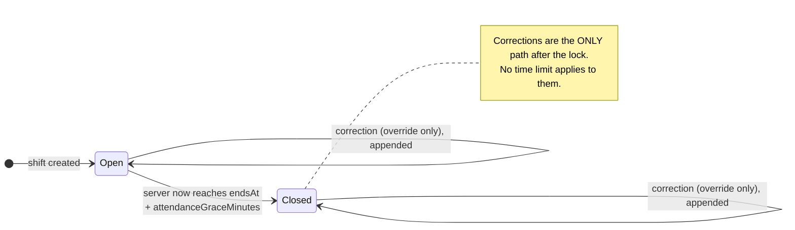
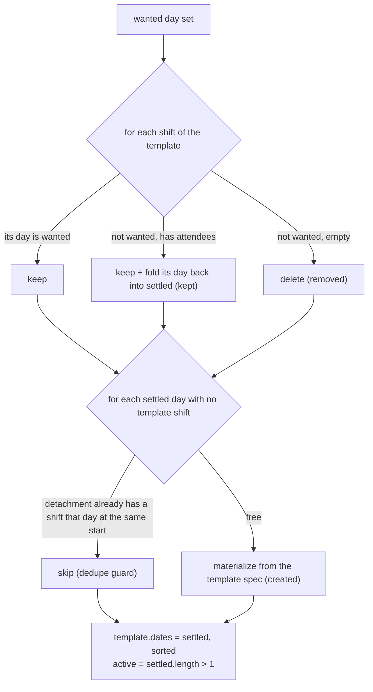

# Shifts, templates & attendance — `/detachments/:id/shifts`, `/shifts`, `/shift-templates`

The detachment schedule behind the Flutter **detachment shifts tab**, the
**shift manage sheet** (edit, repeat, candidates, assign, quick-fill), the
**attendance sheet** (check-in / check-out / absent / reset) and the
**correction form** — the server half of `mock_shift_repository.dart` and
`attendance_policy.dart`.

Code: `routes/detachmentShiftRoutes.js`, `routes/shiftRoutes.js`,
`routes/shiftTemplateRoutes.js`, `controllers/tenant/{shift,shiftTemplate,attendance}Controller.js`,
`services/shiftService.js`, `services/attendanceService.js`, `validators/shiftValidators.js`.
Tests: `tests/shifts.test.js`, `tests/attendance.test.js`.
Postman: folder **Tenant · Shifts & attendance** (`postman/modules/30-shifts.js`).

Every route runs `tenantGuard` (a platform/demo session → `403 tenant_context_unavailable`).
Capabilities are **scoped**: they are checked in the detachment the shift (or
template) belongs to.

| # | Endpoint | Capability (in the detachment) | Success |
|---|---|---|---|
| 1 | `GET /detachments/:detachmentId/shifts/today` | `detachment.view` | `200 [Shift]` |
| 2 | `GET /detachments/:detachmentId/shifts?from&to` | `detachment.view` | `200 [Shift]` |
| 3 | `GET /detachments/:detachmentId/shifts/week?weekStart` | `detachment.view` | `200 {weekStart, days, shifts, summary}` |
| 4 | `POST /detachments/:detachmentId/shifts` | `shift.manage` | `201 Shift` (the anchor) |
| 5 | `POST /detachments/:detachmentId/shifts/copy-day` | `shift.manage` | `200 {created}` |
| 6 | `POST /detachments/:detachmentId/shifts/copy-week` | `shift.manage` | `200 {created}` |
| 7 | `GET /detachments/:detachmentId/shift-templates?active` | `detachment.view` | `200 [ShiftTemplate]` |
| 8 | `GET /shifts/:shiftId` | `detachment.view` | `200 Shift` |
| 9 | `PUT` / `PATCH /shifts/:shiftId` | `shift.manage` | `200 Shift` |
| 10 | `DELETE /shifts/:shiftId` | `shift.delete` | `204` |
| 11 | `PUT /shifts/:shiftId/repeat` | `shift.manage` | `200 {template, shifts}` |
| 12 | `POST /shifts/:shiftId/assignments` | `shift.assign` | `200 Shift` |
| 13 | `DELETE /shifts/:shiftId/assignments/:memberId` | `shift.assign` | `200 Shift` |
| 14 | `GET /shifts/:shiftId/candidates` | `shift.assign` | `200 [Candidate]` |
| 15 | `POST /shifts/:shiftId/quick-fill` | `shift.assign` | `200 {added, shift}` |
| 16 | `POST /shifts/:shiftId/members/:memberId/check-in` | `shift.attendance.record` OR `…override` + window | `200 Shift` |
| 17 | `POST /shifts/:shiftId/members/:memberId/check-out` | same | `200 Shift` |
| 18 | `POST /shifts/:shiftId/members/:memberId/absent` | same | `200 Shift` |
| 19 | `POST /shifts/:shiftId/members/:memberId/reset` | same | `200 Shift` |
| 20 | `PATCH /shifts/:shiftId/members/:memberId/attendance` | same (legacy `markAttendance`) | `200 Shift` |
| 21 | `POST /shifts/:shiftId/members/:memberId/attendance-corrections` | `shift.attendance.override` only, **no window** | `200 Shift` |
| — | `GET /shifts/:shiftId/attendance-corrections` | `detachment.view` | `200 [AttendanceCorrection]` |
| 22 | `GET /shift-templates/:templateId` | `detachment.view` | `200 ShiftTemplate` |
| 23 | `GET /shift-templates/:templateId/shifts` | `detachment.view` | `200 [Shift]` |
| 24 | `PUT /shift-templates/:templateId/dates` | `shift.manage` | `200 {template, created, removed, kept}` |
| 25 | `POST /shift-templates/:templateId/stop` | `shift.manage` | `200 ShiftTemplate` |

Refusal order: session → surface → **not_found** (detachment / shift / template
not in this tenant) → **not_permitted** → `Idempotency-Key` → **validation** →
business rules. Every write accepts an optional `Idempotency-Key`.

---

## Wire shapes

### Shift

`services/serializers.shift` plus `attendanceClosesAt`:

```json
{
  "id": "sh_01J9ZQ3M4T7K2P8V6N5R1C0XWD",
  "detachmentId": "d_dam_central",
  "templateId": "tpl_01J9ZQ3M4S9D0F2G4H6J8K0M2N",
  "date": "2026-10-03",
  "centerName": "مركز الشعلان",
  "startMinutes": 1200,
  "endMinutes": 120,
  "needed": 4,
  "attendees": [
    {
      "id": "m1", "name": "أحمد كنعان", "initials": "أك", "department": "الإسعاف",
      "personalNumber": "101", "role": "shiftSupervisor", "detachmentId": "d_dam_central",
      "attendance": "checkedOut", "active": true, "version": 1, "phoneMasked": "+963 9•• ••• 123",
      "checkInAt": "2026-10-03T17:05:00.000Z", "checkOutAt": "2026-10-03T23:02:00.000Z"
    }
  ],
  "corrections": [ { "…": "see AttendanceCorrection" } ],
  "version": 3,
  "startsAt": "2026-10-03T17:00:00.000Z",
  "endsAt": "2026-10-03T23:00:00.000Z",
  "crossesMidnight": true,
  "assigned": 1,
  "hasCoverageGap": true,
  "attendanceClosesAt": "2026-10-04T00:00:00.000Z"
}
```

- `date` is the tenant-local calendar day the shift **starts** on. `endMinutes <= startMinutes` ⇒ it crosses midnight.
- `startsAt` / `endsAt` are **always recomputed by the server** (`utils/time.shiftWindow`) from `date` + minutes in the tenant timezone whenever either changes. A client never sends them.
- `attendanceClosesAt = endsAt + settings.attendanceGraceMinutes` (platform setting, default 60).
- `templateId` and `corrections` are omitted when absent. Each correction also carries `clientCorrectedAt` when the client sent one.
- A member deleted since assignment renders as `"name": "عضو محذوف"`, `"active": false`.

### ShiftTemplate

```json
{ "id": "tpl_01J…", "detachmentId": "d_dam_central", "centerName": "مركز الشعلان",
  "dates": ["2026-10-03", "2026-10-05", "2026-10-07"], "startMinutes": 420, "endMinutes": 900,
  "needed": 4, "active": true, "version": 2 }
```

### AttendanceCorrection (append-only)

```json
{
  "id": "corr_01J9ZR0…",
  "shiftId": "sh_01J…",
  "memberId": "m4",
  "before": { "status": "notCheckedIn" },
  "after": { "status": "checkedIn", "checkInAt": "2026-09-24T05:03:00.000Z" },
  "reason": "نسي المشرف تسجيل الدخول وقت الشفت",
  "author": { "id": "u_demo_main", "displayName": "سلمى الحارثي" },
  "correctedAt": "2026-09-28T10:00:04.211Z",
  "clientCorrectedAt": "2026-09-28T10:00:00.000Z"
}
```

`correctedAt` is **server time** (authoritative). `clientCorrectedAt` is what the
device's clock read (advisory). There is **no** update or delete endpoint for a
correction.

---

## 1–3. Schedule reads (detachment shifts tab)

`GET /detachments/d_dam_central/shifts/today` — the shifts dated today in the
tenant timezone, sorted by `startMinutes`.

`GET /detachments/d_dam_central/shifts?from=2026-09-26&to=2026-10-02` — both
required, `YYYY-MM-DD` (a Dart `toIso8601String()` of a local midnight is also
accepted), inclusive, `to ≥ from`, at most **62 days** inclusive. Sorted by
`date`, then `startMinutes`.

`GET /detachments/d_dam_central/shifts/week?weekStart=2026-09-30` — any day;
normalized to the **Saturday** that starts its week (default: this week).

```json
{
  "weekStart": "2026-09-26",
  "days": ["2026-09-26", "2026-09-27", "2026-09-28", "2026-09-29", "2026-09-30", "2026-10-01", "2026-10-02"],
  "shifts": [ "…Shift…" ],
  "summary": { "shiftCount": 6, "needed": 40, "assigned": 17, "coveragePercent": 43, "gaps": 23 }
}
```

| Summary field | Formula (over the week's shifts) |
|---|---|
| `shiftCount` | number of shifts |
| `needed` | Σ `needed` |
| `assigned` | Σ `min(attendees, needed)` — over-staffing never inflates coverage |
| `coveragePercent` | `needed == 0 ? 0 : min(100, round(assigned / needed × 100))` — the same number the detachment card's roll-up shows |
| `gaps` | Σ `max(0, needed − attendees)` |

## 4. Create (+ repeat)

```http
POST /api/v1/detachments/d_dam_central/shifts
Idempotency-Key: 0192f3c4-7a1e-7b3c-9d10-5f2a8c1e4b77

{ "date": "2026-10-03", "centerName": "مركز الشعلان", "startMinutes": 420, "endMinutes": 900,
  "needed": 4, "repeatOn": ["2026-10-05", "2026-10-07"] }
```

`201` — the **anchor** shift (the one on `date`).

| Field | Rule (422 `validation`, `fields.<name>`) |
|---|---|
| `date` | calendar day, required |
| `centerName` | required; trimmed + whitespace-collapsed; blank → `fields.centerName` |
| `startMinutes` | integer 0–1439 |
| `endMinutes` | integer 0–1440; **must differ from `startMinutes`** (`fields.endMinutes`) |
| `needed` | integer ≥ 1 |
| `repeatOn` | optional list of days (≤ 366) |

**Repeat.** The repeat set is `{date} ∪ repeatOn`. One day → a standalone shift
(no template). More than one → a `ShiftTemplate` with the sorted day set is
created and one shift per day is materialized with its `templateId`, **skipping a
day that already has a shift of this detachment at the same `startMinutes`**
(the dedupe guard). The anchor itself is always created.

## 5–6. Copy day / copy week

```json
POST /detachments/d_dam_central/shifts/copy-day   { "fromDay": "2026-09-26", "toDay": "2026-10-03" }
POST /detachments/d_dam_central/shifts/copy-week  { "fromWeekStart": "2026-09-19", "toWeekStart": "2026-09-26" }
→ 200 { "created": 5 }
```

Copies are **empty** (no attendees — the schedule repeats, the people do not) and
**standalone** (no `templateId`). A day+start already taken is skipped, so copying
twice is harmless. Week starts are normalized to Saturday; each source weekday
lands on the same weekday of the target week (calendar arithmetic, DST-safe).
Same day / same week → `422 validation` (`fields.toDay` / `fields.toWeekStart`).

## 7. Templates of a detachment

`GET /detachments/d_dam_central/shift-templates?active=true` — `active=true` →
only active, `active=false` → only stopped, omitted → all. Sorted by first day,
then `startMinutes`.

## 8–10. One shift

- `GET /shifts/:shiftId` → `Shift` (another tenant's id → `404`).
- `PUT` / `PATCH /shifts/:shiftId` — body: any of `date`, `centerName`,
  `startMinutes`, `endMinutes`, `needed`, `version`. Same validation as create
  (the start/end check uses the merged values). The window is recomputed.
  `version` present and stale → `409 stale_write` with `currentVersion` +
  `currentRecord`. Editing a shift never touches its template or its siblings.
- `DELETE /shifts/:shiftId` → `204` (needs `shift.delete`, **not** `shift.manage`).

## 11. Repeat of an existing shift

`PUT /shifts/:shiftId/repeat {"dates": ["2026-10-05"]}` — the wanted set is
`{shift.date} ∪ dates`. A shift without a template gets one. Reconciled exactly
like #24; the template then mirrors the anchor's current spec (centre, times,
needed) and `active = settled.length > 1`.

```json
{ "template": { "id": "tpl_…", "dates": ["2026-10-03", "2026-10-05"], "active": true, "…": "…" },
  "shifts": [ "…the template's shifts, by date…" ] }
```

## 12–15. Assignment (shift manage sheet)

`POST /shifts/:shiftId/assignments {"memberId": "m4"}` → the shift with a new
attendee `{attendance: "notCheckedIn"}`. Refusals, in this order:

| Case | Answer |
|---|---|
| member not in this tenant | `404 not_found` |
| member of another detachment | `422 validation` `fields.memberId` |
| member inactive | `422 validation` `fields.memberId` |
| already on this shift | `409 conflict` |
| already on another shift **of this tenant** whose real `[startsAt, endsAt)` intersects this one | `409 conflict` + `reason: "overlap"`, `overlapShiftId` |

Overlap uses real instants, so `20:00–02:00` on Monday collides with `00:00–06:00`
on Tuesday; back-to-back shifts (`end == start`) do not.

`DELETE /shifts/:shiftId/assignments/:memberId` → the shift; not assigned → `404`.

`GET /shifts/:shiftId/candidates` — active members of the shift's detachment not
already on it, **free first**, then role order (`shiftSupervisor`,
`administrator`, `followUp`, `member`), then name (Arabic collation):

```json
[
  { "member": { "id": "m1", "name": "أحمد كنعان", "role": "shiftSupervisor", "…": "…" }, "busy": false },
  { "member": { "id": "m5", "name": "ياسر البكري", "role": "member", "…": "…" }, "busy": true,
    "busyWith": { "shiftId": "sh_…", "detachmentId": "d_dam_central", "centerName": "مركز المهاجرين",
                  "date": "2026-10-03", "startMinutes": 600, "endMinutes": 900 } }
]
```

`POST /shifts/:shiftId/quick-fill` → `{ "added": 2, "shift": Shift }` — adds free
candidates in that order until `attendees == needed`.

Assignment and attendance commands carry no `version`: a lost race with a
concurrent writer is **re-applied on the fresh shift** (rules re-checked) up to
three times, then `409 stale_write`.

## 16–20. Attendance — the ordinary path (attendance sheet)

Allowed with `shift.attendance.record` **or** `shift.attendance.override` in the
detachment, and only while the window is open:

> `now < endsAt + settings.attendanceGraceMinutes` — **server** time; `now == lock` is closed.

Otherwise `409 attendance_window_expired` with `closesAt`. A member not on the
shift → `404 not_found` (checked after the window).

| Call | Body | Effect / refusals |
|---|---|---|
| `check-in` | `{ "at"?: instant }` (default: server now) | `checkInAt = at`; `attendance = checkOutAt ? checkedOut : checkedIn`. A recorded check-out and `at > checkOut` → `422 checkin_after_checkout` |
| `check-out` | `{ "at"?: instant }` | no check-in → `422 check_in_required`. If `at < checkIn`, the shift crosses midnight and `at` falls on `shift.date` (tenant tz) → `at + 1 day`. Still `< checkIn` → `422 checkout_before_checkin`. Then `attendance = checkedOut` |
| `absent` | — | clears both times, `absent` |
| `reset` | — | clears both times, `notCheckedIn` |
| `PATCH …/attendance` | `{ "attendance": "present" }` | legacy `markAttendance`: dispatches to the four above at **server now** (`checkedIn`→check-in, `checkedOut`→check-out, `absent`, `notCheckedIn`→reset) |

Instants: RFC 3339; a value **without an offset** (`"2026-10-03T20:30:00"`) is
read in the tenant timezone. Attendance values accept the legacy aliases
`present`/`late` → `checkedIn`, `notInvited` → `notCheckedIn`.



## 21. Corrections (correction form)

```http
POST /api/v1/shifts/sh_01J…/members/m4/attendance-corrections
Idempotency-Key: …

{ "status": "checkedIn", "checkInAt": "2026-09-24T08:03:00.000", "checkOutAt": null,
  "reason": "نسي المشرف تسجيل الدخول وقت الشفت", "correctedAt": "2026-09-28T13:00:00.000" }
```

- `shift.attendance.override` in the detachment — `shift.attendance.record` alone is **not** enough (`403`). **No window check**: valid forever.
- `status` ∈ the four states (aliases accepted). `reason` is trimmed and whitespace-collapsed; empty → `422 validation fields.reason`.
- `checkInAt` + `checkOutAt` get the same overnight normalization as check-out; still out of order → `422 checkout_before_checkin` (nothing is written).
- The correction is **appended** (`before` = the attendee's state now, `after` = the request), `author` is the calling account, `correctedAt` is server now; the attendee then takes the `after` values. `200` → the Shift.
- `GET /shifts/:shiftId/attendance-corrections` → the list, append order.

## 22–25. Templates

- `GET /shift-templates/:templateId`, `GET /shift-templates/:templateId/shifts` (by date).
- `PUT /shift-templates/:templateId/dates {"dates": [...], "version"?}` — reconciles and answers:

```json
{ "template": { "dates": ["2026-10-03", "2026-10-07", "2026-10-09"], "active": true, "…": "…" },
  "created": ["sh_new"], "removed": ["sh_empty"], "kept": ["sh_staffed"] }
```

`kept` lists surplus shifts that **stayed because someone is assigned** (their days
were folded back into `template.dates`).

- `POST /shift-templates/:templateId/stop` → `active: false`. The shifts it made are kept.



---

## Errors

| Code | HTTP | When |
|---|---|---|
| `not_found` | 404 | detachment / shift / template / member not in this tenant; member not on the shift; unassign of a non-attendee |
| `not_permitted` | 403 | capability missing in the shift's detachment |
| `validation` | 422 | bad field; `startMinutes == endMinutes`; `needed < 1`; blank centre; range > 62 days; copy onto itself; member of another detachment / inactive; blank correction reason |
| `conflict` | 409 | member already on the shift; `reason: "overlap"` + `overlapShiftId` for a double booking |
| `stale_write` | 409 | stale `version` (edit, template dates) or a race lost three times |
| `attendance_window_expired` | 409 | ordinary attendance edit after `endsAt + grace` (`closesAt`) |
| `check_in_required` | 422 | check-out with no check-in |
| `checkin_after_checkout` | 422 | check-in later than the recorded check-out |
| `checkout_before_checkin` | 422 | check-out (or corrected times) before the check-in |
| `tenant_context_unavailable` | 403 | platform / demo session |
