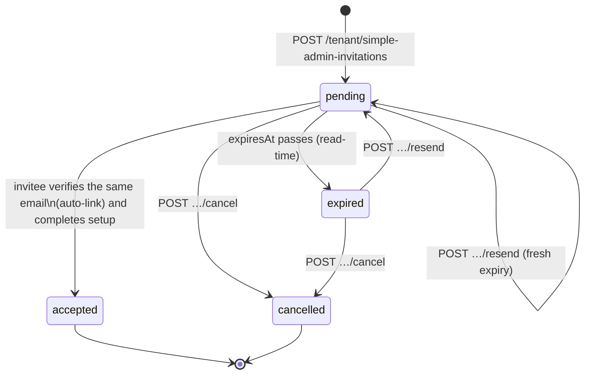

# Tenant administration — `/settings`, `/tenant`

Account settings, the organisation profile, the tenant-plane read of the
organisation and its modules, Simple Admin management and the tenant audit
stream. Flutter: `SettingsRepository` (`NotificationPrefs`, `OrgInfo`),
`OrganizationRepository` (`OrganizationSnapshot`), `TenantFeatureRepository`,
`SimpleAdminRepository`.

Code: `routes/settingsRoutes.js`, `routes/tenantRoutes.js`,
`controllers/tenant/{settings,organization,simpleAdmin,tenantAudit}Controller.js`,
`services/simpleAdminService.js`, `validators/tenantAdminValidators.js`.
Tests: `tests/tenant-admin.test.js`, `tests/tenant-admin-simple-admins.test.js`.
Postman: folder **Tenant · Administration** (`postman/modules/40-tenant-admin.js`).

All errors use the shared envelope `{ "error": { "code", "message", "fields"?, …, "reference" } }`.

| Endpoint | Guard | Idempotency-Key | Success |
|---|---|---|---|
| `GET /settings/notifications` | any full session (tenant, platform, demo) | — | `200 NotificationPrefs` |
| `PUT /settings/notifications` | any full session | optional | `200 NotificationPrefs` |
| `GET /settings/organization` | tenant | — | `200 OrgInfo` |
| `PATCH /settings/organization` | tenant + `org.edit` | optional | `200 OrgInfo` |
| `POST /settings/organization/logo` | tenant + `org.edit` (multipart `image`) | — | `200 OrgInfo` |
| `DELETE /settings/organization/logo` | tenant + `org.edit` | — | `200 OrgInfo` |
| `GET /tenant/organization` | tenant | — | `200 OrganizationSnapshot` |
| `GET /tenant/features` | tenant | — | `200 { features, readAt }` |
| `GET /tenant/simple-admins` | tenant + `admin.manage` | — | `200 SimpleAdminSnapshot` |
| `POST /tenant/simple-admin-invitations` | tenant + `admin.manage` | **required** | `201 Invitation` |
| `POST /tenant/simple-admin-invitations/:invitationId/cancel` | tenant + `admin.manage` | **required** | `200 Invitation` |
| `POST /tenant/simple-admin-invitations/:invitationId/resend` | tenant + `admin.manage` | optional | `200 Invitation` |
| `PATCH /tenant/simple-admins/:accountId/capabilities` | tenant + `admin.manage` | optional | `200 AdminAccount` |
| `POST /tenant/simple-admins/:accountId/suspend` | tenant + `admin.manage` | optional | `200 AdminAccount` |
| `POST /tenant/simple-admins/:accountId/reactivate` | tenant + `admin.manage` | optional | `200 AdminAccount` |
| `GET /tenant/audit` | tenant + `admin.manage` | — | `200 { items, nextCursor }` |

"tenant" = `tenantGuard` (session → MFA → account active → tenant role →
tenant `active`). A platform or demo session on a tenant endpoint answers
`403 tenant_context_unavailable`; a suspended tenant `403 tenant_unavailable`
(+ `tenantStatus`).

---

## 1. Notification preferences

```http
GET /api/v1/settings/notifications
Authorization: Bearer <access>
```

```json
{ "shiftReminders": true, "stockAlerts": true, "workshopUpdates": true, "joinRequests": false }
```

Stored per ACCOUNT (`Account.notificationPrefs`), so it works for every full
session. `PUT` replaces the whole object — all four keys are required and must
be JSON booleans (`"true"` is refused):

```http
PUT /api/v1/settings/notifications
Content-Type: application/json

{ "shiftReminders": false, "stockAlerts": true, "workshopUpdates": false, "joinRequests": true }
```

| Refusal | When |
|---|---|
| `401 authentication_expired` | no/expired session |
| `403 onboarding_required` | an onboarding session |
| `422 validation` | a key missing or not a boolean (`fields.<key>`) |

## 2. Organisation profile (`OrgInfo`)

```json
{
  "name": "alwalla",
  "legalName": "جمعية فرق الهلال الطبية",
  "address": "دمشق — المزة",
  "emailPublic": "info@hilal-medical.org",
  "detachmentCount": 4,
  "memberCount": 96,
  "logoUrl": "http://localhost:4000/images/tenants/tenant-saas_hilal-01j….webp"
}
```

- `name` is the tenant display name (`SaasTenant.displayName`) — platform-owned.
- `detachmentCount` = ACTIVE detachments; `memberCount` = ACTIVE team members.
- `logoUrl` only when a logo is set.

`PATCH /settings/organization` (`org.edit`) accepts any of
`legalName` (≤ 160), `address` (≤ 300), `emailPublic` (a valid email, or `""`
to clear; lower-cased). At least one field is required. `name`,
`displayName` and `teamCode` are **refused** (`422`, `fields.<key>`: "platform-owned")
— the display name and the Team Code are edited only on the control plane.

`POST /settings/organization/logo` — multipart, field `image` (JPEG/PNG/WebP/GIF/HEIC,
≤ `MAX_UPLOAD_MB`). Re-encoded to WebP (512×512 contain, preset `tenantLogo`),
counted in the tenant's `storage_bytes` (plan limit checked first →
`409 plan_limit_reached`). Replacing a logo deletes the previous file.
`DELETE /settings/organization/logo` removes it. Both answer the fresh `OrgInfo`.

| Refusal | When |
|---|---|
| `403 not_permitted` | PATCH/logo without `org.edit` (Simple Admins never hold it) |
| `422 validation` | bad email, empty body, platform-owned key, missing `image` |
| `413 payload_too_large` | image over the upload limit |

## 3. `GET /tenant/organization` — OrganizationSnapshot

```json
{
  "organization": {
    "tenantId": "saas_hilal",
    "displayName": "alwalla",
    "lifecycleStatus": "active",
    "createdAt": "2026-01-10T08:00:00.000Z"
  },
  "mainAdmin": { "displayName": "سلمى الحارثي" },
  "subscription": { "status": "active", "planId": "mtm_standard", "renewsAt": "2027-01-10T08:00:00.000Z" },
  "limits": {
    "usageIncluded": true,
    "items": [
      { "key": "detachment_groups", "overridden": false, "planDefault": 5, "effective": 5, "usage": 3 },
      { "key": "detachments", "overridden": false, "planDefault": 15, "effective": 15, "usage": 4 },
      { "key": "admins", "overridden": true, "planDefault": 8, "effective": 10, "usage": 2 },
      { "key": "members", "overridden": false, "planDefault": 300, "effective": 300, "usage": 96 },
      { "key": "workshops", "overridden": false, "planDefault": 40, "effective": 40, "usage": 3 },
      { "key": "storage_bytes", "overridden": false, "planDefault": 21474836480, "effective": 21474836480, "usage": 5242880 }
    ]
  },
  "readAt": "2026-09-28T09:00:00.000Z"
}
```

- `mainAdmin` — the current seat holder's **display name only**; omitted when the seat is empty.
- `subscription` — `status`, `planId` (`null` = no plan), and only the non-null
  of `trialEndsAt` / `renewsAt` / `graceEndsAt`.
- `limits.items` — every `PLAN_LIMIT_KEYS` key in catalogue order.
  `effective = override ?? planDefault`. No plan → rows carry only `key` + `overridden`.
- **Usage is gated by `org.edit`**: without it `usageIncluded` is `false` and no
  row has a `usage` key (the limits themselves are still shown).
- Never present: Team Code, any version token, suspension/deletion reason,
  history, price, the Main Admin's email or account state.

## 4. `GET /tenant/features`

```json
{
  "features": [
    { "key": "inventory", "enabled": true },
    { "key": "statistics_reports", "enabled": true },
    { "key": "workshops", "enabled": false },
    { "key": "announcements", "enabled": true }
  ],
  "readAt": "2026-09-28T09:00:00.000Z"
}
```

Always all four keys, in this order. A disabled module answers
`403 feature_disabled` (+ `feature`) on its endpoints.

## 5. Simple Admin management

### 5.1 Snapshot — `GET /tenant/simple-admins`

```json
{
  "revision": 7,
  "accounts": [
    {
      "id": "u_demo_simple",
      "tenantId": "saas_hilal",
      "email": "hamodekaherhm@gmail.com",
      "name": "حمود الإداري",
      "status": "active",
      "capabilities": {
        "global": ["workshop.create", "workshop.edit"],
        "scoped": { "d_dam_central": ["member.view", "shift.manage"], "d_homs": ["member.view", "shift.manage"] }
      },
      "createdAt": "2026-02-01T10:00:00.000Z",
      "lastLoginAt": "2026-09-27T18:12:00.000Z"
    }
  ],
  "invitations": [
    {
      "id": "az_01J…",
      "tenantId": "saas_hilal",
      "email": "noura@hilal-medical.org",
      "suggestedName": "نورة العتيبي",
      "status": "pending",
      "capabilities": { "global": [], "scoped": { "d_dam_central": ["member.view"] } },
      "createdAt": "2026-09-20T09:00:00.000Z",
      "expiresAt": "2026-09-27T09:00:00.000Z"
    }
  ],
  "assignableKeys": ["detachment.view", "member.view", "…", "announcement.publish"],
  "readAt": "2026-09-28T09:00:00.000Z"
}
```

- `accounts` — role `admin` accounts of this tenant that are not revoked (oldest first).
- `invitations` — every `simple_admin` authorization of this tenant, newest first.
  `status` is the **effective** status: a `pending` invitation past `expiresAt` reads `expired`.
- `assignableKeys` — `SIMPLE_ADMIN_ASSIGNABLE` (the sub-admin preset + `announcement.publish`)
  minus keys whose module is disabled (`CAP_FEATURE`). `admin.manage`, `org.edit`,
  lifecycle and money keys are never assignable.
- `revision` — `SaasTenant.adminManagementRevision`. **Every** management mutation bumps it
  (invite, cancel, resend, accept, capabilities, suspend, reactivate).

### 5.2 Invite — `POST /tenant/simple-admin-invitations`

```http
POST /api/v1/tenant/simple-admin-invitations
Idempotency-Key: 0192f3c4-…
Content-Type: application/json

{
  "invitedEmail": "noura@hilal-medical.org",
  "suggestedName": "نورة العتيبي",
  "capabilityKeys": ["detachment.view", "member.view", "shift.manage", "workshop.create"],
  "detachmentIds": ["d_dam_central"],
  "expectedRevision": 7
}
```

- `email` is accepted as an alias of `invitedEmail`. Normalized (trim + lower-case).
- `detachmentIds` scopes the SCOPED keys to those detachments; global keys
  (`workshop.*`) stay global. Omitted/empty → every key is held globally.
  (`grantFromKeys`.)
- The server derives the tenant (the caller's) and the role (`admin`); a
  `tenantId`/`role` in the body is ignored.
- Effect (one transaction): an `Authorization { kind: simple_admin, role: admin, status: pending,
  expiresAt: now + invitationDays }`, revision + 1, tenant audit `admin_invitation_created`.
  Then the `simpleAdminInvitation` email (tenant name + inviter name — **never the Team Code**).
- `201` → the Invitation JSON.

| Refusal | When |
|---|---|
| `422 validation` | no `Idempotency-Key`; bad email (`fields.invitedEmail`); `suggestedName` not 1–80; empty/unknown/unassignable key or a key of a disabled module (`fields.capabilityKeys`); a detachment that is not this tenant's (`fields.detachmentIds`); `expectedRevision` missing |
| `409 stale_admin_management` | `expectedRevision` ≠ current revision (+ `currentRevision`) |
| `409 admin_invitation_exists` | an account with that email exists, or a pending UNEXPIRED invitation for it exists in this tenant |
| `409 plan_limit_reached` | the `admins` limit is reached (`limitKey`, `limit`, `usage`) |
| `403 not_permitted` | no `admin.manage` |
| `409 idempotency_conflict` | the same key with a different body |

### 5.3 Cancel — `POST /tenant/simple-admin-invitations/:invitationId/cancel`

Body `{ "expectedRevision": 8 }`, `Idempotency-Key` required. A `pending`
invitation (including one expired by time) → `cancelled`. If an identity had
already auto-linked to it (not yet set up), that account's `linkStatus`
becomes `withdrawn` and `linkedAuthorizationId` `null` — its onboarding reads
"withdrawn" on the next `GET /auth/me`. Audit `admin_invitation_cancelled`.

Refusals: `404 not_found` (unknown / other tenant), `409 conflict` (not pending —
accepted, cancelled…; `invitationStatus` in the error), `409 stale_admin_management`, `422 validation`.

### 5.4 Resend — `POST /tenant/simple-admin-invitations/:invitationId/resend`

Pending or expired-by-time only → a fresh `expiresAt`, `status: pending`, a
new email. Cancelled / accepted / withdrawn → `409 conflict`. Unknown → `404`.

### 5.5 Capabilities — `PATCH /tenant/simple-admins/:accountId/capabilities`

```json
{ "capabilityKeys": ["member.view", "stats.view"], "detachmentIds": ["d_homs"], "expectedRevision": 9 }
```

Replaces the account's grant (same key rules as the invitation). Audit
`admin_capabilities_changed` (`capability_grant` before → after, comma-joined keys).
The server authorizes every request from the stored grant, so the change is
effective immediately; the app sees it on its next session read (`GET /auth/me`).

### 5.6 Suspend / reactivate

`POST /tenant/simple-admins/:accountId/suspend` `{ "reason"?: "≤ 280 chars" }` —
active → suspended, **every session of the account is revoked** (its next
request answers `401 authentication_expired`, and any surviving session
answers `403 account_unavailable`). `POST …/reactivate` — suspended → active.
Audit `admin_suspended` / `admin_reactivated` (`account_status`).

Target rules for 5.5 / 5.6: unknown, another tenant's, or a non-administrator
account → `404 not_found`; your own account → `409 conflict`; the Main Admin →
`403 not_permitted` (the seat is platform-managed). Wrong state → `409 conflict` (+ `accountStatus`).

### 5.7 Invitation state machine



Linking is automatic: when a verified account whose email matches a pending,
unexpired invitation reads its onboarding state, it links
(`authorizationService.refreshLinkState`); `POST /auth/onboarding/complete`
consumes it atomically (`pending → accepted`, account role `admin` with the
invitation's grant, revision + 1, audit `admin_invitation_accepted`).

## 6. Tenant audit — `GET /tenant/audit`

`?limit` 1–100 (default 50), `?cursor` (opaque, from `nextCursor`). Events of
stream `tenant` for THIS tenant, newest first.

```json
{
  "items": [
    {
      "id": "audit_01J…",
      "occurredAt": "2026-09-28T09:01:00.000Z",
      "actor": { "kind": "tenant_administrator", "id": "u_demo_main", "displayName": "سلمى الحارثي" },
      "action": "admin_invitation_created",
      "category": "admin_management",
      "target": { "type": "simple_admin_invitation", "id": "az_01J…", "displayName": "نورة العتيبي" },
      "tenant": { "id": "saas_hilal", "displayName": "alwalla", "isDeleted": false },
      "changes": [
        { "field": "invitation_status", "after": { "kind": "text", "value": "pending" } },
        { "field": "capability_grant", "after": { "kind": "text", "value": "detachment.view,member.view" } }
      ]
    }
  ],
  "nextCursor": "eyJ2IjoxLCJ0Ijoi…"
}
```

Actions: `admin_invitation_created`, `admin_invitation_cancelled`,
`admin_invitation_accepted` (actor `system`), `admin_capabilities_changed`,
`admin_suspended`, `admin_reactivated`. Emails, reasons and tokens never appear
(`login_identity` is always redacted). `nextCursor` is `null` on the last page.
A malformed cursor or out-of-range limit → `422 validation`.
