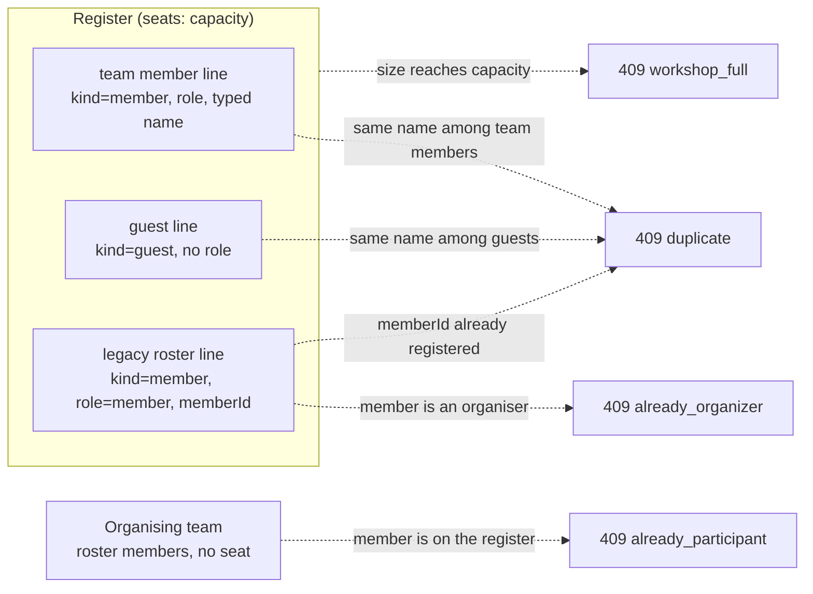

# Workshops — `/workshops`, `/workshop-participants`

Organisation-level training workshops behind the Flutter **/workshop** screens:
the list (upcoming / past / archived tabs, search), the detail header, the
**register** tab (team members typed by name, volunteers/visitors, attendance,
payment), the **organising team** tab, the **statistics** tab and its export —
the server half of `mock_workshop_repository.dart` and `workshop_stats.dart`.

Code: `routes/workshopRoutes.js`, `routes/workshopParticipantRoutes.js`,
`controllers/tenant/{workshop,workshopParticipant}Controller.js`,
`services/workshopService.js`, `services/workshopStatsService.js`,
`validators/workshopValidators.js`. Tests: `tests/workshops.test.js`.
Postman: folder **Tenant · Workshops** (`postman/modules/31-workshops.js`).

Every route: `tenantGuard` → feature **`workshops`** (`403 feature_disabled`).
Workshops have **no detachment**; every `workshop.*` capability is **global**.
Reads need no capability.

| # | Endpoint | Capability | Success |
|---|---|---|---|
| 26 | `GET /workshops?bucket&query` | — | `200 [Workshop]` |
| 27 | `GET /workshops/:workshopId` | — | `200 Workshop` |
| 28 | `POST /workshops` | `workshop.create` + plan limit `workshops` | `201 Workshop` |
| 29 | `PUT` / `PATCH /workshops/:workshopId` | `workshop.edit` | `200 Workshop` |
| 30 | `PATCH /workshops/:workshopId/archive` | `workshop.archive` | `200 Workshop` |
| 31 | `POST` / `DELETE /workshops/:workshopId/cover` | `workshop.edit` | `200 Workshop` |
| 32 | `GET /workshops/:workshopId/participants` | — | `200 [Participant]` |
| 33 | `POST /workshops/:workshopId/team-members` | `workshop.people.manage` | `201 Participant` |
| 34 | `POST /workshops/:workshopId/guests` | `workshop.people.manage` | `201 Participant` |
| 35 | `POST /workshops/:workshopId/participants` (legacy) | `workshop.people.manage` | `201 [Participant]` |
| 36 | `PUT /workshop-participants/:participantId` | `workshop.people.manage` | `200 Participant` |
| 37 | `DELETE /workshop-participants/:participantId` | `workshop.people.manage` | `204` |
| 38 | `PATCH /workshop-participants/:participantId/attendance` | `workshop.attendance.record` | `200 Participant` |
| 39 | `PATCH /workshop-participants/:participantId/payment` | `workshop.payment.record` | `200 Participant` |
| 40 | `POST /workshops/:workshopId/organizers` | `workshop.people.manage` | `200 Workshop` |
| 41 | `DELETE /workshops/:workshopId/organizers/:memberId` | `workshop.people.manage` | `200 Workshop` |
| 42 | `PATCH /workshops/:workshopId/organizers/:memberId/attendance` | `workshop.attendance.record` | `200 Workshop` |
| 43 | `GET /workshops/:workshopId/stats` | feature `statistics_reports` | `200 WorkshopStats` |
| 44 | `GET /workshops/:workshopId/export.csv` | — | `200 text/csv` |

Refusal order: feature → capability → `not_found` → **`archived`** → `Idempotency-Key` → validation → business rules.
Every write accepts an optional `Idempotency-Key` (except the multipart cover upload).

---

## Wire shapes

### Workshop (`serializers.workshop`)

```json
{
  "id": "w1",
  "name": "الإسعاف الأولي المتقدم",
  "at": "2026-10-02T06:00:00.000Z",
  "location": "قاعة التدريب — دمشق",
  "capacity": 20,
  "registered": 6,
  "guests": 3,
  "status": "scheduled",
  "registrationFee": 25000,
  "archived": false,
  "organizingTeam": [
    { "id": "m2", "name": "ليلى ياسين", "initials": "لي", "role": "administrator",
      "detachmentId": "d_dam_central", "attendance": "checkedIn", "active": true, "version": 1, "…": "…" }
  ],
  "coverImageUrl": "http://localhost:4000/images/workshops/workshop-w1-01j….webp",
  "version": 4
}
```

`registered` / `guests` are **derived from the register** on every read (never
stored, never accepted). `registrationFee` is a plain number in the tenant's
local currency (the app renders ل.س); `0` = free. `organizingTeam` holds roster
members with **this workshop's** attendance.

### Participant (`serializers.participant`)

```json
{ "id": "p_01J…", "workshopId": "w1", "name": "سارة المصري", "initials": "سا",
  "kind": "member", "role": "trainer", "attendance": "checkedIn", "paymentStatus": "paid", "version": 2 }
```

`role` only on `kind: "member"`; `memberId` only on legacy roster lines;
`paymentStatus` omitted when null.

---

## 26–27. List & detail

`GET /workshops` — everything (archived included), sorted by `at` ascending.

| `bucket` | Filter |
|---|---|
| omitted / `all` | every workshop |
| `upcoming` | `!archived && at > now` |
| `past` | `!archived && at ≤ now` |
| `archived` | `archived` |

`query` is matched against `name` + `location` with Arabic folding
(`إنعاش` ≈ `انعاش`, `ة` ≈ `ه`, digits folded). `GET /workshops/:id` → `404` when
unknown or in another tenant.

## 28–29. Create & edit

```http
POST /api/v1/workshops
{ "name": "إدارة الحوادث الجماعية", "at": "2026-10-12T09:30:00", "location": "مركز الشعلان",
  "capacity": 30, "registrationFee": 40000 }
```

`201` — `status: "scheduled"`, no organisers. `name` / `location` are trimmed and
required; `capacity` integer ≥ 1; `registrationFee` number ≥ 0 (default 0); `at`
an instant (no offset → tenant timezone). Then the plan limit
(`409 plan_limit_reached`, `limitKey: "workshops"` — counts non-archived workshops).

`PUT` / `PATCH /workshops/:id` — only `name`, `at`, `location`, `capacity`,
`status` (`scheduled|ongoing|done`), `registrationFee` (+ optional `version`).
`registered`, `guests`, `organizingTeam`, `archived` in the body are
**ignored**, so a stale form cannot clobber the register. A body `id` must equal
the path id. `capacity` below the register size → `409 capacity_below_registered`
(`registered`); `capacity < 1` → `422`.

## 30–31. Archive & cover

`PATCH /workshops/:id/archive {"archived": true|false}` — setting the current
value again is a `200` no-op. Restoring counts against the `workshops` plan limit.
While archived, **every other mutation** of the workshop, its register or its
organisers answers `409 archived`; reads keep working.

`POST /workshops/:id/cover` — multipart, field `image` (JPEG/PNG/WebP/GIF/HEIC,
re-encoded to WebP, preset `workshop` 1600×900). Replaces the previous cover.
`DELETE /workshops/:id/cover` removes it. Both return the Workshop.

## 32–39. The register

Everyone on the register takes **one seat**; organisers never do.



- `GET /workshops/:id/participants` — kind `member` first, then `guest`, each in creation order.
- `POST /workshops/:id/team-members {"name": "نور الحسن", "role": "trainer", "paid": true}` → `201`, `attendance: notCheckedIn`, `paymentStatus` `paid|unpaid`, no `memberId`. The name is trimmed + whitespace-collapsed; blank → `422 fields.name`; role ∉ `leader|trainer|support|management|member` → `422 fields.role`; the same normalized name among **team-member** lines → `409 duplicate` (a guest of that name does not collide); full → `409 workshop_full`.
- `POST /workshops/:id/guests {"name": "عمر الشامي", "paid": false}` → `201` `kind: "guest"`; duplicates are checked among guests only.
- `POST /workshops/:id/participants {"memberIds": ["m4", "m5"]}` — **legacy** roster registration, **all or nothing**: ids de-duplicated; unknown member → `404` (`memberIds`); already registered → `409 duplicate`; an organiser → `409 already_organizer`; register + ids > capacity → `409 workshop_full` (`capacity`, `registered`, `remaining`). Lines: `kind member`, `role member`, `memberId`, `paymentStatus unpaid`.
- `PUT /workshop-participants/:id {"name", "role", "paid"}` — team-member lines only (a guest line → `404`); duplicate check excludes the line itself; attendance untouched.
- `DELETE /workshop-participants/:id` → `204`. Removes the line only; a `TeamMember` behind a legacy line is untouched.
- `PATCH /workshop-participants/:id/attendance {"attendance": "present"}` — any of the four states (legacy aliases accepted).
- `PATCH /workshop-participants/:id/payment {"paymentStatus": "paid"|"unpaid"|null}`.

Register writes run in a transaction that first touches the workshop document,
so concurrent adds cannot overbook the last seat or break organiser exclusivity.

## 40–42. Organising team

- `POST /workshops/:id/organizers {"memberIds": ["m3"]}` → Workshop. All or nothing: unknown → `404`; already an organiser → `409 duplicate`; on the register → `409 already_participant`. **No seat limit.** New organisers start `notCheckedIn`.
- `DELETE /workshops/:id/organizers/:memberId` → Workshop (not an organiser → `404`). The roster is untouched.
- `PATCH /workshops/:id/organizers/:memberId/attendance {"attendance": "checkedIn"}` → Workshop.

## 43. Statistics (statistics tab)

Needs feature `statistics_reports` as well as `workshops`; no capability.

```json
{
  "workshopId": "w1", "name": "الإسعاف الأولي المتقدم", "at": "2026-10-02T06:00:00.000Z",
  "location": "قاعة التدريب — دمشق",
  "registrationFee": 25000, "isFree": false,
  "capacity": 20, "registeredCount": 6, "guests": 3, "capacityPercent": 30,
  "participants": { "total": 6, "present": 4, "absent": 2, "percent": 67, "paid": 5, "unpaid": 1 },
  "team": { "total": 2, "present": 2, "absent": 0, "percent": 100 },
  "totalPaidAmount": 125000,
  "people": [
    { "id": "p1", "name": "سارة المصري", "group": "participant", "kind": "member", "role": "trainer", "attendance": "checkedIn", "paymentStatus": "paid" },
    { "id": "p4", "name": "عمر الشامي", "group": "participant", "kind": "guest", "role": "guest", "attendance": "checkedIn", "paymentStatus": "paid" },
    { "id": "m2", "name": "ليلى ياسين", "group": "team", "role": "administrator", "attendance": "checkedIn", "paymentStatus": null }
  ]
}
```

| Figure | Formula |
|---|---|
| participants | the whole register (member **and** guest lines) |
| team | the organising team only (never averaged with participants) |
| `present` | attendance `checkedIn` **or** `checkedOut` |
| `absent` | `total − present` |
| `percent` | `total == 0 ? 0 : clamp(round(present / total × 100), 0, 100)` |
| `paid` / `unpaid` | participants with `paid` / `total − paid` (null counts as unpaid); the team carries no payment |
| `capacityPercent` | `capacity == 0 ? 0 : clamp(round(registeredCount / capacity × 100), 0, 100)` |
| `totalPaidAmount` | `registrationFee × participants.paid` |
| `isFree` | `registrationFee == 0` |
| `people[].role` | participant: its workshop role, `"guest"` for guests; team: the member's roster role |

## 44. CSV export

`GET /workshops/:id/export.csv` → `text/csv; charset=utf-8`, UTF-8 **with BOM**,
CRLF, `Content-Disposition: attachment; filename="workshop-<id>.csv"`:

```
name,kind,role,attendance,payment
سارة المصري,member,trainer,checkedIn,paid
عمر الشامي,guest,,checkedIn,paid
```

Register order; `payment` is `paid|unpaid` (null → `unpaid`). Cells that would
start a spreadsheet formula (`= + - @`) are prefixed with `'`.

---

## Errors

| Code | HTTP | When |
|---|---|---|
| `feature_disabled` | 403 | `workshops` (every route) or `statistics_reports` (stats) disabled |
| `not_permitted` | 403 | global capability missing |
| `not_found` | 404 | workshop / line / member / organiser unknown; PUT on a guest line |
| `validation` | 422 | blank name/location, capacity < 1, fee < 0, bad instant, unknown role/status/attendance, body `id` ≠ path |
| `archived` | 409 | any mutation of an archived workshop |
| `capacity_below_registered` | 409 | new capacity below the register size (`registered`) |
| `duplicate` | 409 | same normalized name within the kind; member already registered / already an organiser |
| `workshop_full` | 409 | no free seat (`capacity`, `registered`, `remaining`) |
| `already_organizer` | 409 | legacy registration of an organiser |
| `already_participant` | 409 | organiser who is on the register |
| `plan_limit_reached` | 409 | creating/restoring beyond the plan's `workshops` limit |
| `stale_write` | 409 | stale `version` or a lost race |
| `payload_too_large` | 413 | cover image over the upload limit |
